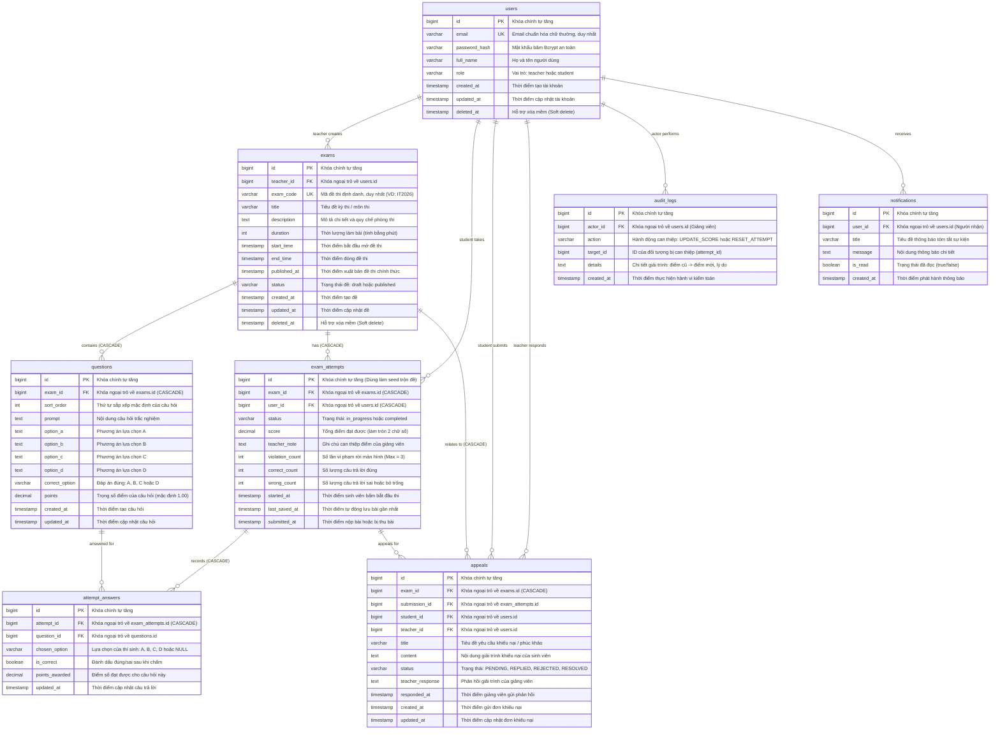
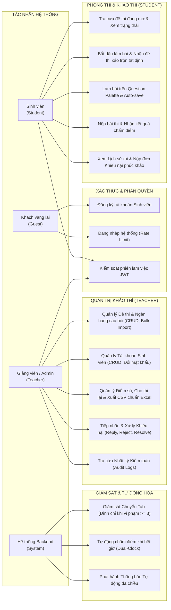
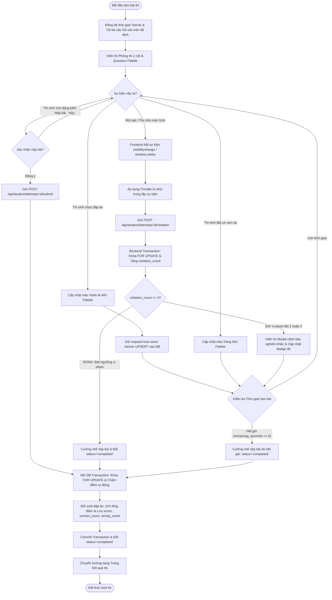
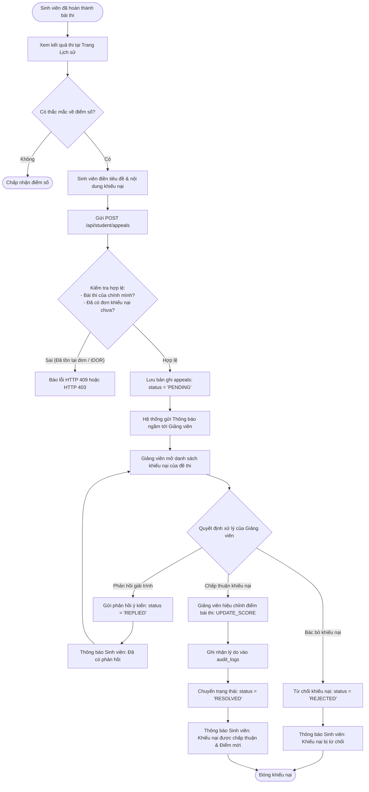
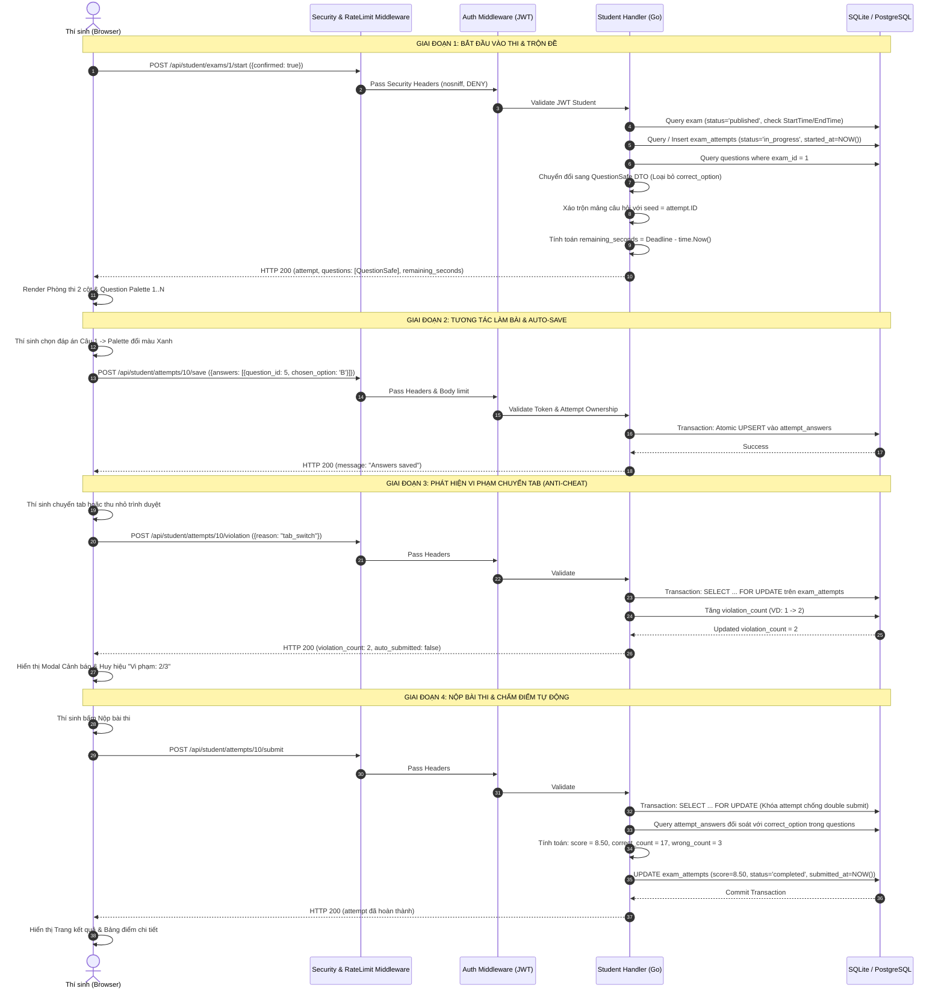
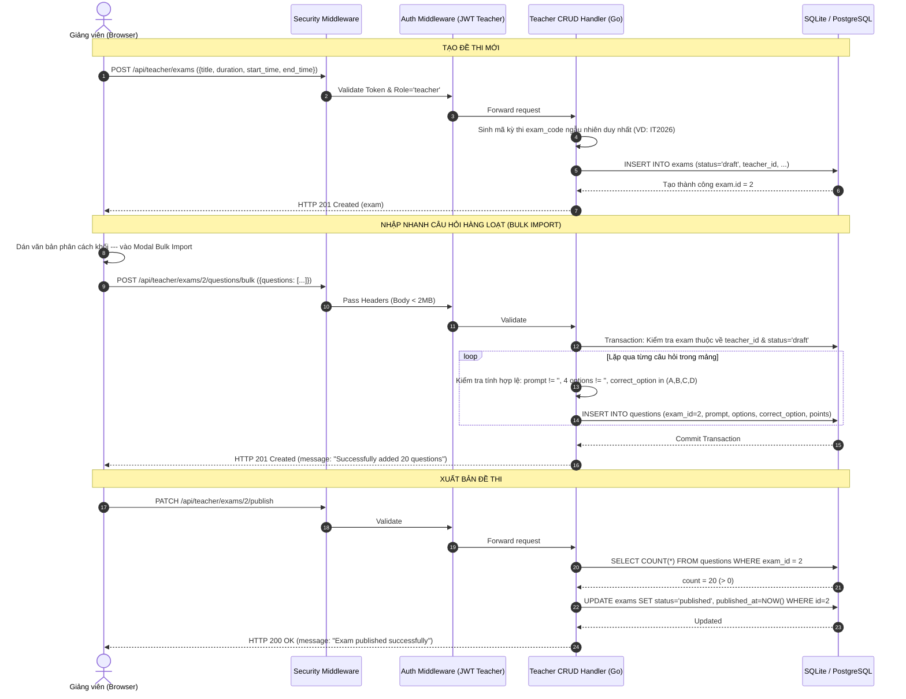
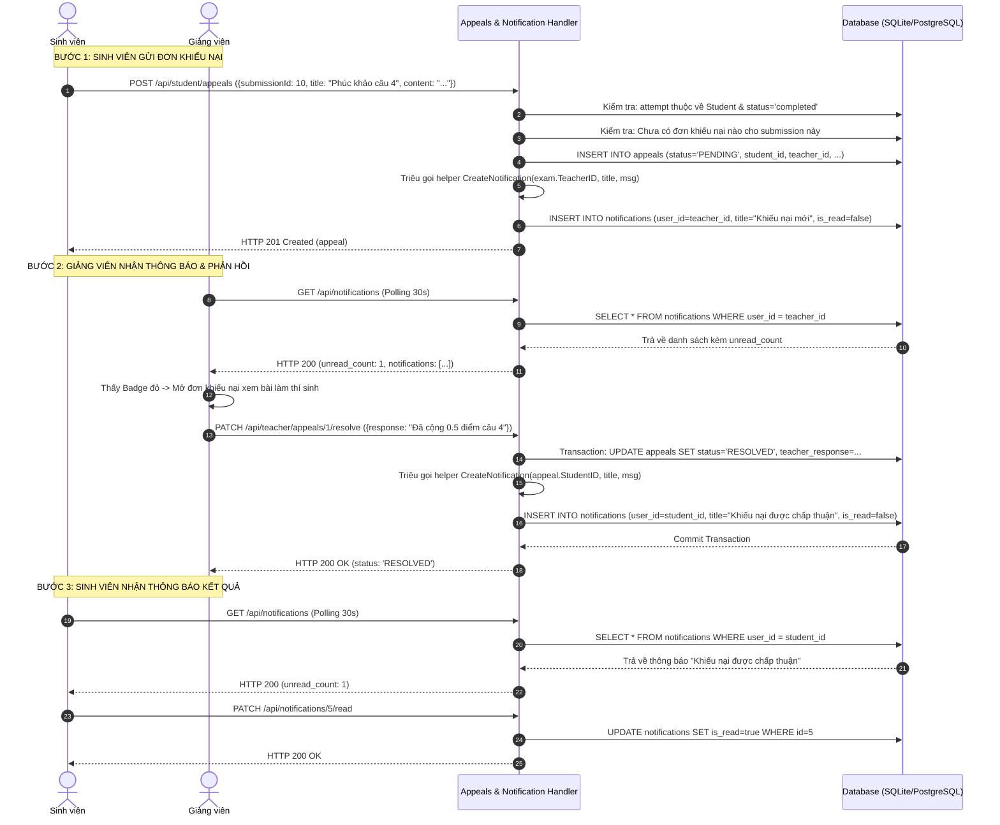
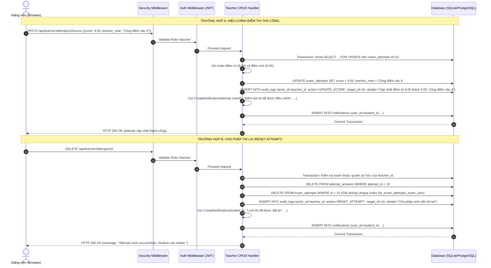

# BÁO CÁO THIẾT KẾ KIẾN TRÚC VÀ ĐẶC TẢ YÊU CẦU PHẦN MỀM
## DỰ ÁN: HỆ THỐNG THI TRẮC NGHIỆM TRỰC TUYẾN ĐẠI HỌC (UNIVERSITY EXAMINATION SYSTEM)
**Vai trò báo cáo**: Senior System Architect & Business Analyst (BA)  
**Phiên bản hệ thống**: MVP v2.0 (Bản nâng cấp toàn diện ngày 30/10/2026)  
**Môi trường triển khai**: Golang 1.21+ (Gin Engine) | React 19 (Vite) | PostgreSQL 15 / SQLite In-Memory  

---

## 1. TỔNG QUAN KIẾN TRÚC HỆ THỐNG & THIẾT KẾ CƠ SỞ DỮ LIỆU

### 1.1. Mô hình Kiến trúc Phân tầng (Layered Clean Architecture)

Hệ thống được thiết kế theo mô hình **Client-Server phân tầng độc lập (Layered Architecture)**, tách rời hoàn toàn giữa giao diện người dùng (Frontend Single Page Application - SPA) và dịch vụ xử lý dữ liệu trung tâm (Backend RESTful API). Mô hình này bảo đảm tính module hóa, dễ dàng mở rộng quy mô, nâng cao tính bảo mật và đơn giản hóa quá trình bảo trì.

```
+---------------------------------------------------------------------------------------------------+
|                                      CLIENT LAYER (TRÌNH DUYỆT)                                   |
|   React 19 + Vite + TailwindCSS + React Router v6 + Axios Interceptor                             |
|   - Phân hệ Giảng viên: Quản trị Đề thi, Ngân hàng câu hỏi, Quản lý sinh viên, Bảng điểm, Appeals |
|   - Phân hệ Sinh viên: Cổng kỳ thi, Phòng thi 2 cột chuẩn hóa (Question Palette), Lịch sử & Phúc khảo|
|   - Component chung: Notification Dropdown (auto-polling 30s), Toast & Modal xác nhận             |
+---------------------------------------------------------------------------------------------------+
                                                  |
                                          HTTP / REST (JSON)
                                 Authorization: Bearer <JWT Token>
                                                  v
+---------------------------------------------------------------------------------------------------+
|                                      BACKEND LAYER (GOLANG)                                       |
|  +---------------------------------------------------------------------------------------------+  |
|  | Gin Gonic Web Engine (Cổng 8081) + CORS Middleware                                          |  |
|  +---------------------------------------------------------------------------------------------+  |
|  | Global Security Middleware: Security Headers (nosniff, DENY, strict-origin) & Body Limit 2MB |  |
|  +---------------------------------------------------------------------------------------------+  |
|  | Rate Limiting Middleware: In-Memory Sliding Window (15 req/phút/IP cho Login & Lookup)      |  |
|  +---------------------------------------------------------------------------------------------+  |
|  | Authentication & RBAC Middleware: JWT HMAC-SHA256 Verification & Role Guard                 |  |
|  +---------------------------------------------------------------------------------------------+  |
|  | Handlers (Bộ điều khiển nghiệp vụ):                                                         |  |
|  |   - Auth Handler: Đăng ký, Đăng nhập, Cấp phát JWT Token                                    |  |
|  |   - Teacher CRUD Handler: Quản lý Đề thi, Nhập câu hỏi hàng loạt, Quản lý sinh viên         |  |
|  |   - Student Handler: Khảo thí, Xáo trộn câu hỏi tất định, Auto-save (UPSERT), Auto-submit   |  |
|  |   - Anti-Cheat & Audit Handler: Ghi nhận vi phạm chuyển Tab, Audit Logs, Xuất CSV UTF-8 BOM |  |
|  |   - Appeals Handler: Quy trình Phúc khảo 4 trạng thái (PENDING, REPLIED, REJECTED, RESOLVED)|  |
|  |   - Notifications Handler: Thông báo tự động phi phong tỏa (Fail-safe, defer recover)       |  |
|  +---------------------------------------------------------------------------------------------+  |
|  | Data Access Layer: GORM ORM (DB Transactions, Pessimistic Locking FOR UPDATE, Prepared Stmt)|  |
|  +---------------------------------------------------------------------------------------------+  |
+---------------------------------------------------------------------------------------------------+
                                                  |
                                          Database Driver (TCP)
                                                  v
+---------------------------------------------------------------------------------------------------+
|                                    PERSISTENCE LAYER (RDBMS)                                      |
|   PostgreSQL 15 (Môi trường Production) / SQLite In-Memory + WAL Mode (Môi trường Test CI/CD)     |
|   8 Normalized Tables (3NF) + 2 Unique Composite Indexes + Cascading Foreign Key Constraints       |
+---------------------------------------------------------------------------------------------------+
```

### 1.2. Công nghệ Lựa chọn (Tech Stack) & Cơ sở Lập luận Kỹ thuật

1. **Ngôn ngữ Backend - Golang & Gin Framework**:
   - Khả năng xử lý hàng chục nghìn kết nối đồng thời với mô hình Goroutine tiêu tốn rất ít RAM (khoảng 2KB mỗi routine), đáp ứng xuất sắc kịch bản hàng trăm hoặc hàng nghìn thí sinh nộp bài hoặc tự động lưu bài (auto-save) cùng một giây.
   - Gin Framework xây dựng trên cây Radix tree cho tốc độ routing cực nhanh, độ trễ xử lý ở mức micro-giây.

2. **Cơ sở dữ liệu - PostgreSQL 15 & SQLite In-Memory**:
   - Trong môi trường sản xuất (Docker), PostgreSQL cung cấp đầy đủ các chuẩn ACID, khóa dòng bi quan (`SELECT ... FOR UPDATE`), câu lệnh nguyên tử `ON CONFLICT DO UPDATE` (Atomic UPSERT) và ràng buộc toàn vẹn khóa ngoại tầng (Cascading Deletions).
   - Trong môi trường kiểm thử tự động (Unit & Integration Testing), SQLite in-memory được cấu hình ở chế độ **WAL (Write-Ahead Logging)** và **Busy Timeout 5000ms** (`EnableSQLitePragmas`), cho phép đọc và ghi song song, loại bỏ hoàn toàn lỗi khóa bảng `database is locked (5)` khi chạy kiểm thử đồng thời.

3. **Frontend - React 19, Vite & TailwindCSS**:
   - Sử dụng Vite tối ưu hóa tốc độ build và Hot Module Replacement (HMR).
   - TailwindCSS đem lại giao diện học thuật tối giản, nhất quán, loại bỏ toàn bộ emoji phi quy chuẩn, đáp ứng thẩm mỹ của hệ thống khảo thí đại học chính quy.
   - Axios Interceptor tự động xử lý đính kèm Bearer JWT Token vào mọi request có yêu cầu xác thực và xử lý lỗi tập trung.

---

### 1.3. Sơ đồ Thực thể Liên kết (Mermaid ERD Diagram)

Toàn bộ hệ thống được xây dựng trên **8 bảng chuẩn hóa 3NF**, bảo đảm không trùng lặp dữ liệu, duy trì toàn vẹn dữ liệu thông qua các khóa chính, khóa ngoại và chỉ mục tổng hợp duy nhất.



---

### 1.4. Phân tích Chi tiết 8 Bảng Dữ liệu & Thiết lập Tối ưu

| STT | Tên Bảng | Mục đích Nghiệp vụ & Ràng buộc Kỹ thuật |
| :--- | :--- | :--- |
| 1 | `users` | Quản lý định danh người dùng. Phân quyền thông qua cột `role` (`teacher` hoặc `student`). Cột `email` có ràng buộc `UNIQUE` và được chuẩn hóa chữ thường. Mật khẩu được mã hóa an toàn bằng thuật toán băm Bcrypt. Cột `deleted_at` hỗ trợ xóa mềm (Soft Delete). |
| 2 | `exams` | Lưu trữ thông tin đề thi do Giảng viên tạo (`teacher_id`). Mã đề thi `exam_code` là duy nhất toàn hệ thống. Cột `status` quản lý trạng thái vòng đời của đề (`draft` -> `published`). Khung giờ mở đề được kiểm soát chặt chẽ qua cặp mốc `start_time` và `end_time`. |
| 3 | `questions` | Lưu trữ ngân hàng câu hỏi trắc nghiệm trực thuộc đề thi (`exam_id`). Bao gồm 4 phương án lựa chọn độc lập (`option_a`, `option_b`, `option_c`, `option_d`), đáp án chuẩn `correct_option` và trọng số điểm `points`. Ràng buộc khóa ngoại tầng `ON DELETE CASCADE` tự động xóa câu hỏi khi đề thi bị xóa. |
| 4 | `exam_attempts` | Đại diện cho một phiên làm bài thi độc nhất của một sinh viên cho một đề thi. Cột `status` chuyển từ `in_progress` sang `completed` khi nộp bài hoặc bị cưỡng chế thu bài do hết giờ / quá số lần vi phạm. Trường `violation_count` đếm số lần thí sinh chuyển tab hoặc thu nhỏ cửa sổ. ID của bảng được dùng làm seed sinh số ngẫu nhiên phục vụ xáo trộn câu hỏi. |
| 5 | `attempt_answers` | Lưu chi tiết phương án thí sinh đã chọn cho từng câu hỏi (`chosen_option`). Cột `is_correct` và `points_awarded` được cập nhật trong giao dịch chấm điểm tự động. |
| 6 | `appeals` | Quản lý quy trình khiếu nại / phúc khảo điểm thi giữa sinh viên và giảng viên. Ràng buộc trạng thái chặt chẽ theo máy trạng thái: `PENDING` -> `REPLIED` / `REJECTED` / `RESOLVED`. |
| 7 | `audit_logs` | Lưu trữ nhật ký kiểm toán bất biến (Immutable Audit Trail) đối với các hành vi can thiệp nhạy cảm của giảng viên (Hiệu chỉnh điểm số `UPDATE_SCORE`, Xóa lượt thi cho thi lại `RESET_ATTEMPT`), phục vụ công tác thanh tra khảo thí. |
| 8 | `notifications` | Quản lý hệ thống thông báo nội bộ thời gian thực gửi tới giảng viên và sinh viên khi phát sinh các sự kiện: khiếu nại mới, phản hồi khiếu nại, hiệu chỉnh điểm, cấp quyền thi lại. |

#### Hai Chỉ mục Tổng hợp Duy nhất (Unique Composite Indexes)
1. **`idx_exam_attempts_exam_user` trên `exam_attempts(exam_id, user_id)`**:
   - **Mục đích**: Bảo đảm nguyên tắc khảo thí tối cao: Mỗi sinh viên chỉ được phép có duy nhất một lượt làm bài cho một đề thi. Ngăn chặn triệt để hành vi cố tình mở nhiều tab để tạo nhiều bài thi cùng lúc.
   - **Cơ chế Reset Attempt**: Khi giảng viên cho phép thí sinh thi lại (`DELETE /api/teacher/attempts/:id`), bản ghi lượt thi cũ bị xóa vĩnh viễn trong Transaction, qua đó giải phóng chỉ mục này và cho phép sinh viên bắt đầu một lượt làm bài mới hợp lệ.
2. **`idx_attempt_answers_attempt_question` trên `attempt_answers(attempt_id, question_id)`**:
   - **Mục đích**: Bảo đảm trong một bài thi, mỗi câu hỏi chỉ có duy nhất một câu trả lời.
   - **Tối ưu hóa Atomic UPSERT**: Cho phép thực thi câu lệnh lưu đáp án tức thời:
     ```sql
     INSERT INTO attempt_answers (attempt_id, question_id, chosen_option, is_correct, points_awarded, updated_at)
     VALUES (?, ?, ?, false, 0, ?)
     ON CONFLICT (attempt_id, question_id)
     DO UPDATE SET chosen_option = EXCLUDED.chosen_option, updated_at = EXCLUDED.updated_at;
     ```
     Loại bỏ hoàn toàn việc phải chạy tuần tự hai câu lệnh `SELECT` kiểm tra và `UPDATE`, giảm tải 50% thao tác I/O xuống cơ sở dữ liệu.

---

## 2. SƠ ĐỒ USE CASE TỔNG QUÁT & PHÂN QUYỀN TÁC NHÂN (ACTORS)

### 2.1. Ma trận Phân quyền Tác nhân (Actors Permission Matrix)

Hệ thống định nghĩa 4 tác nhân chính tham gia tương tác:
1. **Khách vãng lai (Guest / Unauthenticated User)**: Người dùng chưa đăng nhập, chỉ có quyền đăng ký tài khoản sinh viên mới, đăng nhập hệ thống và kiểm tra trạng thái dịch vụ (`/health`).
2. **Sinh viên (Student Actor)**: Người học có tài khoản hợp lệ, có quyền tra cứu đề thi đang mở, vào thi (với đề đã xáo trộn), tự động lưu bài, nộp bài, xem điểm số bài làm, xem lịch sử thi, nộp đơn khiếu nại và nhận thông báo cá nhân.
3. **Giảng viên / Quản trị viên (Teacher / Admin Actor)**: Người phụ trách môn thi, có toàn quyền quản lý đề thi (soạn thảo, nhập câu hỏi hàng loạt, xuất bản, chỉnh sửa, xóa cascade), quản lý tài khoản sinh viên (CRUD, reset mật khẩu), xem bảng điểm, xuất bảng điểm CSV có UTF-8 BOM, hiệu chỉnh điểm thi, cho phép sinh viên thi lại, phản hồi/giải quyết đơn khiếu nại và tra cứu nhật ký kiểm toán (Audit Logs).
4. **Hệ thống Tự động (Backend System / Cron)**: Tự động tính toán hạn chót nộp bài (Dual-Clock), tự động thu bài và chấm điểm khi hết giờ hoặc khi sinh viên vi phạm quy chế chuyển Tab 3 lần, tự động kích hoạt thông báo ngầm phi phong tỏa.

### 2.2. Sơ đồ Phân rã Chức năng Use Case Tổng quát (Mermaid Diagram)



---

## 3. BẢNG ĐẶC TẢ CHI TIẾT TỪNG USE CASE (DETAILED USE CASE SPECIFICATIONS)

Dưới đây là 8 bảng đặc tả chuẩn mực kỹ thuật phần mềm bao phủ 100% chức năng cốt lõi của hệ thống:

### UC01: Đăng ký, Đăng nhập & Kiểm soát Phiên truy cập

| Thuộc tính | Đặc tả chi tiết |
| :--- | :--- |
| **Mã Use Case** | **UC01** |
| **Tên Use Case** | Đăng ký, Đăng nhập & Kiểm soát Phiên truy cập |
| **Tác nhân** | Khách vãng lai, Sinh viên, Giảng viên |
| **Mô tả ngắn** | Cung cấp cổng xác thực người dùng an toàn, cấp phát JSON Web Token (JWT) và bảo vệ hệ thống trước các cuộc tấn công Brute-force thông qua Rate Limiting. |
| **Tiền điều kiện** | Hệ thống Backend hoạt động bình thường; người dùng có kết nối mạng tới cổng API 8081. |
| **Hậu điều kiện** | Người dùng nhận được Access Token hợp lệ; thông tin tài khoản và vai trò được lưu vào Context phía Frontend. |
| **Luồng sự kiện chính (Basic Flow)** | 1. Người dùng truy cập trang Đăng ký hoặc Đăng nhập trên giao diện React.<br/>2. Người dùng nhập thông tin: Họ tên, Email, Mật khẩu (đối với Đăng ký) hoặc Email, Mật khẩu (đối với Đăng nhập).<br/>3. Client gửi request `POST /api/auth/login` (kèm IP client).<br/>4. Middleware `IPRateLimit` kiểm tra tần suất gọi API từ IP hiện tại (ngưỡng tối đa 15 req/phút).<br/>5. Backend kiểm tra tính tồn tại của email trong bảng `users`.<br/>6. Backend thực hiện so khớp mật khẩu bằng hàm `bcrypt.CompareHashAndPassword`.<br/>7. Backend khởi tạo JWT Token chứa payload `{user_id, role, email, exp}` có chữ ký HMAC-SHA256.<br/>8. Backend trả về HTTP 200 kèm Token và thông tin User Profile.<br/>9. Frontend lưu Token vào `localStorage`, gắn mặc định vào Axios Authorization Header và chuyển hướng người dùng theo vai trò (`/student` hoặc `/teacher`). |
| **Luồng rẽ nhánh / Ngoại lệ (Alternative & Exception Flows)** | - **A1. Tần suất vượt ngưỡng (Rate Limited)**: Nếu cùng 1 IP gửi quá 15 request trong vòng 1 phút, middleware trả về HTTP 429 Too Many Requests kèm thông báo "Quá nhiều yêu cầu đăng nhập. Vui lòng thử lại sau 1 phút".<br/>- **A2. Email trùng lặp khi đăng ký**: Nếu email đã tồn tại trong cơ sở dữ liệu, trả về HTTP 409 Conflict.<br/>- **A3. Sai mật khẩu hoặc email không tồn tại**: Trả về HTTP 401 Unauthorized kèm thông báo chung "Email hoặc mật khẩu không chính xác" (tránh lộ thông tin tài khoản tồn tại).<br/>- **A4. Token hết hạn hoặc không hợp lệ**: Middleware `AuthRequired` chặn request với mã HTTP 401, Frontend tự động xóa phiên đăng nhập và điều hướng về trang Login. |

---

### UC02: Quản lý Đề thi & Ngân hàng Câu hỏi

| Thuộc tính | Đặc tả chi tiết |
| :--- | :--- |
| **Mã Use Case** | **UC02** |
| **Tên Use Case** | Quản lý Đề thi & Ngân hàng Câu hỏi (Full CRUD & Bulk Import) |
| **Tác nhân** | Giảng viên / Quản trị viên |
| **Mô tả ngắn** | Cho phép Giảng viên tạo mới, chỉnh sửa, xuất bản, xóa tầng đề thi, quản lý từng câu hỏi lẻ hoặc nhập hàng loạt hàng chục câu hỏi từ văn bản phi cấu trúc / JSON. |
| **Tiền điều kiện** | Giảng viên đã đăng nhập thành công với vai trò `teacher`. |
| **Hậu điều kiện** | Đề thi và các câu hỏi được lưu trữ hoặc cập nhật nhất quán trong cơ sở dữ liệu; mã đề `exam_code` được sinh ngẫu nhiên duy nhất. |
| **Luồng sự kiện chính (Basic Flow)** | 1. Giảng viên truy cập mục "Quản lý đề thi" và chọn "Tạo đề thi mới".<br/>2. Giảng viên điền tiêu đề, mô tả, thời lượng (phút), thời gian mở đề và đóng đề.<br/>3. Backend tạo bản ghi `exams` ở trạng thái `draft` và sinh mã `exam_code` 6 ký tự viết hoa.<br/>4. Giảng viên thêm câu hỏi theo 2 phương thức:<br/>&nbsp;&nbsp;&nbsp;&nbsp;a) **Thêm câu hỏi lẻ**: Nhập nội dung câu hỏi, 4 phương án A/B/C/D, chọn đáp án đúng và điểm số.<br/>&nbsp;&nbsp;&nbsp;&nbsp;b) **Nhập nhanh hàng loạt (Bulk Import)**: Dán văn bản có định dạng chuẩn (phân cách bằng `---`) hoặc mảng JSON. Bộ parser bóc tách tự động và gửi request `POST /api/teacher/exams/:id/questions/bulk`.<br/>5. Giảng viên chỉnh sửa câu hỏi (`PUT /api/teacher/questions/:id`) hoặc xóa câu hỏi (`DELETE /api/teacher/questions/:question_id`).<br/>6. Giảng viên bấm "Xuất bản đề thi" (`PATCH /api/teacher/exams/:id/publish`). Backend kiểm tra đề có ít nhất 1 câu hỏi, chuyển `status = 'published'` và gán `published_at = NOW()`.<br/>7. Giảng viên có thể chỉnh sửa thông tin đề thi (`PUT /api/teacher/exams/:id`) hoặc xóa đề thi (`DELETE /api/teacher/exams/:id`). Toàn bộ câu hỏi, bài làm, câu trả lời và khiếu nại phụ thuộc bị dọn sạch trong 1 Transaction duy nhất (Cascade). |
| **Luồng rẽ nhánh / Ngoại lệ (Alternative & Exception Flows)** | - **A1. Xuất bản đề thi trống**: Nếu đề thi chưa có bất kỳ câu hỏi nào, Backend trả về HTTP 400 Bad Request ("Cannot publish an exam with no questions").<br/>- **A2. Chỉnh sửa câu hỏi khi đề đã xuất bản**: Backend từ chối với HTTP 400 để bảo đảm tính toàn vẹn dữ liệu cho thí sinh đang làm bài.<br/>- **A3. Vi phạm quyền sở hữu (IDOR)**: Nếu giảng viên cố tình thao tác trên đề thi hoặc câu hỏi do giảng viên khác tạo, Backend trả về HTTP 403 Forbidden hoặc HTTP 404 Not Found.<br/>- **A4. Lỗi định dạng khi Bulk Import**: Parser Frontend báo lỗi trực quan dòng vi phạm nếu thiếu phương án hoặc thiếu đáp án chuẩn. |

---

### UC03: Quản trị Tài khoản Sinh viên

| Thuộc tính | Đặc tả chi tiết |
| :--- | :--- |
| **Mã Use Case** | **UC03** |
| **Tên Use Case** | Quản trị Tài khoản Sinh viên (Full CRUD Student Management) |
| **Tác nhân** | Giảng viên / Quản trị viên |
| **Mô tả ngắn** | Cung cấp giao diện bảng quản trị học viên toàn trường: tìm kiếm, thống kê số lượng bài thi đã tham gia, tạo mới tài khoản sinh viên, chỉnh sửa thông tin và đặt lại mật khẩu. |
| **Tiền điều kiện** | Giảng viên đã đăng nhập với vai trò `teacher`. |
| **Hậu điều kiện** | Tài khoản sinh viên được thêm mới, cập nhật hoặc xóa bỏ hoàn toàn khỏi hệ thống mà không để lại dữ liệu rác. |
| **Luồng sự kiện chính (Basic Flow)** | 1. Giảng viên truy cập mục "Quản lý sinh viên" (`TeacherStudentsPage.jsx`).<br/>2. Giao diện gửi request `GET /api/teacher/students` kèm từ khóa tìm kiếm tùy chọn `?q=...`.<br/>3. Backend truy vấn danh sách `users` có `role = 'student'`, kết hợp tính toán số lượt thi (`total_attempts`) và số lượt hoàn thành (`completed_attempts`).<br/>4. **Tạo tài khoản mới**: Giảng viên bấm "Thêm sinh viên", nhập họ tên, email, mật khẩu khởi tạo. Backend băm mật khẩu Bcrypt và lưu vào bảng `users`.<br/>5. **Chỉnh sửa thông tin**: Giảng viên cập nhật họ tên, email hoặc nhập mật khẩu mới nếu sinh viên yêu cầu cấp lại mật khẩu (`PUT /api/teacher/students/:id`).<br/>6. **Xóa sinh viên**: Giảng viên bấm "Xóa" và xác nhận trên Modal an toàn. Backend mở Database Transaction xóa toàn bộ khiếu nại, câu trả lời, lượt thi của sinh viên trước khi xóa bản ghi tài khoản (`DELETE /api/teacher/students/:id`). |
| **Luồng rẽ nhánh / Ngoại lệ (Alternative & Exception Flows)** | - **A1. Trùng lặp email sinh viên**: Khi tạo mới hoặc cập nhật email trùng với tài khoản khác, Backend trả về HTTP 409 Conflict.<br/>- **A2. Xóa tài khoản đang có dữ liệu thi**: Hệ thống thực hiện xóa tầng an toàn trong DB Transaction, bảo đảm không bị lỗi ràng buộc khóa ngoại (Foreign Key Constraint Violation). |

---

### UC04: Tổ chức Thi, Trộn đề động & Giám sát Chống gian lận

| Thuộc tính | Đặc tả chi tiết |
| :--- | :--- |
| **Mã Use Case** | **UC04** |
| **Tên Use Case** | Tổ chức Thi, Trộn đề động & Giám sát Chống gian lận |
| **Tác nhân** | Sinh viên, Hệ thống Tự động |
| **Mô tả ngắn** | Sinh viên vào phòng thi, nhận bộ câu hỏi đã xáo trộn ngẫu nhiên theo seed `attempt.ID`, tương tác với Bảng điều khiển câu hỏi (Question Palette), hệ thống tự động lưu bài (Auto-save) và giám sát vi phạm rời màn hình (Tab-switch). |
| **Tiền điều kiện** | Sinh viên đã đăng nhập; đề thi đã xuất bản và đang trong khung giờ mở thi (`StartTime <= Now <= EndTime`). |
| **Hậu điều kiện** | Lượt thi được tạo hoặc tiếp tục; câu trả lời được lưu vết; nếu vi phạm chuyển tab 3 lần bài thi tự động bị thu. |
| **Luồng sự kiện chính (Basic Flow)** | 1. Sinh viên xem danh sách đề thi mở trên Cổng sinh viên (`GET /api/student/exams/available`) và bấm "Vào thi ngay".<br/>2. Sinh viên xác nhận cam kết quy chế thi và gửi request `POST /api/student/exams/:id/start` (`{confirmed: true}`).<br/>3. Backend tạo bản ghi `exam_attempts` mới (nếu chưa có) và tính toán thời gian còn lại `remaining_seconds` theo cơ chế Server-Authoritative.<br/>4. Backend chuyển đổi toàn bộ câu hỏi sang DTO `QuestionSafe` (ẩn hoàn toàn `correct_option`).<br/>5. **Xáo trộn tất định**: Backend dùng `attempt.ID` làm seed ngẫu nhiên để xáo trộn mảng câu hỏi. Thứ tự câu hỏi của mỗi sinh viên là duy nhất và không bị thay đổi khi tải lại trang (F5).<br/>6. Frontend hiển thị phòng thi 2 cột: Cột trái hiển thị câu hỏi hiện tại; Cột phải hiển thị Bảng điều khiển câu hỏi (Question Palette 1..N).<br/>7. Sinh viên nhấp chọn đáp án: Palette đổi sang màu Xanh lá; bấm "Đặt cờ xem lại": Palette đổi sang màu Vàng.<br/>8. Frontend kích hoạt tự động lưu đáp án (`POST /api/student/attempts/:id/save`) sau mỗi lần chọn và định kỳ 60s thông qua Atomic UPSERT.<br/>9. **Giám sát vi phạm**: Khi sinh viên chuyển tab hoặc rời cửa sổ, Frontend phát hiện qua `visibilitychange` và `window.onblur`, gửi `POST /api/student/attempts/:id/violation`. Backend tăng `violation_count`. Nếu `violation_count >= 3`, hệ thống tự động thu bài và chấm điểm ngay lập tức. |
| **Luồng rẽ nhánh / Ngoại lệ (Alternative & Exception Flows)** | - **A1. Đề thi chưa đến giờ hoặc đã đóng**: Backend từ chối với HTTP 403 Forbidden.<br/>- **A2. Sinh viên đã nộp bài trước đó**: Backend từ chối tạo mới lượt thi với HTTP 400 Bad Request.<br/>- **A3. Khôi phục bài thi dở dang (Resume Exam)**: Nếu sinh viên bị ngắt kết nối mạng hoặc đóng trình duyệt, khi vào lại hệ thống tải lại toàn bộ đáp án đã lưu trước đó và giữ nguyên thứ tự câu hỏi đã xáo trộn.<br/>- **A4. Hết thời gian làm bài**: Đồng hồ đếm ngược về 00:00, hệ thống tự động khóa giao diện và gọi API nộp bài cưỡng chế. |

---

### UC05: Chấm điểm Tự động & Quản lý Điểm số / Lượt thi

| Thuộc tính | Đặc tả chi tiết |
| :--- | :--- |
| **Mã Use Case** | **UC05** |
| **Tên Use Case** | Chấm điểm Tự động (ACID Transaction) & Quản lý Điểm số / Lượt thi |
| **Tác nhân** | Sinh viên, Giảng viên, Hệ thống Tự động |
| **Mô tả ngắn** | Hệ thống tự động chấm điểm bài thi bảo đảm tính toán vẹn ACID; Giảng viên xem thống kê phổ điểm, hiệu chỉnh điểm thi, cho phép sinh viên thi lại và xuất bảng điểm CSV chuẩn Microsoft Excel. |
| **Tiền điều kiện** | Bài thi đã được nộp hoặc bị hệ thống thu bài. |
| **Hậu điều kiện** | Điểm số được tính toán chính xác; các can thiệp của Giảng viên được ghi nhận vào nhật ký kiểm toán `audit_logs` và sinh thông báo gửi tới sinh viên. |
| **Luồng sự kiện chính (Basic Flow)** | 1. Khi sinh viên bấm "Nộp bài" hoặc hết giờ: Request `POST /api/student/attempts/:id/submit` được gửi lên.<br/>2. Backend mở Database Transaction, khóa dòng bi quan `SELECT ... FOR UPDATE` trên bản ghi `exam_attempts`.<br/>3. Backend đối soát toàn bộ câu trả lời trong `attempt_answers` với đáp án chuẩn trong `questions`, cộng điểm các câu đúng và tính tổng điểm theo thang 10.<br/>4. Cập nhật `score`, `correct_count`, `wrong_count`, `status = 'completed'`, `submitted_at = NOW()` và Commit Transaction.<br/>5. **Giảng viên xem kết quả**: Giảng viên truy cập tab "Bảng điểm" xem danh sách điểm số, ĐTB, điểm Min, Max.<br/>6. **Hiệu chỉnh điểm thủ công**: Giảng viên chọn "Sửa điểm" (`PATCH /api/teacher/attempts/:id/score`), nhập điểm mới và ghi chú giải trình. Backend cập nhật điểm, tạo bản ghi `audit_logs` (`action = 'UPDATE_SCORE'`) và tạo thông báo gửi tới sinh viên.<br/>7. **Cho phép thi lại (Reset Attempt)**: Khi sinh viên gặp sự cố bất khả kháng, Giảng viên chọn "Cho thi lại" (`DELETE /api/teacher/attempts/:id`). Backend xóa toàn bộ lượt thi cũ trong Transaction, giải phóng Unique Index, ghi nhật ký `audit_logs` (`action = 'RESET_ATTEMPT'`) và thông báo cho sinh viên.<br/>8. **Xuất bảng điểm CSV**: Giảng viên bấm "Xuất bảng điểm (CSV)". Backend tự động chấm các bài thi quá hạn chưa nộp, gắn Byte Order Mark (UTF-8 BOM `\xef\xbb\xbf`) và trả về file CSV mở trực tiếp trên Excel không bị lỗi font tiếng Việt. |
| **Luồng rẽ nhánh / Ngoại lệ (Alternative & Exception Flows)** | - **A1. Nộp bài trùng lặp (Double Submit)**: Do có khóa `FOR UPDATE`, request thứ hai đến sau sẽ thấy trạng thái đã là `completed` và bị từ chối với HTTP 400 Bad Request.<br/>- **A2. Trễ mạng khi nộp bài**: Backend áp dụng Grace Period 5 giây; nếu gửi trong vòng 5 giây sau deadline vẫn chấp nhận lưu bài; nếu quá 5 giây sẽ tự động kích hoạt hàm chấm bài dựa trên các đáp án đã lưu trước đó. |

---

### UC06: Xem Lịch sử Bài làm & Quy trình Khiếu nại / Phúc khảo

| Thuộc tính | Đặc tả chi tiết |
| :--- | :--- |
| **Mã Use Case** | **UC06** |
| **Tên Use Case** | Xem Lịch sử Bài làm & Quy trình Khiếu nại / Phúc khảo (Academic Appeals Workflow) |
| **Tác nhân** | Sinh viên, Giảng viên |
| **Mô tả ngắn** | Sinh viên tra cứu lịch sử các bài thi đã hoàn thành, xem chi tiết bài làm (đáp án đúng chỉ hiển thị sau khi đề thi đóng hoàn toàn), gửi đơn phúc khảo; Giảng viên phản hồi, chấp thuận hoặc từ chối đơn khiếu nại. |
| **Tiền điều kiện** | Bài thi của sinh viên đã ở trạng thái `completed`. |
| **Hậu điều kiện** | Đơn khiếu nại chuyển đổi trạng thái hợp lệ trên máy trạng thái; thông báo được phát hành hai chiều. |
| **Luồng sự kiện chính (Basic Flow)** | 1. Sinh viên vào mục "Lịch sử thi" (`GET /api/student/history?page=1&page_size=10`).<br/>2. Sinh viên bấm xem chi tiết một bài thi (`GET /api/student/history/:submissionId`).<br/>3. **Bảo mật đáp án kép**: Nếu đề thi vẫn đang trong khung giờ mở (`Now < exam.EndTime`), trường `correct_option` của toàn bộ câu hỏi vẫn bị ẩn (`nil`). Chỉ khi đề thi đã kết thúc hoàn toàn (`Now >= exam.EndTime`), sinh viên mới được xem đáp án chuẩn.<br/>4. Sinh viên bấm "Khiếu nại kết quả thi", điền tiêu đề và nội dung giải trình (`POST /api/student/appeals`). Backend lưu bản ghi `appeals` với trạng thái `PENDING` và tạo thông báo gửi tới Giảng viên sở hữu đề thi.<br/>5. Giảng viên mở tab "Khiếu nại & Phúc khảo" (`GET /api/teacher/exams/:id/appeals`), lọc theo trạng thái (`PENDING`, `REPLIED`, `REJECTED`, `RESOLVED`).<br/>6. Giảng viên bấm xem chi tiết đơn khiếu nại và bài làm của sinh viên (`GET /api/teacher/appeals/:appealId`).<br/>7. Giảng viên xử lý đơn:<br/>&nbsp;&nbsp;&nbsp;&nbsp;a) **Phản hồi ý kiến**: Gửi giải trình (`PATCH /api/teacher/appeals/:appealId/reply`), trạng thái chuyển sang `REPLIED`.<br/>&nbsp;&nbsp;&nbsp;&nbsp;b) **Chấp thuận khiếu nại**: Bấm giải quyết (`PATCH /api/teacher/appeals/:appealId/resolve`), trạng thái chuyển sang `RESOLVED`.<br/>&nbsp;&nbsp;&nbsp;&nbsp;c) **Từ chối khiếu nại**: Bấm từ chối (`PATCH /api/teacher/appeals/:appealId/reject`), trạng thái chuyển sang `REJECTED`.<br/>8. Mọi thao tác xử lý của Giảng viên đều tự động kích hoạt thông báo gửi về tài khoản của Sinh viên. |
| **Luồng rẽ nhánh / Ngoại lệ (Alternative & Exception Flows)** | - **A1. Khiếu nại trùng lặp**: Mỗi bài thi sinh viên chỉ được tạo tối đa 1 đơn khiếu nại. Nếu đã tồn tại đơn khiếu nại, Backend trả về HTTP 409 Conflict ("An appeal already exists for this submission").<br/>- **A2. Khiếu nại bài thi của người khác (IDOR)**: Backend kiểm tra `submission.UserID == currentUserID`, trả về HTTP 403 Forbidden nếu vi phạm. |

---

### UC07: Hệ thống Thông báo Nội bộ

| Thuộc tính | Đặc tả chi tiết |
| :--- | :--- |
| **Mã Use Case** | **UC07** |
| **Tên Use Case** | Hệ thống Thông báo Nội bộ (In-App Event-Driven Notifications) |
| **Tác nhân** | Sinh viên, Giảng viên, Hệ thống Tự động |
| **Mô tả ngắn** | Quản lý và phân phối thông báo sự kiện thời gian thực giữa Giảng viên và Sinh viên, tích hợp Dropdown thông báo trên thanh điều hướng với tính năng tự động đồng bộ (polling) và đánh dấu đã đọc. |
| **Tiền điều kiện** | Người dùng đã đăng nhập vào hệ thống. |
| **Hậu điều kiện** | Bản ghi thông báo được tạo hoặc cập nhật cờ `is_read = true`; số đếm `unread_count` giảm tương ứng. |
| **Luồng sự kiện chính (Basic Flow)** | 1. Khi phát sinh các sự kiện nghiệp vụ quan trọng (Học sinh nộp khiếu nại; Giảng viên phản hồi/duyệt khiếu nại; Giảng viên sửa điểm hoặc cho thi lại), hệ thống triệu gọi hàm helper `CreateNotification(userID, title, message)`.<br/>2. Hàm helper thực thi trong khối an toàn (`defer recover()`), chèn bản ghi vào bảng `notifications` với `is_read = false`.<br/>3. Phía Frontend, component `NotificationDropdown` trên thanh Header tự động gửi request `GET /api/notifications` định kỳ mỗi 30 giây.<br/>4. Backend trả về 20 thông báo mới nhất kèm số lượng thông báo chưa đọc `unread_count`.<br/>5. Nếu `unread_count > 0`, hiển thị huy hiệu (Badge) số màu đỏ trên thanh điều hướng.<br/>6. Người dùng bấm vào biểu tượng thông báo để mở danh sách.<br/>7. Người dùng bấm vào một thông báo cụ thể: Frontend gọi `PATCH /api/notifications/:id/read`, thông báo chuyển sang trạng thái đã đọc.<br/>8. Người dùng bấm "Đánh dấu đã đọc tất cả": Frontend gọi `PATCH /api/notifications/read-all`, toàn bộ thông báo của người dùng chuyển thành đã đọc. |
| **Luồng rẽ nhánh / Ngoại lệ (Alternative & Exception Flows)** | - **A1. Sự cố khi tạo thông báo**: Nếu việc ghi cơ sở dữ liệu cho thông báo thất bại, hàm `CreateNotification` ghi log lỗi và nuốt ngoại lệ, tuyệt đối không làm rollback hoặc làm gián đoạn transaction của nghiệp vụ chính. |

---

### UC08: Nhật ký Kiểm toán & Bảo mật Hệ thống

| Thuộc tính | Đặc tả chi tiết |
| :--- | :--- |
| **Mã Use Case** | **UC08** |
| **Tên Use Case** | Nhật ký Kiểm toán & Bảo mật Hệ thống (System Audit Trail & Security) |
| **Tác nhân** | Giảng viên / Quản trị viên, Hệ thống Backend |
| **Mô tả ngắn** | Lưu trữ bất biến các hành vi can thiệp kết quả khảo thí nhạy cảm của Giảng viên, cung cấp giao diện tra cứu lịch sử minh bạch và áp dụng các tiêu chuẩn bảo mật HTTP toàn diện. |
| **Tiền điều kiện** | Giảng viên có vai trò `teacher` hoặc quản trị viên khảo thí. |
| **Hậu điều kiện** | Lịch sử thao tác được lưu vết vĩnh viễn; các yêu cầu HTTP đều được kiểm soát bởi bộ tiêu đề an ninh mạng. |
| **Luồng sự kiện chính (Basic Flow)** | 1. Khi Giảng viên thực hiện thao tác sửa điểm (`UPDATE_SCORE`) hoặc xóa lượt thi cho thi lại (`RESET_ATTEMPT`), Backend tự động tạo một bản ghi trong bảng `audit_logs` ngay trong Database Transaction.<br/>2. Bản ghi lưu trữ đầy đủ: ID người thực hiện (`actor_id`), mã hành động (`action`), ID lượt thi đích (`target_id`), nội dung giải trình chi tiết (`details`) và mốc thời gian tạo (`created_at`).<br/>3. Giảng viên truy cập mục "Nhật ký can thiệp" (`GET /api/teacher/audit-logs`).<br/>4. Backend truy vấn 100 bản ghi audit log gần nhất, thực hiện Preload thông tin Giảng viên (`Actor`) và sắp xếp giảm dần theo thời gian.<br/>5. Giao diện hiển thị bảng nhật ký minh bạch, giúp hội đồng khảo thí dễ dàng thanh tra, hậu kiểm.<br/>6. Đồng thời, toàn bộ các request ra vào hệ thống đều được middleware `SecurityMiddleware` giám sát, áp dụng tiêu đề `nosniff`, cấm nhúng iframe `DENY`, bảo vệ rò rỉ referrer và giới hạn dung lượng request body tối đa 2MB. |
| **Luồng rẽ nhánh / Ngoại lệ (Alternative & Exception Flows)** | - **A1. Thao tác can thiệp thất bại**: Nếu transaction sửa điểm hoặc reset bài thi bị lỗi rollback, bản ghi audit log tương ứng cũng bị hủy bỏ, bảo đảm không có nhật ký giả mạo. |

---

## 4. SƠ ĐỒ LUỒNG HOẠT ĐỘNG (ACTIVITY / FLOWCHART DIAGRAMS)

### 4.1. Sơ đồ 1: Luồng Kiểm soát Bài thi, Xử lý Vi phạm Chuyển Tab (Anti-Cheat) & Tự động Thu bài

Sơ đồ thể hiện toàn diện chu trình từ lúc thí sinh làm bài, cơ chế giám sát vi phạm rời màn hình (Tab-switch Detection) kết hợp hai điều kiện dừng cưỡng chế (Hết giờ làm bài hoặc Vi phạm >= 3 lần):



---

### 4.2. Sơ đồ 2: Luồng Trạng thái và Quy trình Xử lý Khiếu nại / Phúc khảo (Appeals State Machine)

Sơ đồ mô tả vòng đời của một yêu cầu khiếu nại điểm thi từ khi Sinh viên khởi tạo qua các trạng thái của Máy trạng thái (State Machine):



---

## 5. SƠ ĐỒ TUẦN TỰ HỆ THỐNG (SEQUENCE DIAGRAMS)

Dưới đây là 4 sơ đồ tuần tự chi tiết biểu diễn tương tác giữa Client, các lớp Middleware, Handler xử lý và Cơ sở dữ liệu:

### 5.1. Sequence 1: Sinh viên Bắt đầu thi, Lưu bài, Bị ghi nhận Vi phạm chuyển Tab & Nộp bài Chấm điểm



---

### 5.2. Sequence 2: Giảng viên Nhập câu hỏi Hàng loạt (Bulk Import) & Quản lý CRUD Đề thi



---

### 5.3. Sequence 3: Luồng Khiếu nại Kết quả thi & Kích hoạt Thông báo Tự động Hai chiều



---

### 5.4. Sequence 4: Giảng viên Điều chỉnh Điểm / Cho thi lại & Ghi nhận Audit Log



---

## 6. ĐẶC TẢ API ENDPOINTS & KIẾN TRÚC BẢO MẬT (API & SECURITY ARCHITECTURE)

### 6.1. Danh mục Toàn bộ RESTful API Endpoints

Mọi request tới các endpoint yêu cầu xác thực bắt buộc phải đính kèm Header:  
`Authorization: Bearer <jwt_token>`

#### A. Nhóm Xác thực & Hệ thống (Public APIs)
| Method | Endpoint | Quyền hạn | Request Body / Query Params | Mã phản hồi | Mô tả chức năng |
| :--- | :--- | :--- | :--- | :--- | :--- |
| `GET` | `/health` | Public | Không | `200` | Kiểm tra trạng thái sống của dịch vụ Backend |
| `POST` | `/api/auth/register` | Public | `{full_name, email, password}` | `201`, `400`, `409` | Đăng ký tài khoản sinh viên mới |
| `POST` | `/api/auth/login` | Public | `{email, password}` | `200`, `400`, `401`, `429` | Đăng nhập hệ thống (Áp dụng Rate limit 15 req/phút/IP) |

#### B. Nhóm Giảng viên (Teacher APIs - Role = `teacher`)
| Method | Endpoint | Quyền hạn | Request Body / Query Params | Mã phản hồi | Mô tả chức năng |
| :--- | :--- | :--- | :--- | :--- | :--- |
| `GET` | `/api/teacher/exams` | Teacher | Không | `200` | Lấy danh sách đề thi do giảng viên sở hữu |
| `POST` | `/api/teacher/exams` | Teacher | `{title, description, duration, start_time, end_time}` | `201`, `400` | Tạo đề thi mới (trạng thái `draft`, sinh mã `exam_code`) |
| `GET` | `/api/teacher/exams/:id` | Teacher | Không | `200`, `404` | Xem thông tin chi tiết đề thi kèm danh sách câu hỏi |
| `PUT` | `/api/teacher/exams/:id` | Teacher | `{title, description, duration, start_time, end_time, is_published}` | `200`, `400`, `404` | Chỉnh sửa thông tin đề thi và đóng/mở đề |
| `DELETE`| `/api/teacher/exams/:id` | Teacher | Không | `200`, `404` | Xóa đề thi và dọn sạch dữ liệu liên quan (Cascade) |
| `POST` | `/api/teacher/exams/:id/questions` | Teacher | `{questions: [{prompt, option_a, ...}]}` | `201`, `400` | Thêm danh sách câu hỏi vào đề thi (`draft`) |
| `POST` | `/api/teacher/exams/:id/questions/bulk` | Teacher | `{questions: [{prompt, option_a, ...}]}` | `201`, `400` | **Nhập hàng loạt câu hỏi từ file/text trong một Transaction** |
| `PUT` | `/api/teacher/questions/:id` | Teacher | `{prompt, option_a, option_b, option_c, option_d, correct_option, points}` | `200`, `400`, `404` | Chỉnh sửa nội dung câu hỏi và đáp án đúng (khi đề `draft`) |
| `DELETE`| `/api/teacher/questions/:question_id`| Teacher | Không | `200`, `400`, `403`, `404`| Xóa câu hỏi khỏi đề thi (`draft`) |
| `PATCH`| `/api/teacher/exams/:id/publish` | Teacher | Không | `200`, `400`, `404` | Xuất bản đề thi (yêu cầu tối thiểu 1 câu hỏi) |
| `GET` | `/api/teacher/exams/:id/results` | Teacher | Không | `200`, `404` | Thống kê kết quả thi: Danh sách điểm, ĐTB, Min, Max |
| `GET` | `/api/teacher/exams/:id/results/export` | Teacher | Không | `200`, `404` | **Xuất bảng điểm CSV có tiền tố UTF-8 BOM chuẩn cho Excel** |
| `PATCH`| `/api/teacher/attempts/:id/score`| Teacher | `{score, teacher_note}` | `200`, `400`, `404` | **Hiệu chỉnh trực tiếp điểm thi, ghi chú & ghi Audit Log** |
| `DELETE`| `/api/teacher/attempts/:id` | Teacher | Không | `200`, `404` | **Xóa lượt thi (Cho phép sinh viên thi lại từ đầu & ghi Audit Log)** |
| `GET` | `/api/teacher/audit-logs` | Teacher | Không | `200` | **Lấy danh sách nhật ký can thiệp điểm số và lượt thi** |
| `GET` | `/api/teacher/students` | Teacher | Query: `?q=search_term` | `200` | **Danh sách sinh viên, thống kê số bài thi đã tham gia** |
| `POST` | `/api/teacher/students` | Teacher | `{full_name, email, password}` | `201`, `400`, `409` | **Tạo tài khoản sinh viên mới** |
| `PUT` | `/api/teacher/students/:id` | Teacher | `{full_name, email, password?}` | `200`, `400`, `404`, `409` | **Cập nhật thông tin sinh viên hoặc đặt lại mật khẩu** |
| `DELETE`| `/api/teacher/students/:id` | Teacher | Không | `200`, `404` | **Xóa tài khoản sinh viên kèm dữ liệu làm bài** |
| `GET` | `/api/teacher/exams/:id/appeals`| Teacher | Query: `page`, `page_size`, `status`, `q` | `200`, `404` | Lấy danh sách đơn khiếu nại của đề thi (phân trang) |
| `GET` | `/api/teacher/appeals/:appealId` | Teacher | Không | `200`, `404` | Xem chi tiết đơn khiếu nại và bài làm của thí sinh |
| `PATCH`| `/api/teacher/appeals/:appealId/reply` | Teacher | `{response}` | `200`, `400`, `404`, `409`| Phản hồi ý kiến giải trình cho khiếu nại |
| `PATCH`| `/api/teacher/appeals/:appealId/reject`| Teacher | `{response}` (tùy chọn) | `200`, `404`, `409` | Bác bỏ / từ chối đơn khiếu nại |
| `PATCH`| `/api/teacher/appeals/:appealId/resolve`| Teacher | `{response}` (tùy chọn) | `200`, `404`, `409` | Chấp thuận / giải quyết xong đơn khiếu nại |

#### C. Nhóm Sinh viên (Student APIs - Role = `student`)
| Method | Endpoint | Quyền hạn | Request Body / Query Params | Mã phản hồi | Mô tả chức năng |
| :--- | :--- | :--- | :--- | :--- | :--- |
| `GET` | `/api/student/exams/available` | Student | Không | `200` | Danh mục các bài thi đang mở và trạng thái tương ứng |
| `GET` | `/api/student/exams/lookup` | Student | Query: `?code=XYZ` | `200`, `400`, `404`, `429` | Tra cứu đề thi theo mã kỳ thi (Áp dụng Rate limit 15 req/phút/IP) |
| `GET` | `/api/student/attempts` | Student | Không | `200` | Lấy danh sách các lượt thi gần đây của thí sinh |
| `GET` | `/api/student/history` | Student | Query: `page`, `page_size`, `q`, `appeal_status` | `200` | Lấy lịch sử các bài thi đã hoàn thành (phân trang) |
| `GET` | `/api/student/history/:submissionId` | Student | Không | `200`, `404` | Chi tiết bài thi đã nộp (Đáp án đúng chỉ hiện khi đề thi đã kết thúc) |
| `POST` | `/api/student/appeals` | Student | `{submissionId, title, content}` | `201`, `400`, `404`, `409` | Gửi đơn khiếu nại kết quả thi |
| `POST` | `/api/student/exams/:id/start` | Student | `{confirmed: true}` | `200`, `400`, `403`, `404` | Bắt đầu hoặc Resume bài thi (Trả về câu hỏi xáo trộn tất định) |
| `POST` | `/api/student/attempts/:id/violation`| Student | `{reason}` (tùy chọn) | `200`, `400`, `404` | **Ghi nhận vi phạm chuyển tab; tự động nộp bài khi đạt 3 lần** |
| `POST` | `/api/student/attempts/:id/save` | Student | `{answers: [{question_id, chosen_option}]}` | `200`, `400`, `409` | Tự động lưu bài làm (Atomic UPSERT) |
| `POST` | `/api/student/attempts/:id/submit` | Student | `{answers: [...]}` (tùy chọn) | `200`, `400`, `404` | Nộp bài thi và chấm điểm tự động trong DB Transaction |
| `GET` | `/api/student/attempts/:id/result` | Student | Không | `200`, `400`, `404` | Xem điểm số và đối soát bài làm sau khi nộp |

#### D. Nhóm Thông báo Nội bộ (Notification APIs - Authenticated)
| Method | Endpoint | Quyền hạn | Request Body / Query Params | Mã phản hồi | Mô tả chức năng |
| :--- | :--- | :--- | :--- | :--- | :--- |
| `GET` | `/api/notifications` | Auth | Không | `200` | Lấy 20 thông báo mới nhất kèm số lượng chưa đọc (`unread_count`) |
| `PATCH`| `/api/notifications/:id/read` | Auth | Không | `200`, `404` | Đánh dấu một thông báo cụ thể là đã đọc |
| `PATCH`| `/api/notifications/read-all` | Auth | Không | `200` | Đánh dấu tất cả thông báo của người dùng là đã đọc |

---

### 6.2. Phân tích Chi tiết các Lớp Phòng thủ Bảo mật (Security Architecture)

Hệ thống triển khai mô hình phòng thủ theo chiều sâu (Defense-in-Depth) với 7 lớp rào chắn an ninh mạng:

1. **Phòng chống Tấn công SQL Injection (Parameterization & Strict Parsing)**:
   - 100% câu truy vấn cơ sở dữ liệu được tham số hóa thông qua GORM ORM. Tuyệt đối không nối chuỗi văn bản thô vào mệnh đề SQL.
   - Hàm helper `parseUintParam(c, paramName)` thực hiện trích xuất và kiểm tra chặt chẽ kiểu số nguyên dương (`uint`) đối với mọi tham số trên URL (`:id`, `:attempt_id`, `:question_id`), từ chối ngay lập tức các ký tự đặc biệt hoặc payload injection.

2. **Phòng chống Lỗ hổng Phân quyền Đối tượng Trực tiếp (Insecure Direct Object References - IDOR)**:
   - Khi Giảng viên thao tác chỉnh sửa/xóa đề thi, câu hỏi, sửa điểm hoặc reset lượt thi: Backend luôn kèm điều kiện kép `Where("id = ? AND teacher_id = ?", id, currentTeacherID)`. Giảng viên này tuyệt đối không thể can thiệp dữ liệu của giảng viên khác.
   - Khi Sinh viên lưu bài, nộp bài, ghi nhận vi phạm hoặc nộp khiếu nại: Backend luôn xác minh `Where("id = ? AND user_id = ?", attemptID, currentStudentID)`. Sinh viên không thể xem hoặc sửa bài làm của thí sinh khác bằng cách thay đổi ID trên request.

3. **Kiểm soát Thời gian Độc quyền phía Máy chủ (Server-Authoritative Clock)**:
   - Mọi mốc thời gian bắt đầu, hạn chót và thời gian làm bài còn lại (`remaining_seconds`) đều được tính toán bằng `time.Now()` trên máy chủ backend.
   - Thí sinh cố tình chỉnh lùi giờ trên máy tính cá nhân hoàn toàn không có tác dụng can thiệp thời gian thi.
   - Áp dụng **Vùng đệm mạng 5 giây (Network Grace Period)** để bù trừ độ trễ đường truyền khi lưu/nộp bài. Sau mốc `deadline + 5s`, hệ thống từ chối lưu bài mới và tự động kích hoạt chấm điểm cưỡng chế.

4. **Bảo mật Đáp án Tuyệt đối (Zero-Leak Guarantee - DTO Masking)**:
   - Khi sinh viên lấy đề thi để làm bài (`/start`), Backend chuyển đổi 100% câu hỏi sang DTO `QuestionSafe` loại bỏ hoàn toàn trường `correct_option`. Kẻ gian mở DevTools / Network Tab cũng không thể trích xuất đáp án.
   - Tại trang xem lại bài thi sau khi nộp (`/history/:submissionId`), trường `correct_option` chỉ được mở ra khi kỳ thi đã đóng hoàn toàn (`Now >= exam.EndTime`). Nếu kỳ thi vẫn đang diễn ra, đáp án đúng vẫn được ẩn (`nil`) để ngăn chặn việc thí sinh nộp bài sớm rồi tuồn đáp án cho bạn thi.

5. **Giới hạn Tần suất Truy cập (In-Memory Sliding Window Rate Limiting)**:
   - Áp dụng ngưỡng 15 request/phút/IP trên các route nhạy cảm (`/api/auth/login` và `/api/student/exams/lookup`).
   - Cấu trúc dữ liệu sliding window được đồng bộ an toàn luồng bằng `sync.Mutex`, có cơ chế dọn dẹp bộ nhớ RAM tự động đối với các IP không hoạt động.
   - Cung cấp cơ chế tự động Bypass trong môi trường kiểm thử (`gin.Mode() == gin.TestMode` hoặc `RATE_LIMIT_DISABLED=true`) để không làm gián đoạn CI/CD.

6. **Gia cố Tiêu đề HTTP (Security Headers) & Giới hạn Kích thước Body 2MB**:
   - Middleware `SecurityMiddleware` áp dụng toàn cục các tiêu chuẩn an ninh HTTP:
     - `X-Content-Type-Options: nosniff`: Ngăn chặn MIME-sniffing attack.
     - `X-Frame-Options: DENY`: Triệt tiêu nguy cơ Clickjacking, cấm nhúng hệ thống vào thẻ iframe.
     - `Referrer-Policy: strict-origin-when-cross-origin`: Bảo vệ token và URL nhạy cảm.
   - Sử dụng `http.MaxBytesReader` giới hạn payload gửi lên tối đa 2MB, ngăn chặn triệt để tấn công DoS tràn bộ nhớ RAM (Memory Exhaustion).

7. **Nhật ký Kiểm toán Bất biến (Immutable Audit Trail)**:
   - Mọi thao tác sửa điểm (`UPDATE_SCORE`) hoặc reset lượt thi (`RESET_ATTEMPT`) của Giảng viên đều được lưu vết vĩnh viễn trong bảng `audit_logs` ngay trong Database Transaction.
   - Không cung cấp API sửa/xóa nhật ký kiểm toán, bảo đảm tính minh bạch và phục vụ thanh tra khảo thí đại học.

---

### 6.3. Báo cáo Kết quả Kiểm thử Tự động (Integration Test Suite)

Toàn bộ hệ thống Backend được kiểm thử tự động nghiêm ngặt thông qua file [main_test.go](file:///D:/Dung/USTH/CMC/CCYBER/RnD/exam-system-mvp/backend/main_test.go) bao gồm **22 kịch bản tích hợp chuyên sâu**.

Kết quả thực thi lệnh `go test -v ./...`:
```
PASS
ok      exam-system-mvp 8.877s
```

#### Danh mục 22 Kịch bản Kiểm thử Đạt 100% PASS:
1. `TestMVP_FullFlow/UC01_Register_Student`: Đăng ký tài khoản sinh viên mới thành công.
2. `TestMVP_FullFlow/UC01_Register_Duplicate_Email_Should_Fail`: Chặn đăng ký khi trùng email (409 Conflict).
3. `TestMVP_FullFlow/UC01_Verify_Seeded_Accounts`: Xác thực các tài khoản mẫu ban đầu.
4. `TestMVP_FullFlow/UC01_Login_Teacher`: Đăng nhập vai trò Giảng viên thành công.
5. `TestMVP_FullFlow/UC01_Login_Student`: Đăng nhập vai trò Sinh viên thành công.
6. `TestMVP_FullFlow/UC01_Login_Wrong_Password_Should_Fail`: Chặn đăng nhập khi sai mật khẩu (401 Unauthorized).
7. `TestMVP_FullFlow/UC02_Create_Exam`: Giảng viên tạo đề thi mới thành công.
8. `TestMVP_FullFlow/UC02_Add_Questions`: Giảng viên thêm câu hỏi vào đề thi bản nháp.
9. `TestMVP_FullFlow/UC02_Publish_Exam`: Xuất bản đề thi chính thức.
10. `TestMVP_FullFlow/UC02_Cannot_Add_Questions_After_Publish`: Chặn thêm câu hỏi sau khi đề thi đã xuất bản.
11. `TestMVP_FullFlow/UC02_Student_Cannot_Access_Teacher_API`: Chặn Sinh viên truy cập API Giảng viên (403 Forbidden).
12. `TestMVP_FullFlow/UC02_Teacher_Cannot_Access_Student_API`: Chặn Giảng viên truy cập API Sinh viên (403 Forbidden).
13. `TestMVP_FullFlow/UC02_Unauthenticated_Cannot_Access`: Chặn truy cập khi chưa có JWT Token (401 Unauthorized).
14. `TestMVP_FullFlow/UC03_Lookup_Exam_By_Code`: Tra cứu đề thi bằng mã phòng thi thành công.
15. `TestMVP_FullFlow/UC03_Lookup_Invalid_Code`: Báo lỗi 404 khi tra cứu mã đề không tồn tại.
16. `TestMVP_FullFlow/UC04_Start_Exam`: Bắt đầu thi, nhận câu hỏi an toàn (QuestionSafe DTO).
17. `TestMVP_FullFlow/UC04_Save_Answer_Q1`: Tự động lưu câu trả lời (Atomic UPSERT).
18. `TestMVP_FullFlow/UC04_Resume_Exam_Restores_Answers`: Khôi phục câu trả lời khi vào lại bài thi dở dang.
19. `TestMVP_FullFlow/UC05_Submit_With_Answers`: Nộp bài thi và chấm điểm tự động trong DB Transaction.
20. `TestMVP_FullFlow/UC05_Cannot_Submit_Twice`: Chặn nộp bài 2 lần cho cùng một lượt thi.
21. `TestNotifications_FullWorkflow`: Kiểm tra toàn bộ vòng đời Thông báo tự động (Sinh viên khiếu nại -> Báo Giảng viên; Giảng viên phản hồi/sửa điểm -> Báo Sinh viên; Đánh dấu đã đọc đơn lẻ và toàn bộ).
22. `TestSecurityMiddleware_HeadersAndBodyLimit`: Kiểm tra các HTTP Security Headers (`nosniff`, `DENY`, `strict-origin`) và cơ chế từ chối request body vượt quá hạn mức 2MB.

---

## 7. KẾT LUẬN

Hệ thống **Online Examination System MVP v2.0** đã được thiết kế và lập trình hoàn thiện với độ chín muồi cao về mặt kiến trúc phần mềm, năng lực mở rộng và bảo mật thông tin. Việc kết hợp chặt chẽ giữa các quy tắc thiết kế cơ sở dữ liệu chuẩn hóa 3NF, giao dịch nguyên tử ACID, kiểm soát thời gian từ máy chủ, xáo trộn đề tất định và hệ thống thông báo nội bộ hai chiều đã biến hệ thống thành một nền tảng khảo thí đại học trực tuyến tin cậy, vững chắc và chuyên nghiệp.
