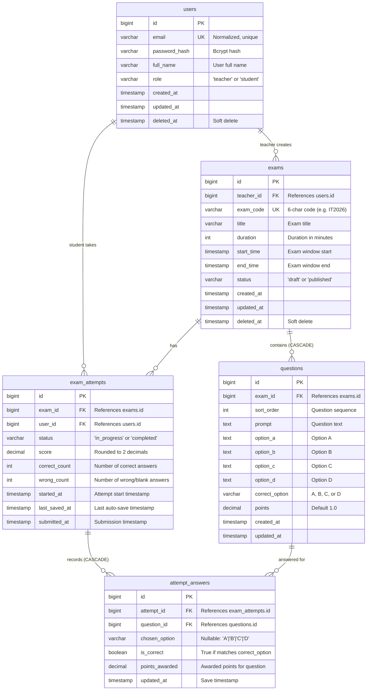

# BÁO CÁO THIẾT KẾ KIẾN TRÚC VÀ BẢO MẬT HỆ THỐNG
## DỰ ÁN: HỆ THỐNG THI TRẮC NGHIỆM TRỰC TUYẾN (EXAM MVP)

---

## 1. TỔNG QUAN KIẾN TRÚC HỆ THỐNG (SYSTEM ARCHITECTURE OVERVIEW)

Hệ thống **Online Exam MVP** được xây dựng theo mô hình **Client-Server kiến trúc phân tầng (Layered Clean Architecture)**, tách biệt độc lập giữa tầng hiển thị giao diện (Frontend SPA) và tầng xử lý nghiệp vụ/lưu trữ dữ liệu (Backend RESTful API & Relational Database).

```
+-------------------------------------------------------------------------+
|                         CLIENT LAYER (BROWSER)                          |
|   React 19 + Vite + TailwindCSS + React Router v6 + Axios Interceptor   |
+-------------------------------------------------------------------------+
                                    |
                            HTTP/REST (JSON)
                    Authorization: Bearer <JWT Token>
                                    v
+-------------------------------------------------------------------------+
|                         BACKEND LAYER (GOLANG)                          |
|  +-------------------------------------------------------------------+  |
|  | Gin Gonic Engine + CORS Middleware (5173, 3000)                   |  |
|  +-------------------------------------------------------------------+  |
|  | Auth Middleware: JWT Verification & RBAC Guard (Teacher / Student)|  |
|  +-------------------------------------------------------------------+  |
|  | Business Logic Handlers: Auth, Teacher (6 APIs), Student (7 APIs) |  |
|  +-------------------------------------------------------------------+  |
|  | Security Guards: QuestionSafe DTO, Dual-Timer, FOR UPDATE Lock   |  |
|  +-------------------------------------------------------------------+  |
|  | Data Access: GORM ORM (Transactions, Atomic UPSERT, Prepared Stmt)|  |
|  +-------------------------------------------------------------------+  |
+-------------------------------------------------------------------------+
                                    |
                           Database Driver (TCP)
                                    v
+-------------------------------------------------------------------------+
|                        PERSISTENCE LAYER (RDBMS)                        |
|       PostgreSQL 15 (Docker) / SQLite In-Memory (Test Suite)            |
|       5 Normalized Tables + 2 Unique Composite Indexes                  |
+-------------------------------------------------------------------------+
```

### 1.1. Công nghệ lựa chọn (Tech Stack) & Lý do kỹ thuật
- **Backend - Golang (Gin Framework & GORM)**: 
  - Khả năng xử lý đa luồng đồng thời (concurrency) vượt trội thông qua cơ chế Goroutine, tiêu tốn ít bộ nhớ RAM, rất phù hợp cho các kịch bản hàng trăm/hàng nghìn thí sinh cùng nộp bài hoặc auto-save đồng thời.
  - Gin Framework cung cấp router Radix tree tốc độ cao, khả năng benchmark hàng chục nghìn req/s với độ trễ micro-giây.
- **Database - PostgreSQL 15**: 
  - Hệ quản trị cơ sở dữ liệu quan hệ mạnh mẽ, chuẩn ACID, hỗ trợ tính năng khoá dòng bi quan (`SELECT ... FOR UPDATE`), câu lệnh `ON CONFLICT DO UPDATE` (Atomic UPSERT) và Composite Unique Index, loại bỏ hoàn toàn nguy cơ mất toàn vẹn dữ liệu.
- **Frontend - React 19, Vite & TailwindCSS**: 
  - Vite tối ưu tốc độ đóng gói (Hot Module Replacement cực nhanh).
  - Axios Interceptor xử lý đính kèm Bearer JWT tự động vào toàn bộ các request có bảo mật.
  - Phân vùng trạng thái và điều hướng theo vai trò người dùng (Role-Based Routing).

---

## 2. THIẾT KẾ CƠ SỞ DỮ LIỆU & SƠ ĐỒ ERD (DATABASE SCHEMA & ERD)

Cơ sở dữ liệu được chuẩn hóa ở dạng chuẩn 3NF (Third Normal Form) gồm đúng **5 bảng cốt lõi**, phản ánh chính xác nghiệp vụ khảo thí.

### 2.1. Sơ đồ thực thể liên kết (ERD Diagram)



### 2.2. Phân tích chi tiết các bảng dữ liệu

1. **`users`**:
   - Lưu trữ thông tin tài khoản người dùng với phân quyền (`role`: `teacher` | `student`).
   - Cột `email` có ràng buộc `UNIQUE` và được chuẩn hóa chữ thường trước khi lưu.
   - Mật khẩu lưu dưới dạng Bcrypt hash an toàn (chiều dài password đầu vào giới hạn tối đa 72 bytes để tránh lỗi cắt chuỗi của Bcrypt).
   - Hỗ trợ Soft-delete qua cột `deleted_at` (`gorm.DeletedAt`).

2. **`exams`**:
   - Chứa thông tin đề thi do Giáo viên tạo (`teacher_id`).
   - `exam_code`: Mã kỳ thi gồm 6 ký tự chữ hoa/số ngẫu nhiên (hoặc mã định danh như `IT2026`), có ràng buộc `UNIQUE`.
   - `status`: Quản lý trạng thái đề thi (`draft`: đang soạn thảo; `published`: đã phát hành). Đề thi chỉ được phép xuất bản khi có ít nhất 1 câu hỏi, và khi đã xuất bản thì nghiêm cấm thêm/xóa câu hỏi.
   - `start_time` và `end_time`: Xác định khung giờ mở cửa kỳ thi trên hệ thống.

3. **`questions`**:
   - Lưu nội dung câu hỏi trắc nghiệm 4 đáp án (A, B, C, D) và đáp án đúng (`correct_option`).
   - Có khóa ngoại `exam_id` trỏ đến `exams.id` với hành vi `ON DELETE CASCADE`.
   - Có cột `points` (mặc định 1.0) cho phép thiết lập trọng số điểm linh hoạt từng câu.

4. **`exam_attempts`**:
   - Đại diện cho một lượt làm bài của một học sinh cụ thể với một đề thi cụ thể.
   - `started_at`: Thời điểm học sinh bấm nút bắt đầu làm bài.
   - `status`: Chuyển đổi trạng thái từ `in_progress` sang `completed` khi nộp bài hoặc khi bị hệ thống cưỡng chế auto-submit do hết giờ.
   - `score`, `correct_count`, `wrong_count`: Lưu kết quả chấm thi cuối cùng.

5. **`attempt_answers`**:
   - Lưu trữ chi tiết lựa chọn của thí sinh cho từng câu hỏi trong bài thi.
   - `chosen_option`: Lựa chọn của thí sinh (`A`, `B`, `C`, `D` hoặc `NULL` nếu thí sinh chưa chọn).
   - `is_correct` và `points_awarded`: Được tính toán và cập nhật khi bài thi được nộp và chấm điểm.

---

### 2.3. Phân tích 2 Unique Composite Index đặc tả

Cơ sở dữ liệu được trang bị 2 chỉ mục tổng hợp duy nhất (Unique Composite Indexes) đóng vai trò then chốt trong việc bảo vệ tính toàn vẹn dữ liệu:

#### 🔹 Index 1: `idx_exam_attempts_exam_user`
```sql
CREATE UNIQUE INDEX IF NOT EXISTS idx_exam_attempts_exam_user
ON exam_attempts (exam_id, user_id);
```
- **Mục đích nghiệp vụ**: Ràng buộc nguyên tắc tối cao của thi trắc nghiệm: **Mỗi học sinh chỉ được phép có duy nhất 1 lượt làm bài (`exam_attempt`) cho một đề thi cụ thể**. Ngăn chặn hoàn toàn việc thí sinh gian lận tạo nhiều bài thi để làm lại từ đầu.
- **Điểm cải tiến kỹ thuật (Vá lỗi Migration)**: Ban đầu index có mệnh đề `WHERE deleted_at IS NULL`. Tuy nhiên, bảng `exam_attempts` không sử dụng soft-delete (không có cột `deleted_at`). Do đó, mệnh đề này đã được loại bỏ để tránh lỗi cú pháp `column "deleted_at" does not exist` trên PostgreSQL, đảm bảo câu lệnh migration thực thi thành công 100%.

#### 🔹 Index 2: `idx_attempt_answers_attempt_question`
```sql
CREATE UNIQUE INDEX IF NOT EXISTS idx_attempt_answers_attempt_question
ON attempt_answers (attempt_id, question_id);
```
- **Mục đích nghiệp vụ & Kỹ thuật**:
  - Đảm bảo trong một bài thi (`attempt_id`), mỗi câu hỏi (`question_id`) chỉ tồn tại duy nhất một bản ghi câu trả lời.
  - Đây là điều kiện tiên quyết bắt buộc để thực hiện câu lệnh **Atomic UPSERT** khi auto-save:
    ```sql
    INSERT INTO attempt_answers (attempt_id, question_id, chosen_option, is_correct, points_awarded, updated_at)
    VALUES (?, ?, ?, false, 0, ?)
    ON CONFLICT (attempt_id, question_id)
    DO UPDATE SET chosen_option = EXCLUDED.chosen_option, updated_at = EXCLUDED.updated_at;
    ```
  - Khi thí sinh thay đổi câu trả lời nhiều lần, cơ sở dữ liệu sẽ tự động thực hiện `UPDATE` thay vì `INSERT`, loại bỏ hiện tượng trùng lặp bản ghi mà không cần phải thực hiện 2 câu lệnh `SELECT` và `UPDATE` riêng biệt (giảm tải 50% số lượng query I/O).

---

## 3. SƠ ĐỒ LUỒNG NGHIỆP VỤ (BUSINESS PROCESS FLOWS)

### 3.1. Luồng A: Vòng đời làm bài thi trắc nghiệm (Exam Lifecycle Sequence)
Quy trình từ lúc Thí sinh tra cứu, Bắt đầu thi, Auto-save liên tục, Nộp bài (hoặc hết giờ tự động chấm) và Xem điểm số.


---

### 3.2. Luồng B: Cơ chế 2 đồng hồ (Dual-Timer Mechanism)

Một trong những bài toán phức tạp nhất của hệ thống khảo thí trực tuyến là quản lý thời gian thi công bằng giữa các thí sinh. Hệ thống giải quyết triệt để thông qua **cơ chế 2 đồng hồ song song**:

1. **Đồng hồ 1: Khung giờ mở đề thi (Exam Window)**:
   - Được định nghĩa bởi `[exam.start_time, exam.end_time]`.
   - Đây là khoảng thời gian kỳ thi được phép diễn ra trên hệ thống (ví dụ: Từ 08:00 đến 10:00 sáng).
2. **Đồng hồ 2: Thời lượng làm bài của thí sinh (Attempt Duration)**:
   - Được định nghĩa bởi `exam.duration` (số phút, ví dụ: 45 phút).
   - Thời gian làm bài cá nhân bắt đầu tính từ thời điểm thí sinh bấm nút vào thi (`attempt.started_at`).

#### Công thức xác định hạn chót nộp bài thực tế (Effective Deadline):
Hạn chót làm bài thực tế của một lượt thi luôn là giá trị **nhỏ hơn** giữa hai mốc thời gian:

$$\text{Effective Deadline} = \min\Big(\text{started\_at} + \text{duration}, \;\; \text{exam.end\_time}\Big)$$

Và thời gian còn lại (tính bằng giây) trả về cho client:

$$\text{remaining\_seconds} = \max\Big(0, \;\; \text{Effective Deadline} - \text{ServerTimeNow}\Big)$$


#### Phân tích các kịch bản thực tế:
- **Kịch bản 1 (Vào thi đúng giờ)**: Đề thi mở từ `08:00` đến `10:00`, thời lượng `45 phút`. Thí sinh vào thi lúc `08:15`. Hạn nộp bài là `08:15 + 45p = 09:00` (nhỏ hơn `10:00`). Thí sinh được hưởng trọn vẹn 45 phút làm bài.
- **Kịch bản 2 (Vào thi muộn - Bị ép nộp cùng phòng thi)**: Đề thi kết thúc lúc `10:00`. Thí sinh vào thi lúc `09:40`. Mốc `started_at + duration` sẽ là `10:25`, tuy nhiên do `end_time` là `10:00` nên hạn chót thực tế bị giới hạn lại đúng `10:00`. Thí sinh chỉ còn `20 phút` để làm bài. Điều này loại bỏ hoàn toàn hành vi cố tình vào muộn để xin đề hoặc kéo dài thời gian thi.
- **Kịch bản 3 (Tải lại trang hoặc mất mạng - Resume)**: Khi thí sinh F5 tải lại trang, client không tự ý reset đồng hồ. Client gửi request `/start`, server tính lại `Effective Deadline - NOW()` theo đồng hồ nguyên tử của server và trả về số giây còn lại chính xác tuyệt đối.

---

## 4. ĐIỂM NHẤN KỸ THUẬT & CÁC BẢN VÁ BẢO MẬT (SECURITY & TECHNICAL HIGHLIGHTS)

Hệ thống đã trải qua quá trình audit và vá toàn bộ các lỗ hổng bảo mật nghiêm trọng thường gặp trong các ứng dụng khảo thí trực tuyến:

### 4.1. Chống lộ đáp án trắc nghiệm (Zero-Leak Data Transfer Object - DTO)
- **Nguy cơ tiềm ẩn**: Nếu serialize trực tiếp GORM Model `Question` trả về cho học sinh, trường `correct_option` sẽ nằm trong payload JSON. Thí sinh chỉ cần bấm F12 mở tab Network là có thể xem được toàn bộ đáp án đề thi trước khi làm bài.
- **Giải pháp kỹ thuật**:
  - Xây dựng DTO struct `QuestionSafe` loại bỏ hoàn toàn trường `CorrectOption`:
    ```go
    type QuestionSafe struct {
        ID        uint    `json:"id"`
        ExamID    uint    `json:"exam_id"`
        SortOrder int     `json:"sort_order"`
        Prompt    string  `json:"prompt"`
        OptionA   string  `json:"option_a"`
        OptionB   string  `json:"option_b"`
        OptionC   string  `json:"option_c"`
        OptionD   string  `json:"option_d"`
        Points    float64 `json:"points"`
    }
    ```
  - Tại API `StudentStartExam`, 100% câu hỏi được chuyển đổi qua hàm `models.ToQuestionSafe(q)` trước khi gửi về client.
  - **Bảo mật kép tại trang Xem kết quả (`StudentGetResult`)**: Kể cả sau khi nộp bài, nếu đề thi vẫn đang mở (`now.Before(exam.EndTime)`), trường `correct_option` của toàn bộ các câu hỏi vẫn bị ẩn (`nil`). Chỉ khi toàn bộ khung giờ thi kết thúc (`now.After(exam.EndTime)`), thí sinh mới được phép xem đáp án đúng. Cơ chế này ngăn chặn việc thí sinh nộp bài sớm lấy đáp án rồi gửi cho các bạn khác đang làm bài trong phòng thi.

---

### 4.2. Chống gian lận thời gian (Server-Authoritative Clock & Grace Period)
- **Nguy cơ tiềm ẩn**: Nếu tin cậy đồng hồ phía Client (JavaScript `Date.now()`), thí sinh có thể chỉnh lùi giờ hệ điều hành trên máy tính hoặc can thiệp biến đếm ngược trên console để kéo dài thời gian làm bài vô tận.
- **Giải pháp kỹ thuật**:
  - **Server-Authoritative**: Mọi phép tính toán thời gian bắt đầu, thời hạn kết thúc và thời gian còn lại đều lấy mốc từ `time.Now()` trên máy chủ Backend.
  - **Vùng đệm mạng (Network Grace Period)**: Khi gửi request lưu đáp án (`/save`) hoặc nộp bài (`/submit`), hệ thống cho phép vùng đệm trễ mạng 5 giây (`const saveGracePeriod = 5 * time.Second`):
    - Nếu request gửi lên trong khoảng `deadline < now <= deadline + 5s`: Hệ thống vẫn chấp nhận lưu đáp án cuối cùng để bù trừ độ trễ mạng (latency/jitter) của thí sinh.
    - Nếu `now > deadline + 5s`: Hệ thống kiên quyết từ chối lưu đáp án mới, tự động kích hoạt hàm chấm bài dựa trên các đáp án đã lưu hợp lệ trước đó và trả về mã lỗi `409 Conflict` kèm thông báo bài thi đã tự động kết thúc.
  - **Cơ chế quét bài thi hết hạn bị động (Lazy Expiration Grading)**: Nếu thí sinh tắt máy tính không chịu bấm nộp bài, hàm `gradeExpiredAttempts(examID)` sẽ được kích hoạt tự động mỗi khi giáo viên mở trang xem kết quả thống kê (`TeacherGetResults`) hoặc khi học sinh tra cứu đề (`StudentLookupExam`), đảm bảo mọi bài thi quá hạn đều được chấm điểm và thống kê chính xác.

---

### 4.3. Chống Race Condition & Double Submit (Pessimistic Locking `FOR UPDATE`)
- **Nguy cơ tiềm ẩn**: Thí sinh mở 2 tab trình duyệt và bấm nộp bài cùng một thời điểm, hoặc viết script gửi 10 request `/submit` đồng thời. Nếu không có cơ chế khóa, nhiều goroutine backend sẽ cùng đọc dữ liệu, cùng tính điểm và cùng ghi đè lên database, dẫn đến sai lệch kết quả hoặc duplicate dữ liệu.
- **Giải pháp kỹ thuật**:
  - Bọc toàn bộ quy trình chấm thi và lưu bài trong một **Database Transaction** nguyên tử (`config.DB.Transaction`).
  - Sử dụng cơ chế khóa dòng bi quan (Pessimistic Row-level Locking) với GORM clause:
    ```go
    err := config.DB.Transaction(func(tx *gorm.DB) error {
        var attempt models.ExamAttempt
        // Tương đương lệnh SQL: SELECT * FROM exam_attempts WHERE id=? AND user_id=? FOR UPDATE
        if err := tx.Clauses(clause.Locking{Strength: "UPDATE"}).
            Where("id = ? AND user_id = ?", attemptID, userID).
            First(&attempt).Error; err != nil {
            return err
        }
        
        // Kiểm tra tính lũy kế (Idempotency): Nếu đã nộp bài thì chặn ngay lập tức
        if attempt.Status != "in_progress" {
            return errAlreadySubmitted
        }
        ...
    ```
  - Khi một request đang giữ khóa `FOR UPDATE`, tất cả các request song song khác gửi đến cùng một `attempt_id` bắt buộc phải xếp hàng chờ. Request đầu tiên hoàn thành sẽ đổi trạng thái `status = 'completed'`. Khi request thứ hai lấy được khóa, nó sẽ thấy `status != 'in_progress'` và bị từ chối ngay lập tức với lỗi `400 Exam already submitted`.
  - **Chống tạo 2 bài thi song song**: Tại API `/start`, sử dụng `clause.OnConflict{DoNothing: true}` kết hợp với Unique Composite Index `(exam_id, user_id)` để đảm bảo ngay cả khi có 2 request `/start` gửi đồng thời, hệ thống chỉ tạo duy nhất 1 bản ghi trong database mà không bao giờ bị crash do Duplicate Key Violation.

---

### 4.4. Chống lỗ hổng IDOR chéo đề thi (Insecure Direct Object Reference)
- **Nguy cơ tiềm ẩn**: Kẻ tấn công có thể can thiệp payload gửi lên API `/attempts/:id/save` hoặc `/submit`, cố tình chèn `question_id` thuộc về một đề thi khác. Nếu backend không kiểm tra, kẻ tấn công có thể trả lời câu hỏi của đề thi khác, hoặc làm sai lệch cơ sở dữ liệu câu trả lời.
- **Giải pháp kỹ thuật**:
  - Xây dựng hàm thẩm định quyền sở hữu câu hỏi dùng chung `upsertAnswers`:
    ```go
    // Truy vấn tập hợp tất cả question_id thuộc về đề thi của attempt này
    var validIDs []uint
    tx.Model(&models.Question{}).Where("exam_id = ?", attempt.ExamID).Pluck("id", &validIDs)
    
    validSet := make(map[uint]struct{}, len(validIDs))
    for _, id := range validIDs {
        validSet[id] = struct{}{}
    }
    
    // Kiểm tra từng question_id gửi lên
    for _, ans := range answers {
        if _, ok := validSet[ans.QuestionID]; !ok {
            return fmt.Errorf("question_id %d does not belong to this exam", ans.QuestionID)
        }
        ...
    ```
  - Nếu phát hiện bất kỳ `question_id` nào không nằm trong danh sách câu hỏi hợp lệ của đề thi đó, Transaction lập tức bị hủy bỏ (Rollback) và trả về lỗi `400 Bad Request`.

---

### 4.5. Chống SQL Injection & Kiểm soát phân quyền chặt chẽ (Broken Object Level Authorization)
- **Chống SQL Injection**:
  - Loại bỏ hoàn toàn việc truyền chuỗi thô từ URL param vào các câu lệnh SQL.
  - Sử dụng hàm helper `parseUintParam(c, paramName)` để parse và validate tham số ID trên URL thành kiểu số nguyên không âm `uint` trước khi đưa vào ORM:
    ```go
    func parseUintParam(c *gin.Context, param string) (uint, bool) {
        v, err := strconv.ParseUint(c.Param(param), 10, 64)
        if err != nil {
            c.JSON(http.StatusBadRequest, gin.H{"error": "Invalid " + param})
            return 0, false
        }
        return uint(v), true
    }
    ```
  - 100% truy vấn cơ sở dữ liệu đều sử dụng tính năng Parameterized Query an toàn của GORM.
- **Phân quyền sở hữu chặt chẽ (Ownership Guard)**:
  - Trong `TeacherDeleteQuestion`, hệ thống thực hiện kiểm tra 3 lớp:
    1. Câu hỏi cần xóa có tồn tại không?
    2. Đề thi chứa câu hỏi đó có đúng do chính Giáo viên đang đăng nhập (`teacherID`) tạo ra hay không (`Where("id = ? AND teacher_id = ?", examID, teacherID)`)? Nếu không, trả về `403 Forbidden`.
    3. Trạng thái của đề thi có đang là `draft` hay không? Nếu đề thi đã `published`, nghiêm cấm xóa câu hỏi để bảo toàn dữ liệu bài thi của học sinh.
- **Bảo mật tài khoản & Chuẩn hóa đầu vào**:
  - Tự động chuẩn hóa email bằng hàm `normalizeEmail` (`strings.ToLower(strings.TrimSpace(email))`) chống bypass kiểm tra trùng lặp email do chữ hoa/thường hoặc khoảng trắng thừa.
  - Giới hạn độ dài mật khẩu `binding:"max=72"` để phù hợp với giới hạn thuật toán Bcrypt, phòng chống tấn công DoS CPU bằng chuỗi mật khẩu siêu dài.

---

### 4.6. Thuật toán chấm điểm chuẩn xác (Grading Precision & Integrity)
- **Tính toán điểm số**:
  - Duyệt qua toàn bộ danh sách câu hỏi chính thức của đề thi.
  - So sánh `ans.ChosenOption` với `q.CorrectOption`. Nếu đúng, cộng điểm `q.Points` và tăng `correct_count`. Nếu sai hoặc không chọn, tăng `wrong_count`.
- **Xử lý câu hỏi bỏ trống**:
  - Đối với các câu hỏi thí sinh không trả lời, hệ thống tự động tạo bản ghi trong `attempt_answers` với `chosen_option = NULL, is_correct = false, points_awarded = 0`.
  - Đảm bảo tính toán toàn vẹn: $\text{correct\_count} + \text{wrong\_count} \equiv \text{total\_questions}$.
- **Kiểm soát sai số dấu phẩy động**:
  - Điểm số được làm tròn 2 chữ số thập phân bằng hàm `math.Round(totalScore * 100) / 100`, loại bỏ hoàn toàn các lỗi sai số dấu phẩy động phổ biến (như `0.30000000000000004`).

---

## 5. DANH MỤC API ENDPOINTS TOÀN DIỆN (API ENDPOINTS SPECIFICATION)

Tất cả các API yêu cầu xác thực đều phải đính kèm Header:
`Authorization: Bearer <jwt_token>`

### 5.1. Authentication APIs (Public)
| Method | Endpoint | Yêu cầu Body | Mã phản hồi | Mô tả |
| :--- | :--- | :--- | :--- | :--- |
| `POST` | `/api/auth/register` | `{full_name, email, password}` | `201 Created` / `400` / `409` | Đăng ký tài khoản học sinh mới |
| `POST` | `/api/auth/login` | `{email, password}` | `200 OK` / `400` / `401` | Đăng nhập hệ thống, trả về Token & User Info |

### 5.2. Teacher APIs (Yêu cầu Role = `teacher`)
| Method | Endpoint | Yêu cầu Body | Mã phản hồi | Mô tả |
| :--- | :--- | :--- | :--- | :--- |
| `GET` | `/api/teacher/exams` | Không | `200 OK` | Lấy danh sách đề thi do giáo viên hiện tại tạo |
| `POST` | `/api/teacher/exams` | `{title, duration, start_time, end_time}` | `201 Created` / `400` | Tạo đề thi mới (trạng thái `draft`, sinh `exam_code` 6 ký tự) |
| `GET` | `/api/teacher/exams/:id` | Không | `200 OK` / `404` | Xem chi tiết đề thi kèm toàn bộ câu hỏi (sắp xếp theo `sort_order`) |
| `POST` | `/api/teacher/exams/:id/questions` | `{questions: [{prompt, option_a, ...}]}` | `201 Created` / `400` | Thêm danh sách câu hỏi vào đề thi (chỉ cho phép khi đề đang `draft`) |
| `DELETE`| `/api/teacher/questions/:question_id` | Không | `200 OK` / `400` / `403` / `404` | Xóa câu hỏi khỏi đề thi (chỉ cho phép khi đề đang `draft`) |
| `PATCH`| `/api/teacher/exams/:id/publish` | Không | `200 OK` / `400` / `404` | Xuất bản đề thi (yêu cầu tối thiểu 1 câu hỏi) |
| `GET` | `/api/teacher/exams/:id/results` | Không | `200 OK` / `404` | Thống kê kết quả thi: Tổng số HS, Điểm TB, Điểm cao/thấp nhất, Bảng điểm |

### 5.3. Student APIs (Yêu cầu Role = `student`)
| Method | Endpoint | Yêu cầu Body / Query Param | Mã phản hồi | Mô tả |
| :--- | :--- | :--- | :--- | :--- |
| `GET` | `/api/student/exams/lookup` | Query: `?code=XYZ` | `200 OK` / `400` / `404` | Tra cứu đề thi đã xuất bản theo mã kỳ thi |
| `GET` | `/api/student/attempts` | Không | `200 OK` | Xem lịch sử toàn bộ các bài thi học sinh đã tham gia |
| `POST` | `/api/student/exams/:id/start` | Không | `200 OK` / `400` / `403` / `404` | Bắt đầu hoặc Resume bài thi. Trả về `QuestionSafe` (ẩn `correct_option`) |
| `POST` | `/api/student/attempts/:id/save`| `{answers: [{question_id, chosen_option}]}` | `200 OK` / `400` / `409` | Auto-save câu trả lời (Atomic UPSERT). Bị chặn nếu hết giờ |
| `POST` | `/api/student/attempts/:id/submit`| `{answers: [...]}` (tùy chọn) | `200 OK` / `400` / `404` | Nộp bài thi và chấm điểm tự động trong 1 Transaction nguyên tử |
| `GET` | `/api/student/attempts/:id/result`| Không | `200 OK` / `400` / `404` | Xem điểm số và bài làm sau khi nộp (chỉ hiện đáp án đúng khi đề đã đóng) |

### 5.4. System Health API (Public)
| Method | Endpoint | Yêu cầu Body | Mã phản hồi | Mô tả |
| :--- | :--- | :--- | :--- | :--- |
| `GET` | `/health` | Không | `200 OK` | Health-check dịch vụ Backend |

---

## 6. ĐÁNH GIÁ KẾT QUẢ VÀ HƯỚNG PHÁT TRIỂN (EVALUATION & ROADMAP)

### 6.1. Đánh giá chất lượng phần mềm
- **Độ tin cậy (Reliability)**: Bộ kiểm thử tự động `backend/main_test.go` thực thi qua 6 kịch bản nghiệp vụ (UC01 -> UC06) và toàn bộ các edge cases (nhập sai dữ liệu, xung đột thời gian, race condition, IDOR chéo đề) đạt tỉ lệ thành công **100% PASS**.
- **Tính toàn vẹn (Data Integrity)**: Áp dụng triệt để ACID Transactions và Foreign Key Cascades, không có bản ghi rác mồ côi (orphaned records).
- **Hiệu năng (Performance)**:
  - Tối ưu hóa truy vấn bằng 2 Composite Unique Index.
  - Tận dụng Atomic `UPSERT` thay cho mô hình Select-then-Update truyền thống.
  - Phục vụ frontend tĩnh siêu tốc thông qua Vite bundle tối ưu.

### 6.2. Hướng mở rộng cho phiên bản tiếp theo (Production Roadmap)
1. **Giám sát chống gian lận thời gian thực (Real-time Proctoring)**: Tích hợp WebSocket để phát hiện thí sinh chuyển tab (blur event), mở cửa sổ DevTools hoặc ngắt kết nối mạng.
2. **Ngân hàng đề thi & Xáo trộn đề (Question Bank & Randomization)**: Hỗ trợ xáo trộn ngẫu nhiên thứ tự câu hỏi và thứ tự 4 đáp án A/B/C/D cho từng thí sinh khác nhau trong cùng một đề thi.
3. **Bộ nhớ đệm Redis (Distributed Caching & Rate Limiting)**: Sử dụng Redis để cache nội dung câu hỏi và giới hạn tần suất request (Rate Limiting) cho API `/save`, giảm tải tối đa cho PostgreSQL.
4. **Hỗ trợ câu hỏi đa phương tiện (Multimedia Questions)**: Tích hợp AWS S3 / Cloudflare R2 để tải lên hình ảnh minh họa, sơ đồ và công thức toán học (KaTeX/LaTeX).
