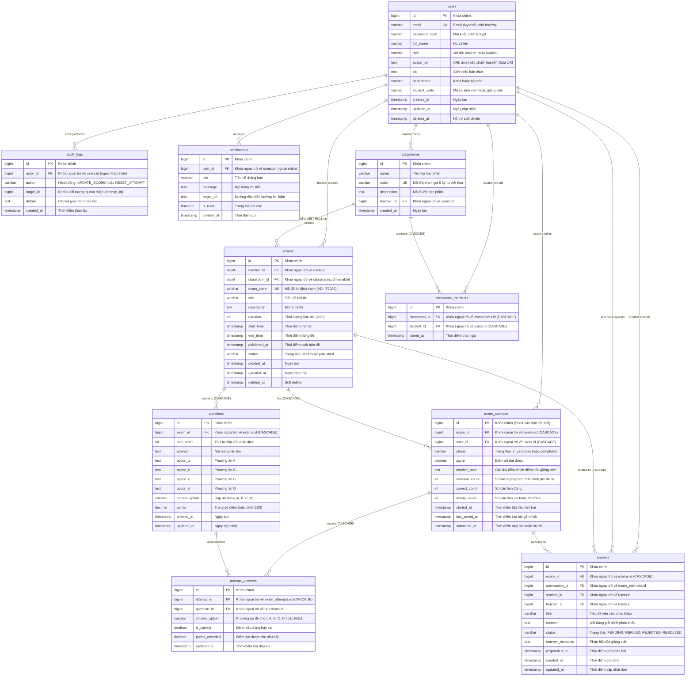
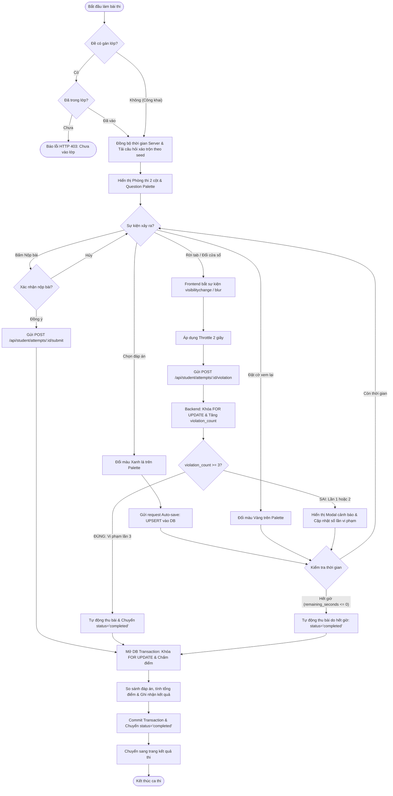
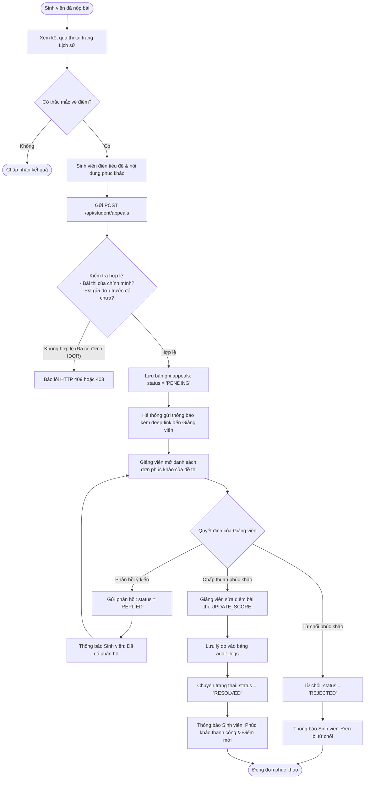
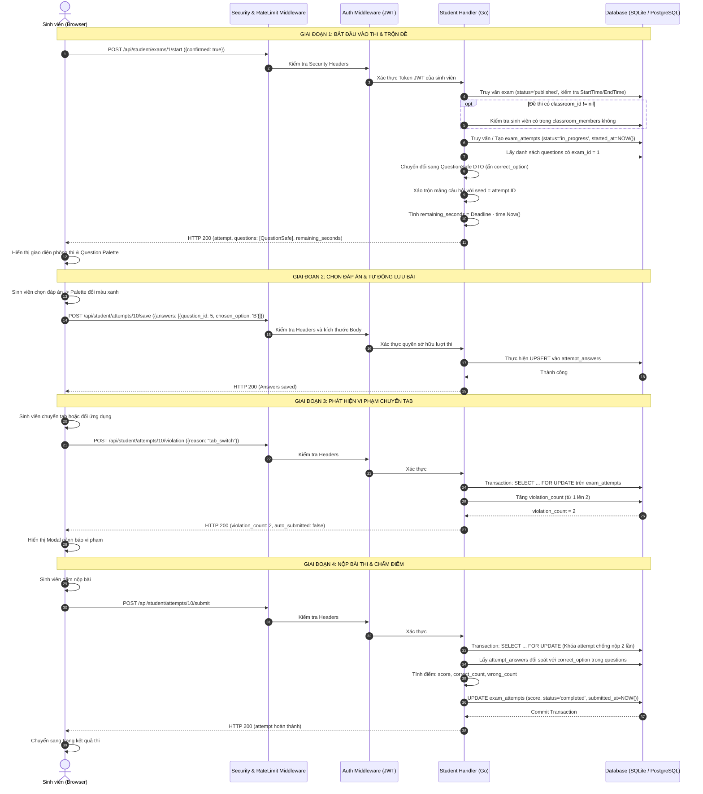
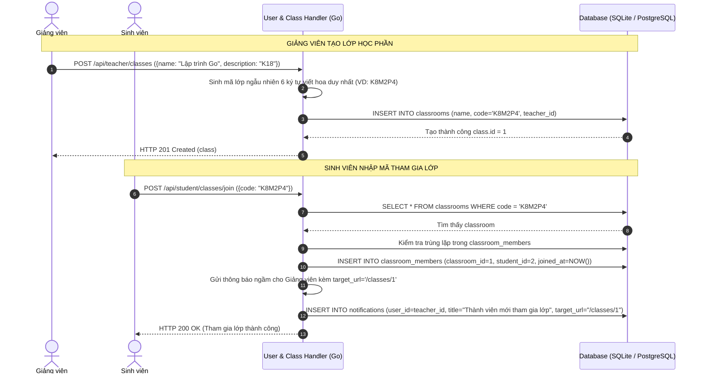
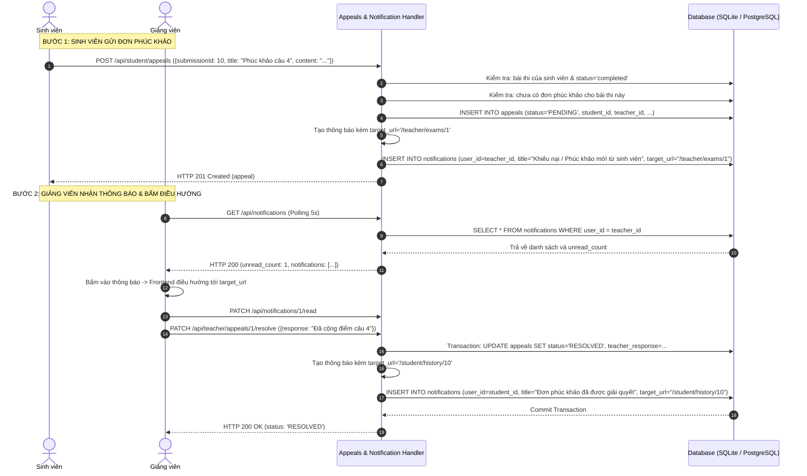
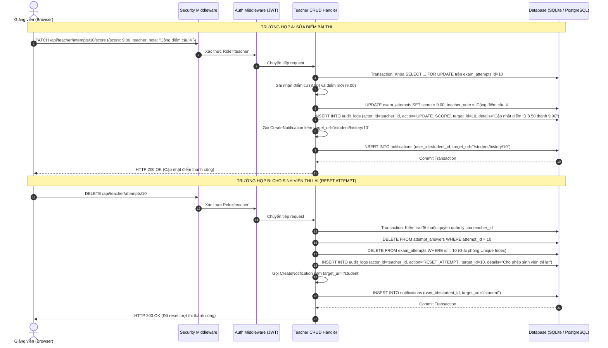

# BÁO CÁO THIẾT KẾ KIẾN TRÚC VÀ ĐẶC TẢ YÊU CẦU PHẦN MỀM
## DỰ ÁN: HỆ THỐNG THI TRẮC NGHIỆM TRỰC TUYẾN ĐẠI HỌC
- **Hệ thống**: Online Exam System
- **Kiến trúc**: Client-Server (REST API)
- **Công nghệ**: Golang 1.21+ (Gin) | React 19 (Vite) | PostgreSQL 15 / SQLite In-Memory

---

## 1. TỔNG QUAN KIẾN TRÚC HỆ THỐNG VÀ CƠ SỞ DỮ LIỆU

### 1.1. Mô hình kiến trúc phân tầng

Hệ thống được tổ chức theo mô hình Client-Server phân tầng, tách biệt giữa ứng dụng giao diện (Frontend React SPA) và máy chủ API (Backend Golang Gin).

```
+---------------------------------------------------------------------------------------------------+
|                                      CLIENT LAYER (TRÌNH DUYỆT)                                   |
|   React 19 + Vite + TailwindCSS + React Router v6 + Axios                                         |
|   - Phân hệ Giảng viên: Đề thi, ngân hàng câu hỏi, lớp học phần, sinh viên, bảng điểm, phúc khảo   |
|   - Phân hệ Sinh viên: Danh sách đề thi, phòng thi 2 cột (Question Palette), lịch sử và phúc khảo  |
|   - Thành phần chung: Hồ sơ cá nhân (Avatar URL/Base64), Danh bạ người dùng, Thông báo (5s)       |
+---------------------------------------------------------------------------------------------------+
                                                  |
                                          HTTP / REST (JSON)
                                 Authorization: Bearer <JWT Token>
                                                  v
+---------------------------------------------------------------------------------------------------+
|                                      BACKEND LAYER (GOLANG)                                       |
|  +---------------------------------------------------------------------------------------------+  |
|  | Gin Gonic Web Engine (Cổng 8081) + CORS Middleware                                          |  |
|  +---------------------------------------------------------------------------------------------+  |
|  | Global Security Middleware: Security Headers (nosniff, DENY, strict-origin) & Body Limit 2MB |  |
|  +---------------------------------------------------------------------------------------------+  |
|  | Rate Limiting Middleware: In-Memory Sliding Window (15 req/phút/IP cho Login và Lookup)     |  |
|  +---------------------------------------------------------------------------------------------+  |
|  | Authentication & RBAC Middleware: JWT HMAC-SHA256 Verification & Role Guard                 |  |
|  +---------------------------------------------------------------------------------------------+  |
|  | Handlers (Bộ điều khiển nghiệp vụ):                                                         |  |
|  |   - Auth Handler: Đăng ký, đăng nhập, cấp JWT Token                                         |  |
|  |   - Teacher CRUD Handler: Quản lý đề thi, nhập câu hỏi hàng loạt, quản lý sinh viên        |  |
|  |   - Student Handler: Khảo thí, xáo trộn câu hỏi theo seed, auto-save (UPSERT), nộp bài       |  |
|  |   - Anti-Cheat & Audit Handler: Ghi nhận vi phạm chuyển tab, audit log, xuất CSV UTF-8 BOM  |  |
|  |   - Appeals Handler: Quy trình phúc khảo 4 trạng thái (PENDING, REPLIED, REJECTED, RESOLVED)|  |
|  |   - Notifications Handler: Tạo thông báo điều hướng sâu (target_url), polling 5s            |  |
|  |   - User & Class Handler: Hồ sơ cá nhân, danh bạ người dùng, phân quyền và lớp học phần     |  |
|  +---------------------------------------------------------------------------------------------+  |
|  | Data Access Layer: GORM ORM (Transactions, Khóa dòng FOR UPDATE, Prepared Statements)       |  |
|  +---------------------------------------------------------------------------------------------+  |
+---------------------------------------------------------------------------------------------------+
                                                  |
                                          Database Driver (TCP)
                                                  v
+---------------------------------------------------------------------------------------------------+
|                                    PERSISTENCE LAYER (RDBMS)                                      |
|   PostgreSQL 15 (Môi trường chạy chính) / SQLite In-Memory + WAL Mode (Môi trường kiểm thử tự động)|
|   10 bảng quan hệ (3NF) + 3 chỉ mục Unique Composite + Ràng buộc Foreign Key Cascade             |
+---------------------------------------------------------------------------------------------------+
```

### 1.2. Công nghệ lựa chọn và lý do kỹ thuật

1. **Backend - Golang & Gin Framework**:
   - Go biên dịch ra file nhị phân duy nhất, khởi động nhanh và tiêu thụ ít bộ nhớ. Mô hình goroutine xử lý I/O non-blocking phù hợp với kịch bản nhiều thí sinh cùng lưu bài hoặc nộp bài đồng thời.
   - Gin Framework sử dụng cây radix tree định tuyến đường dẫn nhanh, cú pháp middleware rõ ràng và dễ bảo trì.

2. **Cơ sở dữ liệu - PostgreSQL 15 & SQLite In-Memory**:
   - Môi trường chạy thực tế dùng PostgreSQL 15 trong Docker: hỗ trợ transaction ACID, khóa bi quan `SELECT ... FOR UPDATE` chống double-submit, câu lệnh nguyên tử `ON CONFLICT DO UPDATE` cho auto-save và cascade foreign key khi xóa đề thi hoặc sinh viên.
   - Môi trường kiểm thử dùng SQLite in-memory: cấu hình chế độ `WAL (Write-Ahead Logging)` và `busy_timeout=5000` (`PRAGMA journal_mode=WAL;` và `PRAGMA busy_timeout=5000;`) giúp các tiến trình đọc/ghi song song không bị lỗi `database is locked`.

3. **Frontend - React 19, Vite & TailwindCSS**:
   - Vite tối ưu tốc độ bundle và hot module replacement trong quá trình phát triển.
   - Giao diện sử dụng TailwindCSS với bảng màu trung tính, thiết kế tối giản, tập trung vào trải nghiệm thi cử nghiêm túc của môi trường đại học.
   - Axios Interceptor tự động đính kèm token xác thực `Bearer` vào header và chuyển tiếp mã lỗi từ backend.

---

### 1.3. Sơ đồ thực thể liên kết (Mermaid ERD Diagram)

Hệ thống gồm **10 bảng quan hệ chuẩn hóa 3NF**, bảo đảm toàn vẹn dữ liệu qua khóa ngoại và các chỉ mục duy nhất:



---

### 1.4. Chi tiết các bảng dữ liệu và thiết lập kỹ thuật

| STT | Tên bảng | Mục đích lưu trữ và ràng buộc |
| :--- | :--- | :--- |
| 1 | `users` | Quản lý tài khoản. Phân quyền qua cột `role` (`teacher` hoặc `student`). Cột `email` có ràng buộc `UNIQUE` và được chuẩn hóa chữ thường. Mật khẩu băm bằng Bcrypt. Mở rộng các trường hồ sơ: `avatar_url`, `bio`, `department`, `student_code`. |
| 2 | `classrooms` | Quản lý lớp học phần do Giảng viên sở hữu (`teacher_id`). Cột `code` là mã định danh tham gia 6 ký tự viết hoa duy nhất. |
| 3 | `classroom_members` | Lưu trữ danh sách sinh viên ghi danh trong lớp học phần (`classroom_id`, `student_id`). |
| 4 | `exams` | Lưu thông tin ca thi do Giảng viên tạo (`teacher_id`). Hỗ trợ trường `classroom_id` (nullable) để phân bổ đề cho lớp học phần cụ thể. Khung giờ mở đề kiểm soát qua `start_time` và `end_time`. |
| 5 | `questions` | Ngân hàng câu hỏi trắc nghiệm của đề thi (`exam_id`). Gồm 4 phương án lựa chọn (`option_a` đến `option_d`), đáp án đúng `correct_option` và trọng số điểm `points`. Ràng buộc `ON DELETE CASCADE` dọn dẹp câu hỏi khi đề thi bị xóa. |
| 6 | `exam_attempts` | Đại diện cho một lượt làm bài của sinh viên cho một đề thi. Cột `status` chuyển từ `in_progress` sang `completed` khi nộp bài hoặc bị thu bài. Cột `violation_count` đếm số lần sinh viên rời màn hình. ID của bản ghi được dùng làm seed xáo trộn thứ tự câu hỏi. |
| 7 | `attempt_answers` | Lưu phương án sinh viên đã chọn cho từng câu hỏi (`chosen_option`). Cột `is_correct` và `points_awarded` được cập nhật khi hệ thống chấm điểm. |
| 8 | `appeals` | Lưu trữ đơn phúc khảo kết quả thi. Quản lý trạng thái theo máy trạng thái: `PENDING` -> `REPLIED` / `REJECTED` / `RESOLVED`. |
| 9 | `audit_logs` | Lưu nhật ký kiểm toán đối với các thao tác can thiệp của giảng viên (sửa điểm `UPDATE_SCORE`, xóa lượt thi cho thi lại `RESET_ATTEMPT`). |
| 10 | `notifications` | Lưu các thông báo nội bộ gửi đến người dùng: có đơn phúc khảo mới, phản hồi phúc khảo, điều chỉnh điểm thi, cấp quyền làm lại bài, ghi danh lớp học. Cột `target_url` hỗ trợ chuyển hướng khi bấm. |

#### Ba chỉ mục tổng hợp duy nhất (Unique Composite Indexes)
1. **`idx_exam_attempts_exam_user` trên `exam_attempts(exam_id, user_id)`**:
   - **Mục đích**: Bảo đảm mỗi sinh viên chỉ có một lượt làm bài cho một đề thi cụ thể, ngăn việc mở nhiều tab tạo nhiều bài thi cùng lúc.
   - **Cơ chế cho thi lại**: Khi giảng viên cho phép sinh viên thi lại (`DELETE /api/teacher/attempts/:id`), bản ghi lượt thi cũ bị xóa trong transaction, giải phóng chỉ mục này để sinh viên có thể bắt đầu lượt làm bài mới.
2. **`idx_attempt_answers_attempt_question` trên `attempt_answers(attempt_id, question_id)`**:
   - **Mục đích**: Bảo đảm mỗi câu hỏi trong một bài thi chỉ có duy nhất một câu trả lời được ghi nhận.
   - **Tối ưu hóa câu lệnh lưu đáp án**: Thực thi lệnh UPSERT nguyên tử:
     ```sql
     INSERT INTO attempt_answers (attempt_id, question_id, chosen_option, is_correct, points_awarded, updated_at)
     VALUES (?, ?, ?, false, 0, ?)
     ON CONFLICT (attempt_id, question_id)
     DO UPDATE SET chosen_option = EXCLUDED.chosen_option, updated_at = EXCLUDED.updated_at;
     ```
3. **`idx_classroom_members_class_student` trên `classroom_members(classroom_id, student_id)`**:
   - **Mục đích**: Bảo đảm mỗi sinh viên chỉ ghi danh một lần duy nhất vào một lớp học phần, ngăn ngừa lỗi trùng lặp bản ghi thành viên.

---

## 2. SƠ ĐỒ USE CASE VÀ PHÂN QUYỀN TÁC NHÂN

### 2.1. Phân quyền tác nhân (Actors)

Hệ thống có 4 tác nhân chính:
1. **Khách vãng lai (Guest)**: Người dùng chưa đăng nhập, chỉ có thể đăng ký tài khoản sinh viên, đăng nhập và kiểm tra trạng thái dịch vụ (`/health`).
2. **Sinh viên (Student)**: Tra cứu đề thi, tham gia lớp học phần bằng mã lớp, vào làm bài (với đề đã xáo trộn câu hỏi theo seed), tự động lưu bài, nộp bài, xem kết quả, xem lịch sử thi, gửi đơn phúc khảo, cập nhật hồ sơ cá nhân và nhận thông báo có điều hướng.
3. **Giảng viên (Teacher)**: Soạn thảo đề thi, gán đề cho lớp học, nhập câu hỏi hàng loạt, xuất bản đề, sửa/xóa đề, tạo và quản lý lớp học phần, quản lý danh sách sinh viên, xem bảng điểm, xuất CSV có UTF-8 BOM, sửa điểm bài thi, cho sinh viên thi lại, xử lý đơn phúc khảo, tra cứu danh bạ và đổi vai trò tài khoản.
4. **Hệ thống (System)**: Tự động tính thời gian làm bài còn lại, thu bài và chấm điểm khi hết giờ hoặc khi thí sinh vi phạm chuyển tab 3 lần, kích hoạt thông báo ngầm kèm đường dẫn điều hướng.

### 2.2. Sơ đồ Use Case tổng quát

```mermaid
flowchart LR
    subgraph Tác_nhân["TÁC NHÂN HỆ THỐNG"]
        Guest["Khách vãng lai<br/>(Guest)"]
        Student["Sinh viên<br/>(Student)"]
        Teacher["Giảng viên<br/>(Teacher)"]
        System["Hệ thống Backend<br/>(System)"]
    end

    subgraph Nhom_Auth["XÁC THỰC & HỒ SƠ"]
        UC01_1["Đăng ký tài khoản Sinh viên"]
        UC01_2["Đăng nhập hệ thống (Rate Limit)"]
        UC01_3["Kiểm soát phiên làm việc JWT"]
        UC09["Quản lý hồ sơ cá nhân (Avatar, Bio, Mật khẩu)"]
        UC09_Dir["Tra cứu danh bạ & Phân quyền vai trò"]
    end

    subgraph Nhom_Class["LỚP HỌC PHẦN (CLASSROOMS)"]
        UC10_T["Tạo & quản lý lớp học phần (Tạo mã 6 ký tự)"]
        UC10_M["Quản lý danh sách thành viên trong lớp"]
        UC10_S["Sinh viên ghi danh lớp bằng mã tham gia"]
    end

    subgraph Nhom_Teacher["QUẢN TRỊ KHẢO THÍ (TEACHER)"]
        UC02["Quản lý đề thi & câu hỏi (CRUD, Gán lớp)"]
        UC03["Quản lý sinh viên (CRUD, đổi mật khẩu)"]
        UC05_T["Quản lý điểm số, cho thi lại & xuất CSV"]
        UC06_T["Tiếp nhận & xử lý phúc khảo"]
        UC08["Tra cứu nhật ký kiểm toán (Audit Logs)"]
    end

    subgraph Nhom_Student["PHÒNG THI & KHẢO THÍ (STUDENT)"]
        UC04_1["Tra cứu đề thi đang mở (Theo lớp hoặc công khai)"]
        UC04_2["Bắt đầu làm bài & nhận đề xáo trộn theo seed"]
        UC04_3["Làm bài trên Question Palette & auto-save"]
        UC04_4["Nộp bài thi & xem kết quả chấm điểm"]
        UC06_S["Xem lịch sử thi & nộp đơn phúc khảo"]
    end

    subgraph Nhom_System["GIÁM SÁT & TỰ ĐỘNG HÓA"]
        UC04_Sys["Giám sát chuyển tab (thu bài khi vi phạm >= 3)"]
        UC05_Sys["Tự động chấm điểm khi hết giờ"]
        UC07["Gửi thông báo điều hướng sâu (target_url)"]
    end

    Guest --> UC01_1
    Guest --> UC01_2

    Student --> UC01_3
    Student --> UC09
    Student --> UC09_Dir
    Student --> UC10_S
    Student --> UC04_1
    Student --> UC04_2
    Student --> UC04_3
    Student --> UC04_4
    Student --> UC06_S

    Teacher --> UC01_3
    Teacher --> UC09
    Teacher --> UC09_Dir
    Teacher --> UC10_T
    Teacher --> UC10_M
    Teacher --> UC02
    Teacher --> UC03
    Teacher --> UC05_T
    Teacher --> UC06_T
    Teacher --> UC08

    System --> UC04_Sys
    System --> UC05_Sys
    System --> UC07
```



---

## 3. BẢNG ĐẶC TẢ CHI TIẾT TỪNG USE CASE

### UC01: Đăng ký, đăng nhập và kiểm soát phiên làm việc

| Thuộc tính | Đặc tả chi tiết |
| :--- | :--- |
| **Mã Use Case** | **UC01** |
| **Tên Use Case** | Đăng ký, đăng nhập và kiểm soát phiên làm việc |
| **Tác nhân** | Khách vãng lai, Sinh viên, Giảng viên |
| **Mô tả ngắn** | Xác thực người dùng, cấp JSON Web Token (JWT) và giới hạn tần suất request bằng Rate Limiting. |
| **Tiền điều kiện** | Backend đang hoạt động tại cổng 8081. |
| **Hậu điều kiện** | Người dùng nhận access token; thông tin và vai trò được lưu vào React Context. |
| **Luồng sự kiện chính** | 1. Người dùng vào trang đăng ký hoặc đăng nhập.<br/>2. Điền thông tin: Họ tên, email, mật khẩu (đăng ký) hoặc email, mật khẩu (đăng nhập).<br/>3. Gửi request `POST /api/auth/login`.<br/>4. Middleware `IPRateLimit` kiểm tra tần suất gọi API từ IP hiện tại (tối đa 15 request/phút).<br/>5. Backend kiểm tra email trong bảng `users`.<br/>6. Backend kiểm tra mật khẩu bằng `bcrypt.CompareHashAndPassword`.<br/>7. Backend tạo token JWT chứa payload `{user_id, role, email, exp}` ký bằng HMAC-SHA256.<br/>8. Trả về mã HTTP 200 kèm token và thông tin người dùng (gồm cả avatar, bio, department, student_code).<br/>9. Frontend lưu token vào `localStorage`, gắn vào header Authorization của Axios và chuyển hướng tới `/student` hoặc `/teacher`. |
| **Luồng ngoại lệ** | - **A1. Tần suất vượt ngưỡng**: Quá 15 request/phút từ cùng một IP, trả về HTTP 429 Too Many Requests.<br/>- **A2. Trùng email khi đăng ký**: Trả về HTTP 409 Conflict.<br/>- **A3. Sai thông tin đăng nhập**: Trả về HTTP 401 Unauthorized kèm thông báo chung "Email hoặc mật khẩu không chính xác".<br/>- **A4. Token hết hạn hoặc không hợp lệ**: Middleware `AuthRequired` trả về HTTP 401, Frontend tự xóa token và chuyển về trang đăng nhập. |

---

### UC02: Quản lý đề thi và ngân hàng câu hỏi

| Thuộc tính | Đặc tả chi tiết |
| :--- | :--- |
| **Mã Use Case** | **UC02** |
| **Tên Use Case** | Quản lý đề thi và ngân hàng câu hỏi (CRUD, Gán lớp và Bulk Import) |
| **Tác nhân** | Giảng viên |
| **Mô tả ngắn** | Cho phép Giảng viên tạo, sửa, gán lớp học phần phụ trách, xuất bản và xóa đề thi; thêm câu hỏi lẻ hoặc nhập nhanh câu hỏi hàng loạt từ văn bản/JSON. |
| **Tiền điều kiện** | Giảng viên đã đăng nhập với vai trò `teacher`. |
| **Hậu điều kiện** | Đề thi và câu hỏi được cập nhật vào database; mã đề `exam_code` được tạo tự động. |
| **Luồng sự kiện chính** | 1. Giảng viên vào mục "Đề thi" và chọn "Tạo đề thi mới".<br/>2. Điền tiêu đề, mô tả, thời lượng (phút), thời gian mở và đóng đề, chọn lớp học phần phụ trách (tùy chọn).<br/>3. Backend tạo bản ghi `exams` ở trạng thái `draft` và sinh mã `exam_code` 6 ký tự viết hoa ngẫu nhiên.<br/>4. Giảng viên thêm câu hỏi theo 2 cách:<br/>&nbsp;&nbsp;&nbsp;&nbsp;a) **Thêm câu hỏi lẻ**: Nhập nội dung, 4 đáp án A/B/C/D, chọn đáp án đúng và điểm số.<br/>&nbsp;&nbsp;&nbsp;&nbsp;b) **Nhập hàng loạt (Bulk Import)**: Dán văn bản có phân cách `---` hoặc mảng JSON. Frontend parse dữ liệu và gửi `POST /api/teacher/exams/:id/questions/bulk`.<br/>5. Giảng viên sửa câu hỏi (`PUT /api/teacher/questions/:id`) hoặc xóa câu hỏi (`DELETE /api/teacher/questions/:question_id`).<br/>6. Giảng viên bấm "Xuất bản đề" (`PATCH /api/teacher/exams/:id/publish`). Backend kiểm tra đề có ít nhất 1 câu hỏi, đổi `status = 'published'` và gán `published_at = NOW()`.<br/>7. Giảng viên có thể sửa thông tin đề (`PUT /api/teacher/exams/:id`) hoặc xóa đề (`DELETE /api/teacher/exams/:id`). Khi xóa đề, transaction sẽ xóa kèm toàn bộ câu hỏi, lượt thi, câu trả lời và đơn phúc khảo liên quan. |
| **Luồng ngoại lệ** | - **A1. Xuất bản đề chưa có câu hỏi**: Backend trả về HTTP 400 Bad Request.<br/>- **A2. Sửa câu hỏi khi đề đã xuất bản**: Backend từ chối với HTTP 400 để bảo đảm dữ liệu của thí sinh đang làm bài không bị thay đổi.<br/>- **A3. Thao tác trên đề của giảng viên khác**: Backend trả về HTTP 403 Forbidden hoặc HTTP 404 Not Found.<br/>- **A4. Lỗi định dạng khi Bulk Import**: Frontend hiển thị vị trí dòng lỗi nếu thiếu phương án hoặc thiếu đáp án đúng. |

---

### UC03: Quản lý tài khoản sinh viên

| Thuộc tính | Đặc tả chi tiết |
| :--- | :--- |
| **Mã Use Case** | **UC03** |
| **Tên Use Case** | Quản lý tài khoản sinh viên (CRUD) |
| **Tác nhân** | Giảng viên |
| **Mô tả ngắn** | Xem danh sách sinh viên, tìm kiếm theo tên hoặc email, xem số lượt thi, tạo tài khoản mới, cập nhật thông tin, đặt lại mật khẩu và xóa tài khoản. |
| **Tiền điều kiện** | Giảng viên đã đăng nhập với vai trò `teacher`. |
| **Hậu điều kiện** | Dữ liệu tài khoản sinh viên được cập nhật trong database. |
| **Luồng sự kiện chính** | 1. Giảng viên vào mục "Sinh viên" (`TeacherStudentsPage.jsx`).<br/>2. Gửi request `GET /api/teacher/students` kèm từ khóa tìm kiếm tùy chọn `?q=...`.<br/>3. Backend truy vấn danh sách `users` có `role = 'student'`, tính toán tổng số lượt thi và số bài đã nộp.<br/>4. **Thêm sinh viên**: Nhập họ tên, email, mật khẩu. Backend băm mật khẩu bằng Bcrypt và lưu vào bảng `users`.<br/>5. **Sửa thông tin**: Cập nhật họ tên, email hoặc nhập mật khẩu mới nếu cần đặt lại mật khẩu (`PUT /api/teacher/students/:id`).<br/>6. **Xóa sinh viên**: Xác nhận trên modal xóa. Backend mở database transaction xóa các đơn phúc khảo, câu trả lời, lượt thi của sinh viên trước khi xóa tài khoản (`DELETE /api/teacher/students/:id`). |
| **Luồng ngoại lệ** | - **A1. Trùng email**: Backend trả về HTTP 409 Conflict.<br/>- **A2. Xóa sinh viên đã có bài thi**: Transaction xóa sạch dữ liệu liên quan mà không vi phạm ràng buộc khóa ngoại. |

---

### UC04: Vào phòng thi, trộn đề theo seed và giám sát chuyển tab

| Thuộc tính | Đặc tả chi tiết |
| :--- | :--- |
| **Mã Use Case** | **UC04** |
| **Tên Use Case** | Vào phòng thi, trộn đề theo seed và giám sát chuyển tab |
| **Tác nhân** | Sinh viên, Hệ thống |
| **Mô tả ngắn** | Sinh viên vào thi, nhận câu hỏi được xáo trộn theo seed `attempt.ID`, thao tác trên Question Palette, hệ thống tự động lưu bài và phát hiện việc chuyển tab. Kiểm tra quyền làm bài nếu đề thi gán theo lớp học. |
| **Tiền điều kiện** | Sinh viên đã đăng nhập; đề thi đã xuất bản và đang trong khung giờ mở (`StartTime <= Now <= EndTime`); nếu đề thi có `classroom_id != nil`, sinh viên phải là thành viên lớp đó. |
| **Hậu điều kiện** | Lượt thi được tạo hoặc tiếp tục; câu trả lời được lưu lại; nếu vi phạm chuyển tab 3 lần bài thi tự động thu bài. |
| **Luồng sự kiện chính** | 1. Sinh viên xem danh sách đề thi mở (`GET /api/student/exams/available`) và chọn đề thi.<br/>2. Xác nhận vào thi, gửi request `POST /api/student/exams/:id/start` (`{confirmed: true}`).<br/>3. Backend kiểm tra nếu đề thi gán cho một lớp học, sinh viên phải có bản ghi trong `classroom_members`.<br/>4. Backend tạo bản ghi `exam_attempts` mới (nếu chưa có) và tính thời gian còn lại `remaining_seconds` dựa trên server.<br/>5. Backend chuyển danh sách câu hỏi sang DTO `QuestionSafe` (đã bỏ trường `correct_option`).<br/>6. **Xáo trộn câu hỏi**: Dùng `attempt.ID` làm seed ngẫu nhiên để xáo trộn mảng câu hỏi. Thứ tự câu hỏi của mỗi sinh viên là cố định khi tải lại trang.<br/>7. Frontend hiển thị phòng thi 2 cột: Cột trái hiển thị câu hỏi hiện tại, cột phải hiển thị bảng số câu hỏi (Question Palette 1..N).<br/>8. Sinh viên chọn đáp án: Palette đổi sang màu xanh lá; bấm "Đặt cờ": Palette đổi sang màu vàng.<br/>9. Frontend gửi request auto-save (`POST /api/student/attempts/:id/save`) khi chọn đáp án và định kỳ 60 giây.<br/>10. **Phát hiện chuyển tab**: Khi sinh viên rời màn hình thi, frontend bắt sự kiện `visibilitychange` và `window.onblur`, gửi `POST /api/student/attempts/:id/violation`. Backend tăng `violation_count`. Nếu đạt 3 lần, hệ thống tự động thu bài và chấm điểm. |
| **Luồng ngoại lệ** | - **A1. Đề thi chưa mở hoặc đã đóng**: Trả về HTTP 403 Forbidden.<br/>- **A2. Chưa tham gia lớp học phần được gán đề**: Trả về HTTP 403 Forbidden kèm thông báo "Đề thi này chỉ dành cho sinh viên thuộc lớp học phần tương ứng".<br/>- **A3. Sinh viên đã nộp bài trước đó**: Trả về HTTP 400 Bad Request.<br/>- **A4. Vào lại bài thi dở dang (Resume)**: Hệ thống tải lại các đáp án đã lưu trước đó và giữ nguyên thứ tự câu hỏi đã xáo trộn.<br/>- **A5. Hết giờ làm bài**: Khi đồng hồ đếm về 0, hệ thống tự động gọi API nộp bài. |

---

### UC05: Chấm điểm tự động và quản lý điểm số / lượt làm bài

| Thuộc tính | Đặc tả chi tiết |
| :--- | :--- |
| **Mã Use Case** | **UC05** |
| **Tên Use Case** | Chấm điểm tự động và quản lý điểm số / lượt làm bài |
| **Tác nhân** | Sinh viên, Giảng viên, Hệ thống |
| **Mô tả ngắn** | Hệ thống chấm điểm tự động trong database transaction; Giảng viên xem kết quả, sửa điểm kèm lý do, cho sinh viên thi lại và xuất bảng điểm CSV. |
| **Tiền điều kiện** | Bài thi đã nộp hoặc bị hệ thống thu bài. |
| **Hậu điều kiện** | Điểm số được cập nhật; thao tác can thiệp của Giảng viên được ghi vào `audit_logs` và gửi thông báo kèm deep-link đến sinh viên. |
| **Luồng sự kiện chính** | 1. Sinh viên bấm "Nộp bài" hoặc hết giờ: Request `POST /api/student/attempts/:id/submit` được gửi lên.<br/>2. Backend mở transaction, dùng `SELECT ... FOR UPDATE` khóa bản ghi `exam_attempts`.<br/>3. Đối soát các câu trả lời trong `attempt_answers` với đáp án chuẩn trong `questions`, cộng điểm các câu đúng và tính tổng điểm.<br/>4. Cập nhật `score`, `correct_count`, `wrong_count`, đổi `status = 'completed'`, gán `submitted_at = NOW()` và commit transaction.<br/>5. **Giảng viên xem kết quả**: Vào tab "Bảng điểm" xem danh sách điểm số, điểm trung bình, điểm cao nhất, thấp nhất.<br/>6. **Sửa điểm thủ công**: Bấm "Sửa điểm" (`PATCH /api/teacher/attempts/:id/score`), nhập điểm mới và lý do giải trình. Backend cập nhật điểm, ghi log vào `audit_logs` (`action = 'UPDATE_SCORE'`) và tạo thông báo cho sinh viên kèm link `/student/history/:attemptId`.<br/>7. **Cho thi lại (Reset Attempt)**: Khi sinh viên gặp sự cố, giảng viên bấm "Cho thi lại" (`DELETE /api/teacher/attempts/:id`). Backend xóa lượt thi cũ trong transaction, giải phóng unique index, ghi log vào `audit_logs` (`action = 'RESET_ATTEMPT'`) và thông báo cho sinh viên kèm link `/student`.<br/>8. **Xuất bảng điểm CSV**: Bấm "Xuất CSV". Backend tự chấm các bài quá hạn chưa nộp, gắn mã UTF-8 BOM (`\xef\xbb\xbf`) vào đầu file CSV để Excel hiển thị đúng tiếng Việt. |
| **Luồng ngoại lệ** | - **A1. Bấm nộp bài nhiều lần**: Nhờ khóa `FOR UPDATE`, request thứ hai thấy bài thi đã ở trạng thái `completed` và bị từ chối với HTTP 400 Bad Request.<br/>- **A2. Độ trễ mạng khi nộp bài**: Backend áp dụng thời gian ân hạn 5 giây; sau mốc deadline 5 giây sẽ từ chối lưu bài mới và tự chấm điểm dựa trên các đáp án đã lưu trước đó. |

---

### UC06: Xem lịch sử bài thi và quy trình xử lý đơn phúc khảo

| Thuộc tính | Đặc tả chi tiết |
| :--- | :--- |
| **Mã Use Case** | **UC06** |
| **Tên Use Case** | Xem lịch sử bài thi và quy trình xử lý đơn phúc khảo |
| **Tác nhân** | Sinh viên, Giảng viên |
| **Mô tả ngắn** | Sinh viên xem lại các bài thi đã làm, gửi đơn phúc khảo; Giảng viên xem chi tiết đơn, phản hồi, chấp thuận hoặc từ chối phúc khảo. |
| **Tiền điều kiện** | Bài thi đã ở trạng thái `completed`. |
| **Hậu điều kiện** | Đơn phúc khảo cập nhật trạng thái hợp lệ; thông báo điều hướng sâu được gửi hai chiều. |
| **Luồng sự kiện chính** | 1. Sinh viên vào mục "Lịch sử thi" (`GET /api/student/history?page=1&page_size=10`).<br/>2. Xem chi tiết bài làm (`GET /api/student/history/:submissionId`).<br/>3. **Ẩn đáp án khi ca thi chưa kết thúc**: Nếu đề thi vẫn đang trong khung giờ mở (`Now < exam.EndTime`), trường `correct_option` của toàn bộ câu hỏi bị ẩn (`nil`). Chỉ khi ca thi kết thúc (`Now >= exam.EndTime`), sinh viên mới xem được đáp án đúng.<br/>4. Sinh viên bấm "Phúc khảo", nhập tiêu đề và nội dung (`POST /api/student/appeals`). Backend tạo bản ghi `appeals` ở trạng thái `PENDING` và gửi thông báo đến giảng viên kèm link `/teacher/exams/:examId`.<br/>5. Giảng viên vào tab "Phúc khảo" (`GET /api/teacher/exams/:id/appeals`), lọc theo trạng thái (`PENDING`, `REPLIED`, `REJECTED`, `RESOLVED`).<br/>6. Giảng viên xem chi tiết đơn và bài làm của sinh viên (`GET /api/teacher/appeals/:appealId`).<br/>7. Xử lý đơn:<br/>&nbsp;&nbsp;&nbsp;&nbsp;a) **Phản hồi**: Gửi ý kiến (`PATCH /api/teacher/appeals/:appealId/reply`), trạng thái chuyển sang `REPLIED`.<br/>&nbsp;&nbsp;&nbsp;&nbsp;b) **Chấp thuận**: Bấm chấp thuận (`PATCH /api/teacher/appeals/:appealId/resolve`), trạng thái chuyển sang `RESOLVED`.<br/>&nbsp;&nbsp;&nbsp;&nbsp;c) **Từ chối**: Bấm từ chối (`PATCH /api/teacher/appeals/:appealId/reject`), trạng thái chuyển sang `REJECTED`.<br/>8. Thao tác xử lý của giảng viên tự động tạo thông báo gửi đến sinh viên kèm link `/student/history/:submissionId`. |
| **Luồng ngoại lệ** | - **A1. Gửi phúc khảo lần thứ hai**: Mỗi bài thi chỉ được gửi tối đa 1 đơn phúc khảo. Nếu gửi thêm sẽ nhận lỗi HTTP 409 Conflict.<br/>- **A2. Phúc khảo bài thi của người khác (IDOR)**: Backend kiểm tra `submission.UserID == currentUserID`, trả về HTTP 403 Forbidden nếu vi phạm. |

---

### UC07: Hệ thống thông báo nội bộ có điều hướng sâu

| Thuộc tính | Đặc tả chi tiết |
| :--- | :--- |
| **Mã Use Case** | **UC07** |
| **Tên Use Case** | Hệ thống thông báo nội bộ có điều hướng sâu (Deep-link In-App Notifications) |
| **Tác nhân** | Sinh viên, Giảng viên, Hệ thống |
| **Mô tả ngắn** | Tạo và hiển thị thông báo sự kiện giữa Giảng viên và Sinh viên, tích hợp menu thông báo trên header với cơ chế polling 5 giây, hỗ trợ bấm vào để chuyển hướng trực tiếp đến trang liên quan qua `target_url`. |
| **Tiền điều kiện** | Người dùng đã đăng nhập vào hệ thống. |
| **Hậu điều kiện** | Bản ghi thông báo được tạo hoặc chuyển `is_read = true`; số thông báo chưa đọc cập nhật tương ứng; người dùng được điều hướng đến đúng URL mục tiêu. |
| **Luồng sự kiện chính** | 1. Khi có sự kiện (sinh viên gửi phúc khảo, giảng viên phản hồi phúc khảo, sửa điểm, cho thi lại, thêm vào lớp học), hệ thống gọi hàm `CreateNotification(userID, title, message, targetURL)`.<br/>2. Hàm helper dùng `defer recover()` để bắt lỗi nếu có sự cố ghi DB, không làm ảnh hưởng đến transaction của luồng nghiệp vụ chính.<br/>3. Phía Frontend, component `NotificationDropdown` tự động gửi request `GET /api/notifications` định kỳ mỗi 5 giây.<br/>4. Backend trả về 20 thông báo mới nhất kèm số lượng chưa đọc `unread_count`.<br/>5. Nếu `unread_count > 0`, hiển thị số đếm màu đỏ trên header.<br/>6. Bấm vào một thông báo: Gửi request `PATCH /api/notifications/:id/read` để đánh dấu đã đọc, đóng dropdown và gọi `navigate(item.target_url)`.<br/>7. Bấm "Đánh dấu đã đọc tất cả": Gửi request `PATCH /api/notifications/read-all`. |
| **Luồng ngoại lệ** | - **A1. Lỗi khi ghi thông báo**: Hàm `CreateNotification` in log lỗi ra console và tiếp tục luồng chạy, không rollback transaction chính. |

---

### UC08: Nhật ký kiểm toán và bảo mật hệ thống

| Thuộc tính | Đặc tả chi tiết |
| :--- | :--- |
| **Mã Use Case** | **UC08** |
| **Tên Use Case** | Nhật ký kiểm toán (Audit Log) và bảo mật hệ thống |
| **Tác nhân** | Giảng viên, Hệ thống Backend |
| **Mô tả ngắn** | Lưu vết các thao tác can thiệp kết quả thi của Giảng viên, cung cấp danh sách tra cứu lịch sử và áp dụng các tiêu chuẩn an ninh HTTP. |
| **Tiền điều kiện** | Giảng viên đã đăng nhập với vai trò `teacher`. |
| **Hậu điều kiện** | Lịch sử can thiệp được lưu vào `audit_logs`; các request HTTP được kiểm tra bởi middleware bảo mật. |
| **Luồng sự kiện chính** | 1. Khi Giảng viên sửa điểm (`UPDATE_SCORE`) hoặc cho thi lại (`RESET_ATTEMPT`), Backend tự động chèn một bản ghi vào bảng `audit_logs` trong cùng transaction.<br/>2. Bản ghi lưu: ID người thực hiện (`actor_id`), hành động (`action`), ID lượt thi (`target_id`), ghi chú chi tiết (`details`) và thời điểm tạo (`created_at`).<br/>3. Giảng viên vào mục xem nhật ký (`GET /api/teacher/audit-logs`).<br/>4. Backend lấy 100 bản ghi gần nhất, preload thông tin giảng viên (`Actor`) và sắp xếp giảm dần theo thời gian.<br/>5. Hiển thị danh sách nhật ký trên giao diện.<br/>6. Đồng thời, mọi request đều đi qua `SecurityMiddleware`, gắn tiêu đề `X-Content-Type-Options: nosniff`, `X-Frame-Options: DENY`, `Referrer-Policy: strict-origin-when-cross-origin` và giới hạn body tối đa 2MB. |
| **Luồng ngoại lệ** | - **A1. Transaction can thiệp bị lỗi rollback**: Bản ghi audit log cũng bị rollback theo, bảo đảm dữ liệu nhật ký luôn khớp với dữ liệu thực tế. |

---

### UC09: Quản lý hồ sơ cá nhân và danh bạ người dùng

| Thuộc tính | Đặc tả chi tiết |
| :--- | :--- |
| **Mã Use Case** | **UC09** |
| **Tên Use Case** | Quản lý hồ sơ cá nhân và danh bạ người dùng |
| **Tác nhân** | Sinh viên, Giảng viên |
| **Mô tả ngắn** | Người dùng quản lý ảnh đại diện, khoa/bộ môn, mã số SV/GV, tiểu sử và đổi mật khẩu; tra cứu danh bạ toàn trường và phân quyền vai trò người dùng. |
| **Tiền điều kiện** | Người dùng đã đăng nhập vào hệ thống. |
| **Hậu điều kiện** | Thông tin người dùng được cập nhật trong database; ảnh đại diện hiển thị đồng bộ trên thanh điều hướng. |
| **Luồng sự kiện chính** | 1. **Xem hồ sơ**: Người dùng vào mục "Hồ sơ" (`GET /api/profile`), backend trả về toàn bộ thông tin cá nhân.<br/>2. **Cập nhật ảnh đại diện**: Người dùng có thể dán URL ảnh trực tiếp hoặc tải tệp ảnh từ máy tính (ảnh được đọc sang chuỗi Base64 Data URI qua `FileReader`).<br/>3. **Cập nhật thông tin**: Người dùng chỉnh sửa họ tên, khoa/bộ môn, mã số SV/GV, tiểu sử bio và gửi `PUT /api/profile`.<br/>4. **Đổi mật khẩu**: Nhập mật khẩu mới và xác nhận mật khẩu (tối thiểu 6 ký tự). Backend băm Bcrypt và lưu vào `password_hash`.<br/>5. **Tra cứu danh bạ**: Vào mục "Danh bạ" (`GET /api/users/directory?q=...&role=...`), hệ thống tìm kiếm theo tên, email, mã số, khoa và lọc theo vai trò.<br/>6. **Phân quyền người dùng**: Giảng viên có quyền chuyển đổi vai trò của người dùng (`PATCH /api/teacher/users/:id/role`) sang Giảng viên hoặc Sinh viên. |
| **Luồng ngoại lệ** | - **A1. Tự đổi vai trò chính mình**: Giảng viên bị chặn đổi vai trò của chính tài khoản mình (HTTP 400 Bad Request).<br/>- **A2. Mật khẩu mới dưới 6 ký tự hoặc không khớp**: Frontend và Backend từ chối với thông báo lỗi rõ ràng. |

---

### UC10: Quản lý lớp học phần và ghi danh theo mã tham gia

| Thuộc tính | Đặc tả chi tiết |
| :--- | :--- |
| **Mã Use Case** | **UC10** |
| **Tên Use Case** | Quản lý lớp học phần và ghi danh theo mã tham gia |
| **Tác nhân** | Sinh viên, Giảng viên, Hệ thống |
| **Mô tả ngắn** | Giảng viên tạo lớp học phần, cấp phát mã tham gia 6 ký tự, quản lý thành viên; Sinh viên nhập mã lớp để ghi danh tham gia. |
| **Tiền điều kiện** | Người dùng đã đăng nhập vào hệ thống. |
| **Hậu điều kiện** | Bản ghi lớp học phần và quan hệ thành viên được thiết lập; sinh viên được quyền làm các đề thi gán cho lớp đó. |
| **Luồng sự kiện chính** | 1. **Giảng viên tạo lớp**: Bấm "Tạo lớp học mới", nhập tên lớp và mô tả (`POST /api/teacher/classes`). Backend sinh ngẫu nhiên mã tham gia 6 ký tự viết hoa (bảng ký tự an toàn loại trừ 0, O, 1, I) và bảo đảm duy nhất.<br/>2. **Sinh viên ghi danh bằng mã**: Sinh viên bấm "Tham gia lớp học", nhập mã 6 ký tự (`POST /api/student/classes/join`). Backend kiểm tra mã, tạo bản ghi `classroom_members` và gửi thông báo ngầm cho giảng viên.<br/>3. **Giảng viên thêm sinh viên thủ công**: Giảng viên vào chi tiết lớp học (`/classes/:id`), chọn "Thêm sinh viên", nhập email hoặc mã sinh viên (`POST /api/teacher/classes/:id/members`). Backend kiểm tra và tạo thành viên kèm gửi thông báo cho sinh viên.<br/>4. **Giảng viên xóa sinh viên khỏi lớp**: Bấm "Xóa khỏi lớp" (`DELETE /api/teacher/classes/:id/members/:studentId`).<br/>5. **Xem chi tiết lớp học**: Cả Giảng viên và Sinh viên trong lớp đều có thể xem danh sách thành viên và các đề thi được phân bổ cho lớp (`GET /api/classes/:id`). |
| **Luồng ngoại lệ** | - **A1. Nhập sai mã lớp học**: Backend trả về HTTP 404 Not Found "Không tìm thấy lớp học với mã này".<br/>- **A2. Đã tham gia lớp từ trước**: Backend trả về HTTP 409 Conflict "Bạn đã tham gia lớp học này".<br/>- **A3. Sinh viên xem lớp mà mình chưa tham gia**: Backend trả về HTTP 403 Forbidden. |

---

## 4. SƠ ĐỒ LUỒNG HOẠT ĐỘNG (FLOWCHARTS)

### 4.1. Sơ đồ luồng làm bài thi, phát hiện chuyển tab và thu bài tự động



---

### 4.2. Sơ đồ vòng đời và quy trình xử lý đơn phúc khảo



---

## 5. SƠ ĐỒ TUẦN TỰ HỆ THỐNG (SEQUENCE DIAGRAMS)

### 5.1. Sequence 1: Bắt đầu thi, lưu bài, ghi nhận vi phạm chuyển tab và nộp bài



---

### 5.2. Sequence 2: Giảng viên tạo lớp học và sinh viên ghi danh bằng mã



---

### 5.3. Sequence 3: Quy trình phúc khảo bài thi và gửi thông báo điều hướng sâu



---

### 5.4. Sequence 4: Giảng viên sửa điểm / cho thi lại và ghi nhật ký kiểm toán



---

## 6. ĐẶC TẢ API VÀ CÁC BIỆN PHÁP BẢO MẬT

### 6.1. Danh mục API Endpoints

Các request yêu cầu xác thực cần gửi kèm Header:  
`Authorization: Bearer <jwt_token>`

#### A. Nhóm xác thực và hệ thống
| Method | Endpoint | Quyền hạn | Tham số / Body | Mã HTTP | Mô tả chức năng |
| :--- | :--- | :--- | :--- | :--- | :--- |
| `GET` | `/health` | Public | Không | `200` | Kiểm tra trạng thái hoạt động của server |
| `POST` | `/api/auth/register` | Public | `{full_name, email, password}` | `201`, `400`, `409` | Đăng ký tài khoản sinh viên mới |
| `POST` | `/api/auth/login` | Public | `{email, password}` | `200`, `400`, `401`, `429` | Đăng nhập hệ thống (Rate limit 15 req/phút/IP) |

#### B. Nhóm Hồ sơ cá nhân và Danh bạ người dùng
| Method | Endpoint | Quyền hạn | Tham số / Body | Mã HTTP | Mô tả chức năng |
| :--- | :--- | :--- | :--- | :--- | :--- |
| `GET` | `/api/profile` | Auth | Không | `200`, `401`, `404` | Xem thông tin hồ sơ cá nhân của người dùng |
| `PUT` | `/api/profile` | Auth | `{full_name, avatar_url, bio, department, student_code, password?}` | `200`, `400`, `401` | Cập nhật hồ sơ cá nhân và đổi mật khẩu |
| `GET` | `/api/users/directory` | Auth | Query: `q`, `role`, `department` | `200`, `401` | Tra cứu danh bạ người dùng toàn hệ thống |
| `PATCH`| `/api/teacher/users/:id/role` | Teacher | `{role: 'teacher' | 'student'}` | `200`, `400`, `403`, `404` | Giảng viên phân quyền hoặc chuyển đổi vai trò |

#### C. Nhóm Lớp học phần (Classrooms)
| Method | Endpoint | Quyền hạn | Tham số / Body | Mã HTTP | Mô tả chức năng |
| :--- | :--- | :--- | :--- | :--- | :--- |
| `GET` | `/api/classes` | Auth | Không | `200`, `401` | Danh sách lớp học (GV: lớp sở hữu; SV: lớp đã tham gia) |
| `GET` | `/api/classes/:id` | Auth | Không | `200`, `403`, `404` | Xem chi tiết lớp học (danh sách thành viên và đề thi) |
| `POST` | `/api/teacher/classes` | Teacher | `{name, description}` | `201`, `400`, `403` | Giảng viên tạo lớp học phần mới (sinh mã 6 ký tự) |
| `PUT` | `/api/teacher/classes/:id` | Teacher | `{name?, description?}` | `200`, `400`, `403`, `404` | Cập nhật tên hoặc mô tả lớp học phần |
| `DELETE`| `/api/teacher/classes/:id` | Teacher | Không | `200`, `403`, `404` | Xóa lớp học phần kèm giải tán thành viên |
| `POST` | `/api/teacher/classes/:id/members` | Teacher | `{student_id?, email?, student_code?}` | `201`, `400`, `404`, `409` | Thêm sinh viên vào lớp học phần |
| `DELETE`| `/api/teacher/classes/:id/members/:studentId` | Teacher | Không | `200`, `403`, `404` | Xóa sinh viên khỏi lớp học phần |
| `POST` | `/api/student/classes/join` | Student | `{code: "ABCXYZ"}` | `200`, `400`, `404`, `409` | Sinh viên ghi danh vào lớp bằng mã 6 ký tự |

#### D. Nhóm Giảng viên (Đề thi, Điểm số, Sinh viên)
| Method | Endpoint | Quyền hạn | Tham số / Body | Mã HTTP | Mô tả chức năng |
| :--- | :--- | :--- | :--- | :--- | :--- |
| `GET` | `/api/teacher/exams` | Teacher | Không | `200` | Danh sách đề thi của giảng viên |
| `POST` | `/api/teacher/exams` | Teacher | `{title, description, duration, start_time, end_time, classroom_id?}` | `201`, `400` | Tạo đề thi mới (trạng thái `draft`, sinh mã `exam_code`) |
| `GET` | `/api/teacher/exams/:id` | Teacher | Không | `200`, `404` | Chi tiết đề thi và danh sách câu hỏi |
| `PUT` | `/api/teacher/exams/:id` | Teacher | `{title, description, duration, start_time, end_time, is_published, classroom_id?}` | `200`, `400`, `404` | Sửa thông tin đề thi, gán lớp và đóng/mở đề |
| `DELETE`| `/api/teacher/exams/:id` | Teacher | Không | `200`, `404` | Xóa đề thi kèm dữ liệu liên quan (Cascade) |
| `POST` | `/api/teacher/exams/:id/questions` | Teacher | `{questions: [...]}` | `201`, `400` | Thêm câu hỏi vào đề nháp |
| `POST` | `/api/teacher/exams/:id/questions/bulk` | Teacher | `{questions: [...]}` | `201`, `400` | Nhập nhanh câu hỏi hàng loạt trong một transaction |
| `PUT` | `/api/teacher/questions/:id` | Teacher | `{prompt, option_a, ..., correct_option, points}` | `200`, `400`, `404` | Sửa câu hỏi khi đề còn ở trạng thái `draft` |
| `DELETE`| `/api/teacher/questions/:question_id`| Teacher | Không | `200`, `400`, `403`, `404`| Xóa câu hỏi khỏi đề nháp |
| `PATCH`| `/api/teacher/exams/:id/publish` | Teacher | Không | `200`, `400`, `404` | Xuất bản đề thi (yêu cầu ít nhất 1 câu hỏi) |
| `GET` | `/api/teacher/exams/:id/results` | Teacher | Không | `200`, `404` | Xem kết quả thi: danh sách điểm, ĐTB, điểm cao nhất, thấp nhất |
| `GET` | `/api/teacher/exams/:id/results/export` | Teacher | Không | `200`, `404` | Xuất bảng điểm CSV có tiền tố UTF-8 BOM cho Excel |
| `PATCH`| `/api/teacher/attempts/:id/score`| Teacher | `{score, teacher_note}` | `200`, `400`, `404` | Sửa điểm thi, ghi chú lý do và lưu audit log |
| `DELETE`| `/api/teacher/attempts/:id` | Teacher | Không | `200`, `404` | Xóa lượt thi cho sinh viên thi lại và lưu audit log |
| `GET` | `/api/teacher/audit-logs` | Teacher | Không | `200` | Xem danh sách nhật ký kiểm toán (sửa điểm, reset lượt thi) |
| `GET` | `/api/teacher/students` | Teacher | Query: `?q=search_term` | `200` | Danh sách sinh viên, thống kê số bài đã thi |
| `POST` | `/api/teacher/students` | Teacher | `{full_name, email, password}` | `201`, `400`, `409` | Thêm tài khoản sinh viên mới |
| `PUT` | `/api/teacher/students/:id` | Teacher | `{full_name, email, password?}` | `200`, `400`, `404`, `409` | Sửa thông tin sinh viên hoặc đặt lại mật khẩu |
| `DELETE`| `/api/teacher/students/:id` | Teacher | Không | `200`, `404` | Xóa tài khoản sinh viên kèm dữ liệu làm bài |
| `GET` | `/api/teacher/exams/:id/appeals`| Teacher | Query: `page`, `page_size`, `status`, `q` | `200`, `404` | Danh sách đơn phúc khảo của đề thi (phân trang) |
| `GET` | `/api/teacher/appeals/:appealId` | Teacher | Không | `200`, `404` | Chi tiết đơn phúc khảo và bài làm của sinh viên |
| `PATCH`| `/api/teacher/appeals/:appealId/reply` | Teacher | `{response}` | `200`, `400`, `404`, `409`| Gửi phản hồi cho đơn phúc khảo |
| `PATCH`| `/api/teacher/appeals/:appealId/reject`| Teacher | `{response}` (tùy chọn) | `200`, `404`, `409` | Từ chối đơn phúc khảo |
| `PATCH`| `/api/teacher/appeals/:appealId/resolve`| Teacher | `{response}` (tùy chọn) | `200`, `404`, `409` | Chấp thuận đơn phúc khảo |

#### E. Nhóm Sinh viên (Phòng thi & Lịch sử)
| Method | Endpoint | Quyền hạn | Tham số / Body | Mã HTTP | Mô tả chức năng |
| :--- | :--- | :--- | :--- | :--- | :--- |
| `GET` | `/api/student/exams/available` | Student | Không | `200` | Danh sách bài thi đang mở (lọc theo lớp học phần ghi danh) |
| `GET` | `/api/student/exams/lookup` | Student | Query: `?code=XYZ` | `200`, `400`, `404`, `429` | Tìm kiếm đề thi theo mã đề (Rate limit 15 req/phút/IP) |
| `GET` | `/api/student/attempts` | Student | Không | `200` | Danh sách các lượt thi gần đây |
| `GET` | `/api/student/history` | Student | Query: `page`, `page_size`, `q`, `appeal_status` | `200` | Danh sách lịch sử các bài thi đã làm |
| `GET` | `/api/student/history/:submissionId` | Student | Không | `200`, `404` | Chi tiết bài thi đã nộp (Đáp án đúng chỉ hiện khi đề thi đã kết thúc) |
| `POST` | `/api/student/appeals` | Student | `{submissionId, title, content}` | `201`, `400`, `404`, `409` | Gửi đơn phúc khảo kết quả thi |
| `POST` | `/api/student/exams/:id/start` | Student | `{confirmed: true}` | `200`, `400`, `403`, `404` | Vào phòng thi hoặc làm tiếp (Trả về câu hỏi xáo trộn theo seed) |
| `POST` | `/api/student/attempts/:id/violation`| Student | `{reason}` (tùy chọn) | `200`, `400`, `404` | Ghi nhận vi phạm chuyển tab; tự nộp bài khi đạt 3 lần |
| `POST` | `/api/student/attempts/:id/save` | Student | `{answers: [{question_id, chosen_option}]}` | `200`, `400`, `409` | Tự động lưu bài làm (Atomic UPSERT) |
| `POST` | `/api/student/attempts/:id/submit` | Student | `{answers: [...]}` (tùy chọn) | `200`, `400`, `404` | Nộp bài thi và chấm điểm tự động |
| `GET` | `/api/student/attempts/:id/result` | Student | Không | `200`, `400`, `404` | Xem điểm số và kết quả bài làm sau khi nộp |

#### F. Nhóm Thông báo nội bộ
| Method | Endpoint | Quyền hạn | Tham số / Body | Mã HTTP | Mô tả chức năng |
| :--- | :--- | :--- | :--- | :--- | :--- |
| `GET` | `/api/notifications` | Auth | Không | `200` | Lấy 20 thông báo mới nhất kèm số lượng chưa đọc |
| `PATCH`| `/api/notifications/:id/read` | Auth | Không | `200`, `404` | Đánh dấu một thông báo là đã đọc |
| `PATCH`| `/api/notifications/read-all` | Auth | Không | `200` | Đánh dấu toàn bộ thông báo là đã đọc |

---

### 6.2. Các biện pháp bảo mật trong hệ thống

1. **Chống SQL Injection**:
   - Mọi truy vấn đều sử dụng tham số hóa qua GORM ORM, không nối chuỗi trực tiếp vào câu lệnh SQL.
   - Hàm tiện ích `parseUintParam` kiểm tra chặt chẽ tham số trên URL (`:id`), trả về lỗi ngay nếu tham số không phải số nguyên dương hợp lệ.

2. **Chống lỗi phân quyền đối tượng trực tiếp (IDOR)**:
   - Khi Giảng viên thao tác trên đề thi, câu hỏi, điểm số, lượt thi hoặc lớp học: Backend kiểm tra điều kiện sở hữu `Where("id = ? AND teacher_id = ?", id, currentTeacherID)`. Giảng viên không thể xem hoặc can thiệp dữ liệu thuộc giảng viên khác.
   - Khi Sinh viên lưu bài, nộp bài, ghi nhận vi phạm, phúc khảo hoặc xem lớp học: Backend xác minh quyền truy cập tương ứng. Sinh viên không thể can thiệp bài làm hoặc dữ liệu của người khác bằng cách đổi ID trong request.

3. **Tính toán thời gian từ máy chủ (Server-Authoritative Clock)**:
   - Các mốc thời gian bắt đầu, hạn chót và thời gian còn lại (`remaining_seconds`) đều được tính bằng `time.Now()` trên server backend. Việc chỉnh giờ trên máy tính của sinh viên không làm thay đổi thời gian làm bài.
   - Hệ thống áp dụng thời gian ân hạn 5 giây cho trễ mạng khi nộp bài. Quá thời gian này, server từ chối lưu bài mới và tự thu bài.

4. **Ẩn đáp án đúng trong quá trình thi (DTO Masking)**:
   - Khi sinh viên lấy đề thi qua API `/start`, backend chuyển đổi danh sách câu hỏi sang DTO `QuestionSafe` đã loại bỏ trường `correct_option`.
   - Khi xem lại bài làm tại `/history/:submissionId`, trường `correct_option` chỉ được trả về nếu ca thi đã kết thúc (`Now >= exam.EndTime`). Nếu ca thi vẫn đang mở, đáp án đúng vẫn được ẩn để tránh việc thí sinh nộp bài sớm rồi chia sẻ đáp án cho người khác.

5. **Giới hạn tần suất truy cập (Rate Limiting)**:
   - Giới hạn 15 request/phút/IP đối với các endpoint nhạy cảm (`/api/auth/login` và `/api/student/exams/lookup`).
   - Sử dụng sliding window in-memory với `sync.Mutex` để an toàn luồng, tự động giải phóng bộ nhớ của các IP không hoạt động.
   - Tự động bỏ qua rate limit trong môi trường kiểm thử (`gin.Mode() == gin.TestMode`).

6. **HTTP Security Headers và giới hạn kích thước Request Body**:
   - Middleware `SecurityMiddleware` tự động gắn các tiêu đề HTTP:
     - `X-Content-Type-Options: nosniff`: Chống MIME-sniffing.
     - `X-Frame-Options: DENY`: Chống Clickjacking, không cho phép nhúng ứng dụng vào thẻ iframe.
     - `Referrer-Policy: strict-origin-when-cross-origin`: Giới hạn thông tin referrer gửi ra ngoài.
   - Sử dụng `http.MaxBytesReader` giới hạn dung lượng request body tối đa 2MB để tránh tấn công làm cạn kiệt bộ nhớ máy chủ.

7. **Nhật ký kiểm toán (Audit Trail)**:
   - Mọi thao tác sửa điểm (`UPDATE_SCORE`) hoặc cho thi lại (`RESET_ATTEMPT`) của Giảng viên đều được lưu vào bảng `audit_logs` ngay trong database transaction.
   - Không có API xóa hoặc sửa các bản ghi nhật ký kiểm toán, bảo đảm dữ liệu lưu vết được giữ nguyên vẹn phục vụ hậu kiểm.

---

### 6.3. Kết quả kiểm thử tự động (Integration Test Suite)

Toàn bộ logic backend được kiểm thử qua file `main_test.go` với **25 test suite kiểm thử tích hợp**, bao phủ toàn diện mọi luồng nghiệp vụ.

Kết quả thực thi lệnh `go test -v ./...`:
```
PASS
ok      exam-system-mvp 10.286s
```

#### Danh sách 25 kịch bản kiểm thử:
1. `TestMVP_FullFlow`: Luồng khảo thí tổng thể từ đăng ký, đăng nhập, tạo đề thi, xuất bản, vào thi, lưu đáp án đến nộp bài.
2. `TestHealth`: Kiểm tra API endpoint `/health`.
3. `TestAuth_BadInputs`: Kiểm tra validate đầu vào khi đăng ký và đăng nhập.
4. `TestTeacher_ExamLifecycle`: Vòng đời đề thi (draft, publish, gán câu hỏi).
5. `TestStudent_GradingAccuracy`: Độ chính xác của thuật toán chấm điểm tự động.
6. `TestSecurity_SQLi_DeleteQuestion_InvalidID`: Phòng chống SQL Injection trên tham số xóa câu hỏi.
7. `TestSecurity_IDOR_SaveForeignQuestion`: Phòng chống IDOR khi lưu đáp án cho câu hỏi không thuộc đề thi.
8. `TestSecurity_InvalidChosenOption`: Chặn lưu phương án trả lời không hợp lệ ngoài A, B, C, D.
9. `TestTeacher_Stats_OnlyCompleted`: Thống kê điểm số chỉ tính các lượt thi đã hoàn thành (`status = 'completed'`).
10. `TestAuth_EmailNormalization`: Chuẩn hóa email chữ thường khi đăng ký và đăng nhập.
11. `TestStudent_ConsentAndDeadlineAutograding`: Xác nhận vào thi và cơ chế tự động chấm điểm khi quá hạn.
12. `TestStudentHistoryAndAppealsOwnershipAndWorkflow`: Lịch sử bài thi và toàn bộ quy trình xử lý đơn phúc khảo 4 trạng thái.
13. `TestSeedDataEnsuresDemoUsersOnExistingDatabase`: Tạo dữ liệu mẫu tài khoản demo trên database hiện có.
14. `TestTeacher_ExamCRUD_And_BulkQuestions`: CRUD đề thi và chức năng nhập câu hỏi hàng loạt (Bulk Import).
15. `TestTeacher_ScoreUpdate_And_ResetAttempt`: Giảng viên sửa điểm, cho thi lại và kiểm tra audit log.
16. `TestTeacher_StudentManagementCRUD`: CRUD quản lý tài khoản sinh viên.
17. `TestStudent_AvailableExams`: Danh sách đề thi đang mở và trạng thái tương ứng của sinh viên.
18. `TestAntiCheat_QuestionShufflingAndViolationLimit`: Xáo trộn câu hỏi theo seed và tự động thu bài khi vi phạm chuyển tab 3 lần.
19. `TestTeacher_AuditLogsAndCSVExport`: Truy vấn nhật ký kiểm toán và xuất bảng điểm CSV UTF-8 BOM.
20. `TestRateLimiter_Enforcement`: Cơ chế rate limiting 15 request/phút/IP trên Login và Lookup.
21. `TestNotifications_FullWorkflow`: Tạo thông báo sự kiện, deep-link navigation và đánh dấu đã đọc.
22. `TestSecurityMiddleware_HeadersAndBodyLimit`: HTTP Security Headers và giới hạn kích thước body 2MB.
23. `TestUserProfileAndDirectory`: Lấy thông tin hồ sơ, cập nhật avatar/bio/mật khẩu và tra cứu danh bạ người dùng.
24. `TestTeacher_UserRoleManagement`: Giảng viên phân quyền vai trò tài khoản và chặn tự đổi vai trò chính mình.
25. `TestClassroom_FullWorkflow`: Toàn bộ quy trình lớp học phần (Tạo lớp, cập nhật, sinh viên nhập mã ghi danh, danh sách thành viên, thêm/xóa sinh viên, xóa lớp).

---

## 7. KẾT LUẬN VÀ HƯỚNG PHÁT TRIỂN

Dự án đã hoàn thành xuất sắc các mục tiêu đề ra cho một hệ thống thi trắc nghiệm trực tuyến ở quy mô đồ án môn học / đồ án tốt nghiệp:
- Xây dựng đầy đủ các chức năng quản lý lớp học phần, ngân hàng câu hỏi, đề thi, điểm số và hồ sơ người dùng.
- Tổ chức phòng thi trực tuyến với đồng hồ server, xáo trộn câu hỏi ngẫu nhiên theo seed, lưu bài tự động và giám sát việc chuyển tab.
- Xây dựng quy trình xử lý đơn phúc khảo và hệ thống thông báo nội bộ có điều hướng sâu hỗ trợ tương tác tức thời giữa sinh viên và giảng viên.
- Đạt kết quả pass 25/25 kịch bản kiểm thử tích hợp trên môi trường SQLite in-memory có cấu hình WAL mode.

**Hướng phát triển tiếp theo**:
- Bổ sung giám sát camera (webcam proctoring) và nhận diện khuôn mặt thí sinh.
- Hỗ trợ thêm các dạng câu hỏi phong phú hơn: câu hỏi điền từ, nhiều đáp án đúng, câu hỏi ghép đôi.
- Xây dựng module phân tích đề thi nâng cao: tính độ phân biệt (discrimination index), độ khó của từng câu hỏi và biểu đồ phân phối điểm chi tiết hơn.
