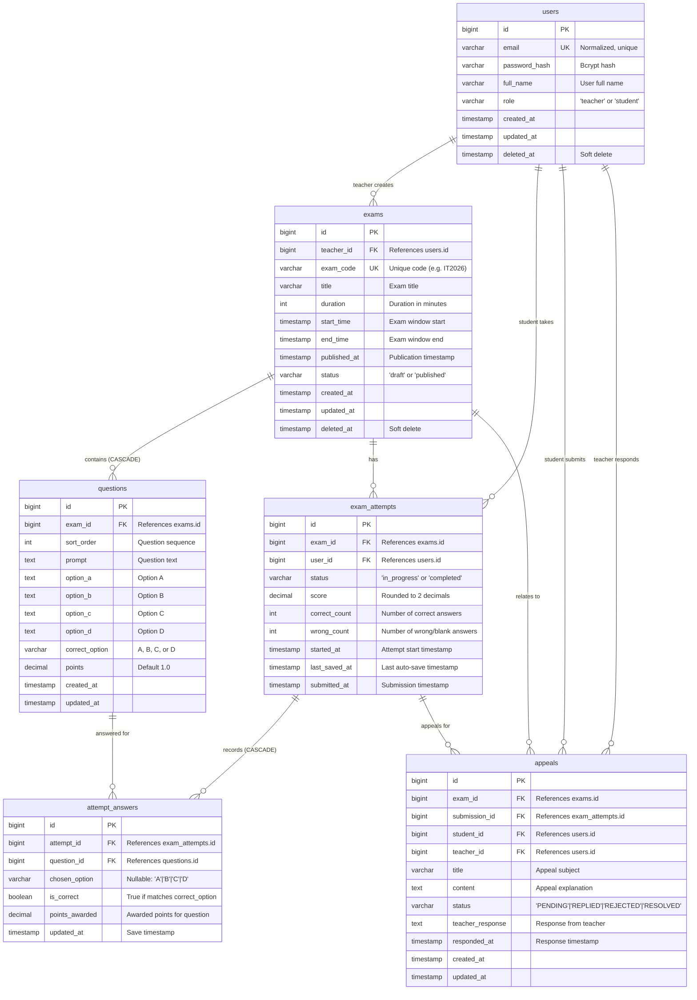
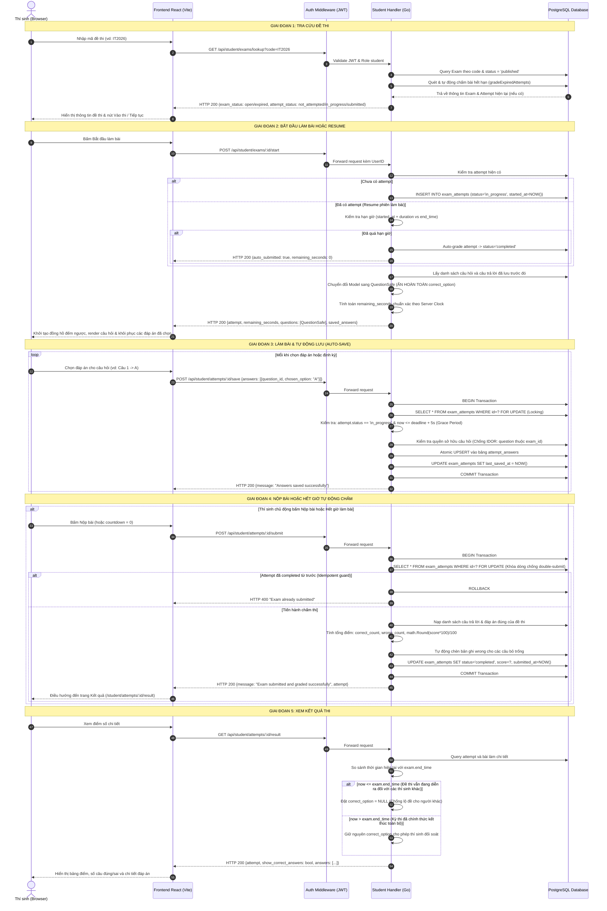
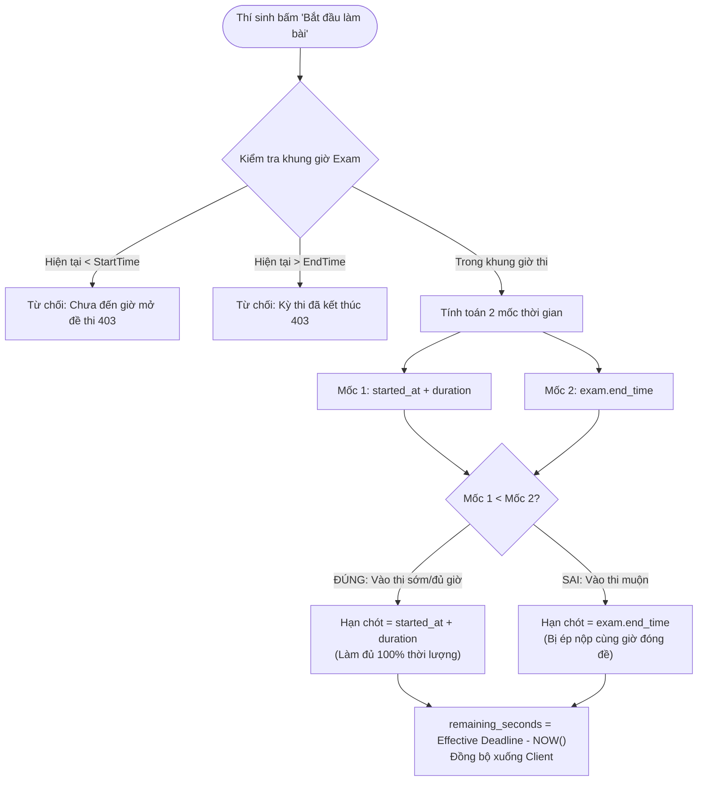

# BÁO CÁO THIẾT KẾ KIẾN TRÚC VÀ BẢO MẬT HỆ THỐNG
## DỰ ÁN: HỆ THỐNG THI TRẮC NGHIỆM TRỰC TUYẾN (EXAM MVP)

---

## 1. TỔNG QUAN KIẾN TRÚC HỆ THỐNG (SYSTEM ARCHITECTURE OVERVIEW)

Hệ thống **Online Exam MVP** được xây dựng theo mô hình **Client-Server kiến trúc phân tầng (Layered Clean Architecture)**, tách biệt độc lập giữa tầng hiển thị giao diện (Frontend SPA) và tầng xử lý nghiệp vụ/lưu trữ dữ liệu (Backend RESTful API & Relational Database).

```
+-------------------------------------------------------------------------+
|                         CLIENT LAYER (BROWSER)                          |
|   React 19 + Vite + TailwindCSS + React Router v6 + Axios Interceptor   |
+-------------------------------------------------------------------------+
                                    |
                            HTTP/REST (JSON)
                    Authorization: Bearer <JWT Token>
                                    v
+-------------------------------------------------------------------------+
|                         BACKEND LAYER (GOLANG)                          |
|  +-------------------------------------------------------------------+  |
|  | Gin Gonic Engine + CORS Middleware (5173, 3000)                   |  |
|  +-------------------------------------------------------------------+  |
|  | Auth Middleware: JWT Verification & RBAC Guard (Teacher / Student)|  |
|  +-------------------------------------------------------------------+  |
|  | Handlers: Auth, Teacher Management, Student Examination & Appeals |  |
|  +-------------------------------------------------------------------+  |
|  | Security Guards: QuestionSafe DTO, Dual-Timer, FOR UPDATE Lock   |  |
|  +-------------------------------------------------------------------+  |
|  | Data Access: GORM ORM (Transactions, Atomic UPSERT, Prepared Stmt)|  |
|  +-------------------------------------------------------------------+  |
+-------------------------------------------------------------------------+
                                    |
                           Database Driver (TCP)
                                    v
+-------------------------------------------------------------------------+
|                        PERSISTENCE LAYER (RDBMS)                        |
|       PostgreSQL 15 (Docker) / SQLite In-Memory (Test Suite)            |
|       6 Normalized Tables + 2 Unique Composite Indexes                  |
+-------------------------------------------------------------------------+
```

### 1.1. Công nghệ lựa chọn (Tech Stack) & Lý do kỹ thuật
- **Backend - Golang (Gin Framework & GORM)**: 
  - Khả năng xử lý đa luồng đồng thời (concurrency) vượt trội thông qua cơ chế Goroutine, tiêu tốn ít bộ nhớ RAM, rất phù hợp cho các kịch bản hàng trăm/hàng nghìn thí sinh cùng nộp bài hoặc auto-save đồng thời.
  - Gin Framework cung cấp router Radix tree tốc độ cao, khả năng benchmark hàng chục nghìn req/s với độ trễ micro-giây.
- **Database - PostgreSQL 15**: 
  - Hệ quản trị cơ sở dữ liệu quan hệ mạnh mẽ, chuẩn ACID, hỗ trợ tính năng khoá dòng bi quan (`SELECT ... FOR UPDATE`), câu lệnh `ON CONFLICT DO UPDATE` (Atomic UPSERT) và Composite Unique Index, loại bỏ hoàn toàn nguy cơ mất toàn vẹn dữ liệu.
- **Frontend - React 19, Vite & TailwindCSS**: 
  - Vite tối ưu tốc độ đóng gói (Hot Module Replacement cực nhanh).
  - Axios Interceptor xử lý đính kèm Bearer JWT tự động vào toàn bộ các request có bảo mật.
  - Phân vùng trạng thái và điều hướng theo vai trò người dùng (Role-Based Routing).

---

## 2. THIẾT KẾ CƠ SỞ DỮ LIỆU & SƠ ĐỒ ERD (DATABASE SCHEMA & ERD)

Cơ sở dữ liệu được chuẩn hóa ở dạng chuẩn 3NF (Third Normal Form) gồm đúng **6 bảng cốt lõi**, phản ánh chính xác nghiệp vụ khảo thí và phúc khảo khiếu nại.

### 2.1. Sơ đồ thực thể liên kết (ERD Diagram)



### 2.2. Phân tích chi tiết các bảng dữ liệu

1. **`users`**:
   - Lưu trữ thông tin tài khoản người dùng với phân quyền (`role`: `teacher` | `student`).
   - Cột `email` có ràng buộc `UNIQUE` và được chuẩn hóa chữ thường trước khi lưu.
   - Mật khẩu lưu dưới dạng Bcrypt hash an toàn (chiều dài password đầu vào giới hạn tối đa 72 bytes để tránh lỗi cắt chuỗi của Bcrypt).
   - Hỗ trợ Soft-delete qua cột `deleted_at` (`gorm.DeletedAt`).

2. **`exams`**:
   - Chứa thông tin đề thi do Giảng viên tạo (`teacher_id`).
   - `exam_code`: Mã kỳ thi gồm chữ hoa/số ngẫu nhiên (hoặc mã định danh như `IT2026`), có ràng buộc `UNIQUE`.
   - `status`: Quản lý trạng thái đề thi (`draft`: đang soạn thảo; `published`: đã phát hành). Đề thi chỉ được phép xuất bản khi có ít nhất 1 câu hỏi, và khi đã xuất bản thì nghiêm cấm thêm/xóa câu hỏi.
   - `start_time` và `end_time`: Xác định khung giờ mở cửa kỳ thi trên hệ thống.
   - `published_at`: Lưu mốc thời gian xuất bản chính thức của đề thi.

3. **`questions`**:
   - Lưu nội dung câu hỏi trắc nghiệm 4 đáp án (A, B, C, D) và đáp án đúng (`correct_option`).
   - Có khóa ngoại `exam_id` trỏ đến `exams.id` với hành vi `ON DELETE CASCADE`.
   - Có cột `points` (mặc định 1.0) cho phép thiết lập trọng số điểm linh hoạt từng câu.

4. **`exam_attempts`**:
   - Đại diện cho một lượt làm bài của một thí sinh cụ thể với một đề thi cụ thể.
   - `started_at`: Thời điểm thí sinh bấm nút bắt đầu làm bài.
   - `status`: Chuyển đổi trạng thái từ `in_progress` sang `completed` khi nộp bài hoặc khi bị hệ thống cưỡng chế auto-submit do hết giờ.
   - `score`, `correct_count`, `wrong_count`: Lưu kết quả chấm thi cuối cùng.

5. **`attempt_answers`**:
   - Lưu trữ chi tiết lựa chọn của thí sinh cho từng câu hỏi trong bài thi.
   - `chosen_option`: Lựa chọn của thí sinh (`A`, `B`, `C`, `D` hoặc `NULL` nếu thí sinh chưa chọn).
   - `is_correct` và `points_awarded`: Được tính toán và cập nhật khi bài thi được nộp và chấm điểm.

6. **`appeals`**:
   - Lưu trữ đơn khiếu nại/phúc khảo điểm thi của thí sinh gửi lên giảng viên phụ trách môn thi.
   - Liên kết 4 khóa ngoại: `exam_id`, `submission_id`, `student_id`, `teacher_id`.
   - `status`: Quản lý tiến trình xử lý đơn (`PENDING`: Chờ xử lý, `REPLIED`: Đã phản hồi, `REJECTED`: Đã từ chối, `RESOLVED`: Đã xử lý).
   - `teacher_response`: Nội dung giải trình, nhận xét từ giảng viên.
   - `responded_at`: Mốc thời gian phản hồi gần nhất của giảng viên.

---

### 2.3. Phân tích 2 Unique Composite Index đặc tả

Cơ sở dữ liệu được trang bị 2 chỉ mục tổng hợp duy nhất (Unique Composite Indexes) đóng vai trò then chốt trong việc bảo vệ tính toàn vẹn dữ liệu:

#### Index 1: `idx_exam_attempts_exam_user`
```sql
CREATE UNIQUE INDEX IF NOT EXISTS idx_exam_attempts_exam_user
ON exam_attempts (exam_id, user_id);
```
- **Mục đích nghiệp vụ**: Ràng buộc nguyên tắc tối cao của thi trắc nghiệm: **Mỗi học sinh chỉ được phép có duy nhất 1 lượt làm bài (`exam_attempt`) cho một đề thi cụ thể**. Ngăn chặn hoàn toàn việc thí sinh gian lận tạo nhiều bài thi để làm lại từ đầu.
- **Điểm cải tiến kỹ thuật (Vá lỗi Migration)**: Ban đầu index có mệnh đề `WHERE deleted_at IS NULL`. Tuy nhiên, bảng `exam_attempts` không sử dụng soft-delete (không có cột `deleted_at`). Do đó, mệnh đề này đã được loại bỏ để tránh lỗi cú pháp `column "deleted_at" does not exist` trên PostgreSQL, đảm bảo câu lệnh migration thực thi thành công 100%.

#### Index 2: `idx_attempt_answers_attempt_question`
```sql
CREATE UNIQUE INDEX IF NOT EXISTS idx_attempt_answers_attempt_question
ON attempt_answers (attempt_id, question_id);
```
- **Mục đích nghiệp vụ & Kỹ thuật**:
  - Đảm bảo trong một bài thi (`attempt_id`), mỗi câu hỏi (`question_id`) chỉ tồn tại duy nhất một bản ghi câu trả lời.
  - Đây là điều kiện tiên quyết bắt buộc để thực hiện câu lệnh **Atomic UPSERT** khi auto-save:
    ```sql
    INSERT INTO attempt_answers (attempt_id, question_id, chosen_option, is_correct, points_awarded, updated_at)
    VALUES (?, ?, ?, false, 0, ?)
    ON CONFLICT (attempt_id, question_id)
    DO UPDATE SET chosen_option = EXCLUDED.chosen_option, updated_at = EXCLUDED.updated_at;
    ```
  - Khi thí sinh thay đổi câu trả lời nhiều lần, cơ sở dữ liệu sẽ tự động thực hiện `UPDATE` thay vì `INSERT`, loại bỏ hiện tượng trùng lặp bản ghi mà không cần phải thực hiện 2 câu lệnh `SELECT` và `UPDATE` riêng biệt (giảm tải 50% số lượng query I/O).

---

## 3. SƠ ĐỒ LUỒNG NGHIỆP VỤ (BUSINESS PROCESS FLOWS)

### 3.1. Luồng A: Vòng đời làm bài thi trắc nghiệm (Exam Lifecycle Sequence)
Quy trình từ lúc Thí sinh tra cứu, Bắt đầu thi, Auto-save liên tục, Nộp bài (hoặc hết giờ tự động chấm) và Xem điểm số.



---

### 3.2. Luồng B: Cơ chế 2 đồng hồ (Dual-Timer Mechanism)

Một trong những bài toán phức tạp nhất của hệ thống khảo thí trực tuyến là quản lý thời gian thi công bằng giữa các thí sinh. Hệ thống giải quyết triệt để thông qua **cơ chế 2 đồng hồ song song**:

1. **Đồng hồ 1: Khung giờ mở đề thi (Exam Window)**:
   - Được định nghĩa bởi `[exam.start_time, exam.end_time]`.
   - Đây là khoảng thời gian kỳ thi được phép diễn ra trên hệ thống (ví dụ: Từ 08:00 đến 10:00 sáng).
2. **Đồng hồ 2: Thời lượng làm bài của thí sinh (Attempt Duration)**:
   - Được định nghĩa bởi `exam.duration` (số phút, ví dụ: 45 phút).
   - Thời gian làm bài cá nhân bắt đầu tính từ thời điểm thí sinh bấm nút vào thi (`attempt.started_at`).

#### Công thức xác định hạn chót nộp bài thực tế (Effective Deadline):
Hạn chót làm bài thực tế của một lượt thi luôn là giá trị **nhỏ hơn** giữa hai mốc thời gian:

$$\text{Effective Deadline} = \min\Big(\text{started\_at} + \text{duration}, \;\; \text{exam.end\_time}\Big)$$

Và thời gian còn lại (tính bằng giây) trả về cho client:

$$\text{remaining\_seconds} = \max\Big(0, \;\; \text{Effective Deadline} - \text{ServerTimeNow}\Big)$$



---

## 4. ĐIỂM NHẤN KỸ THUẬT & CÁC BẢN VÁ BẢO MẬT (SECURITY & TECHNICAL HIGHLIGHTS)

### 4.1. Chống lộ đáp án trắc nghiệm (Zero-Leak Data Transfer Object - DTO)
- **Nguy cơ tiềm ẩn**: Nếu serialize trực tiếp GORM Model `Question` trả về cho học sinh, trường `correct_option` sẽ nằm trong payload JSON. Thí sinh chỉ cần bấm F12 mở tab Network là có thể xem được toàn bộ đáp án đề thi trước khi làm bài.
- **Giải pháp kỹ thuật**:
  - Xây dựng DTO struct `QuestionSafe` loại bỏ hoàn toàn trường `CorrectOption`:
    ```go
    type QuestionSafe struct {
        ID        uint    `json:"id"`
        ExamID    uint    `json:"exam_id"`
        SortOrder int     `json:"sort_order"`
        Prompt    string  `json:"prompt"`
        OptionA   string  `json:"option_a"`
        OptionB   string  `json:"option_b"`
        OptionC   string  `json:"option_c"`
        OptionD   string  `json:"option_d"`
        Points    float64 `json:"points"`
    }
    ```
  - Tại API `StudentStartExam`, 100% câu hỏi được chuyển đổi qua hàm `models.ToQuestionSafe(q)` trước khi gửi về client.
  - **Bảo mật kép tại trang Xem kết quả (`StudentGetResult`)**: Kể cả sau khi nộp bài, nếu đề thi vẫn đang mở (`now.Before(exam.EndTime)`), trường `correct_option` của toàn bộ các câu hỏi vẫn bị ẩn (`nil`). Chỉ khi toàn bộ khung giờ thi kết thúc (`now.After(exam.EndTime)`), thí sinh mới được phép xem đáp án đúng.

---

### 4.2. Chống gian lận thời gian (Server-Authoritative Clock & Grace Period)
- **Nguy cơ tiềm ẩn**: Nếu tin cậy đồng hồ phía Client (JavaScript `Date.now()`), thí sinh có thể chỉnh lùi giờ hệ điều hành trên máy tính để kéo dài thời gian làm bài vô tận.
- **Giải pháp kỹ thuật**:
  - **Server-Authoritative**: Mọi phép tính toán thời gian bắt đầu, thời hạn kết thúc và thời gian còn lại đều lấy mốc từ `time.Now()` trên máy chủ Backend.
  - **Vùng đệm mạng (Network Grace Period)**: Khi gửi request lưu đáp án (`/save`) hoặc nộp bài (`/submit`), hệ thống cho phép vùng đệm trễ mạng 5 giây (`const saveGracePeriod = 5 * time.Second`):
    - Nếu request gửi lên trong khoảng `deadline < now <= deadline + 5s`: Hệ thống vẫn chấp nhận lưu đáp án cuối cùng để bù trừ độ trễ mạng (latency/jitter) của thí sinh.
    - Nếu `now > deadline + 5s`: Hệ thống từ chối lưu đáp án mới, tự động kích hoạt hàm chấm bài dựa trên các đáp án đã lưu hợp lệ trước đó và trả về mã lỗi `409 Conflict`.
  - **Cơ chế quét bài thi hết hạn bị động (Lazy Expiration Grading)**: Khi giáo viên mở bảng điểm hoặc khi học sinh tra cứu đề thi, hàm `gradeExpiredAttempts` tự động chấm điểm toàn bộ các bài thi quá hạn chưa nộp.

---

### 4.3. Chống Race Condition & Double Submit (Pessimistic Locking `FOR UPDATE`)
- **Nguy cơ tiềm ẩn**: Thí sinh mở nhiều tab trình duyệt gửi song song request `/submit` hoặc `/save` gây xung đột dữ liệu.
- **Giải pháp kỹ thuật**:
  - Bọc toàn bộ quy trình chấm thi và lưu bài trong một **Database Transaction** nguyên tử (`config.DB.Transaction`).
  - Khóa dòng bi quan bằng GORM clause:
    ```go
    err := config.DB.Transaction(func(tx *gorm.DB) error {
        var attempt models.ExamAttempt
        if err := tx.Clauses(clause.Locking{Strength: "UPDATE"}).
            Where("id = ? AND user_id = ?", attemptID, userID).
            First(&attempt).Error; err != nil {
            return err
        }
        if attempt.Status != "in_progress" {
            return errAlreadySubmitted
        }
        ...
    ```
  - Khi một request đang giữ khóa `FOR UPDATE`, tất cả các request song song khác gửi đến cùng một `attempt_id` bắt buộc phải xếp hàng chờ. Request đầu tiên hoàn thành sẽ đổi trạng thái `status = 'completed'`, các request sau sẽ bị từ chối ngay lập tức.

---

### 4.4. Chống lỗ hổng IDOR chéo đề thi (Insecure Direct Object Reference)
- **Nguy cơ tiềm ẩn**: Thí sinh can thiệp payload gửi lên API `/save` hoặc `/submit`, cố tình chèn `question_id` thuộc về đề thi khác.
- **Giải pháp kỹ thuật**:
  - Hàm `upsertAnswers` truy vấn danh sách `validIDs` thuộc đề thi, kiểm tra mọi câu hỏi trong payload. Nếu có câu hỏi không thuộc đề, transaction bị rollback và trả về `400 Bad Request`.
  - Tại API khiếu nại (`/student/appeals`), hệ thống xác thực `submissionId` phải thuộc về chính sinh viên đó và ở trạng thái `completed`.

---

### 4.5. Chống SQL Injection & Kiểm soát phân quyền chặt chẽ
- **Chống SQL Injection**: 100% truy vấn dùng Parameterized Query qua GORM; các tham số trên URL đều được kiểm tra kiểu dữ liệu an toàn bằng hàm `parseUintParam`.
- **Phân quyền sở hữu chặt chẽ**:
  - Trong `TeacherDeleteQuestion`, xác thực câu hỏi thuộc về đề thi của giáo viên đó và đề phải đang ở trạng thái `draft`.
  - Trong `TeacherGetAppeal` và `updateAppealStatus`, xác thực khiếu nại thuộc về kỳ thi do chính giáo viên đó quản lý.
- **Chuẩn hóa dữ liệu đầu vào**:
  - Hàm `normalizeEmail` (`strings.ToLower(strings.TrimSpace(email))`) chống bypass kiểm tra trùng lặp email.
  - Giới hạn độ dài mật khẩu `max=72` để tương thích với thuật toán Bcrypt.

---

### 4.6. Thuật toán chấm điểm chuẩn xác
- Duyệt qua toàn bộ danh sách câu hỏi chính thức của đề thi, tự động bổ sung câu sai cho các câu bỏ trống, đảm bảo $\text{correct\_count} + \text{wrong\_count} \equiv \text{total\_questions}$.
- Điểm số được làm tròn 2 chữ số thập phân bằng `math.Round(totalScore * 100) / 100` để khử sai số số thực.

---

## 5. DANH MỤC API ENDPOINTS TOÀN DIỆN (API ENDPOINTS SPECIFICATION)

Tất cả các API yêu cầu xác thực đều phải đính kèm Header:
`Authorization: Bearer <jwt_token>`

### 5.1. Authentication APIs (Public)
| Method | Endpoint | Yêu cầu Body | Mã phản hồi | Mô tả |
| :--- | :--- | :--- | :--- | :--- |
| `POST` | `/api/auth/register` | `{full_name, email, password}` | `201 Created` / `400` / `409` | Đăng ký tài khoản sinh viên mới |
| `POST` | `/api/auth/login` | `{email, password}` | `200 OK` / `400` / `401` | Đăng nhập hệ thống, trả về Token & User Info |

### 5.2. Teacher APIs (Yêu cầu Role = `teacher`)
| Method | Endpoint | Yêu cầu Body | Mã phản hồi | Mô tả |
| :--- | :--- | :--- | :--- | :--- |
| `GET` | `/api/teacher/exams` | Không | `200 OK` | Lấy danh sách đề thi do giáo viên hiện tại tạo |
| `POST` | `/api/teacher/exams` | `{title, duration, start_time, end_time}` | `201 Created` / `400` | Tạo đề thi mới (trạng thái `draft`, sinh `exam_code`) |
| `GET` | `/api/teacher/exams/:id` | Không | `200 OK` / `404` | Xem chi tiết đề thi kèm danh sách câu hỏi |
| `POST` | `/api/teacher/exams/:id/questions` | `{questions: [{prompt, option_a, ...}]}` | `201 Created` / `400` | Thêm danh sách câu hỏi vào đề thi (khi đề đang `draft`) |
| `DELETE`| `/api/teacher/questions/:question_id` | Không | `200 OK` / `400` / `403` / `404` | Xóa câu hỏi khỏi đề thi (khi đề đang `draft`) |
| `PATCH`| `/api/teacher/exams/:id/publish` | Không | `200 OK` / `400` / `404` | Xuất bản đề thi (yêu cầu tối thiểu 1 câu hỏi) |
| `GET` | `/api/teacher/exams/:id/results` | Không | `200 OK` / `404` | Thống kê kết quả thi: Tổng số HS, Điểm TB, Min/Max |
| `GET` | `/api/teacher/exams/:id/appeals` | Query: `page`, `page_size`, `status`, `q` | `200 OK` / `404` | Lấy danh sách đơn khiếu nại của một đề thi |
| `GET` | `/api/teacher/appeals/:appealId` | Không | `200 OK` / `404` | Xem chi tiết một đơn khiếu nại kèm bài làm thí sinh |
| `PATCH`| `/api/teacher/appeals/:appealId/reply` | `{response}` | `200 OK` / `400` / `404` / `409` | Phản hồi ý kiến cho khiếu nại |
| `PATCH`| `/api/teacher/appeals/:appealId/reject` | `{response}` (tùy chọn) | `200 OK` / `404` / `409` | Từ chối đơn khiếu nại |
| `PATCH`| `/api/teacher/appeals/:appealId/resolve` | `{response}` (tùy chọn) | `200 OK` / `404` / `409` | Chấp thuận / giải quyết xong đơn khiếu nại |

### 5.3. Student APIs (Yêu cầu Role = `student`)
| Method | Endpoint | Yêu cầu Body / Query Param | Mã phản hồi | Mô tả |
| :--- | :--- | :--- | :--- | :--- |
| `GET` | `/api/student/exams/lookup` | Query: `?code=XYZ` | `200 OK` / `400` / `404` | Tra cứu đề thi đã xuất bản theo mã kỳ thi |
| `GET` | `/api/student/attempts` | Không | `200 OK` | Xem lịch sử các lượt thi gần đây của thí sinh |
| `GET` | `/api/student/history` | Query: `page`, `page_size`, `q`, `appeal_status` | `200 OK` | Lấy lịch sử các bài thi đã hoàn thành (phân trang) |
| `GET` | `/api/student/history/:submissionId` | Không | `200 OK` / `404` | Xem chi tiết bài làm đã hoàn thành và danh sách khiếu nại |
| `POST` | `/api/student/appeals` | `{submissionId, title, content}` | `201 Created` / `400` / `404` / `409` | Gửi đơn khiếu nại điểm thi |
| `POST` | `/api/student/exams/:id/start` | Không | `200 OK` / `400` / `403` / `404` | Bắt đầu hoặc Resume bài thi. Trả về `QuestionSafe` |
| `POST` | `/api/student/attempts/:id/save`| `{answers: [{question_id, chosen_option}]}` | `200 OK` / `400` / `409` | Auto-save câu trả lời (Atomic UPSERT) |
| `POST` | `/api/student/attempts/:id/submit`| `{answers: [...]}` (tùy chọn) | `200 OK` / `400` / `404` | Nộp bài thi và chấm điểm tự động trong DB Transaction |
| `GET` | `/api/student/attempts/:id/result`| Không | `200 OK` / `400` / `404` | Xem điểm số và đối soát bài làm sau khi nộp |

### 5.4. System Health API (Public)
| Method | Endpoint | Yêu cầu Body | Mã phản hồi | Mô tả |
| :--- | :--- | :--- | :--- | :--- |
| `GET` | `/health` | Không | `200 OK` | Health-check dịch vụ Backend |

---

## 6. ĐÁNH GIÁ KẾT QUẢ VÀ HƯỚNG PHÁT TRIỂN (EVALUATION & ROADMAP)

### 6.1. Đánh giá chất lượng phần mềm
- **Độ tin cậy (Reliability)**: Bộ kiểm thử tự động `backend/main_test.go` thực thi qua toàn bộ kịch bản nghiệp vụ (xác thực, đề thi, làm bài, auto-save, nộp bài, tính điểm, lịch sử bài làm, khiếu nại) đạt tỉ lệ thành công **100% PASS**.
- **Tính toàn vẹn (Data Integrity)**: Áp dụng triệt để ACID Transactions và Foreign Key Cascades, không có bản ghi mồ côi.
- **Giao diện tối giản (Clean UI)**: Loại bỏ toàn bộ các thành phần trang trí không cần thiết, áp dụng bảng màu trung tính, bố cục rõ ràng, tối ưu trải nghiệm người dùng trong môi trường giáo dục đại học.

### 6.2. Hướng mở rộng cho phiên bản tiếp theo
1. **Giám sát thời gian thực (Real-time Proctoring)**: Tích hợp WebSocket để phát hiện thí sinh rời màn hình làm bài thi.
2. **Ngân hàng câu hỏi & Xáo trộn đề**: Tự động sinh đề và xáo trộn thứ tự câu hỏi cũng như thứ tự 4 đáp án cho từng thí sinh.
3. **Phân phối tải (Rate Limiting & Caching)**: Áp dụng Redis cache và giới hạn tần suất gửi request cho các API auto-save.
