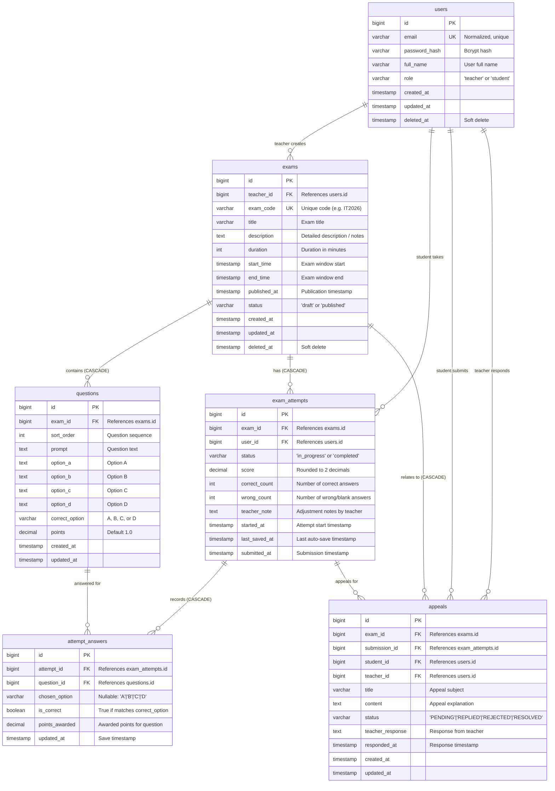
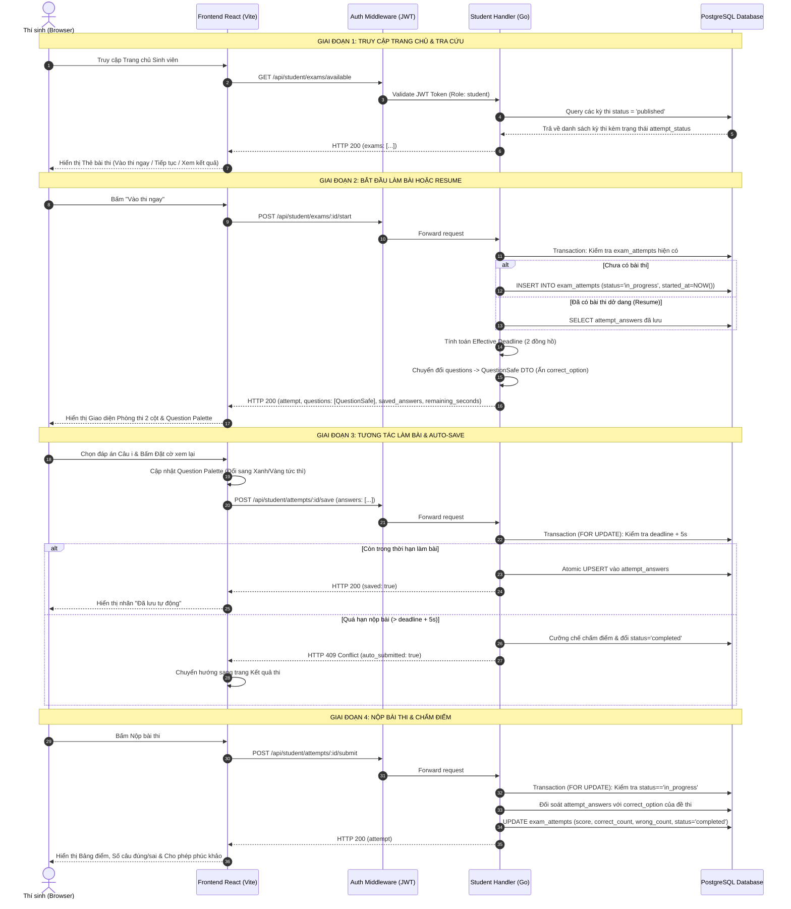
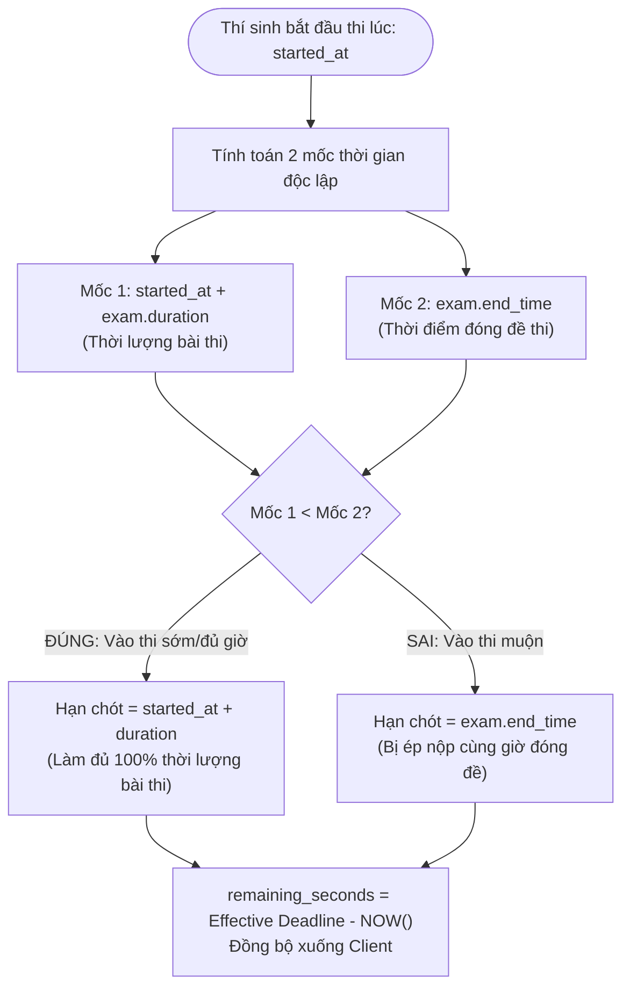

# BÁO CÁO THIẾT KẾ KIẾN TRÚC VÀ BẢO MẬT HỆ THỐNG
## DỰ ÁN: HỆ THỐNG THI TRẮC NGHIỆM TRỰC TUYẾN ĐẠI HỌC (UNIVERSITY EXAMINATION SYSTEM)

---

## 1. TỔNG QUAN KIẾN TRÚC HỆ THỐNG (SYSTEM ARCHITECTURE OVERVIEW)

Hệ thống **Online Examination System** được xây dựng theo mô hình **Client-Server kiến trúc phân tầng (Layered Clean Architecture)**, tách biệt độc lập giữa tầng hiển thị giao diện (Frontend SPA) và tầng xử lý nghiệp vụ/lưu trữ dữ liệu (Backend RESTful API & Relational Database).

```
+-------------------------------------------------------------------------+
|                         CLIENT LAYER (BROWSER)                          |
|   React 19 + Vite + TailwindCSS + React Router v6 + Axios Interceptor   |
|   Phòng thi chuẩn hóa 2 cột: Khối câu hỏi + Bảng điều khiển 1..N       |
+-------------------------------------------------------------------------+
                                    |
                            HTTP/REST (JSON)
                    Authorization: Bearer <JWT Token>
                                    v
+-------------------------------------------------------------------------+
|                         BACKEND LAYER (GOLANG)                          |
|  +-------------------------------------------------------------------+  |
|  | Gin Gonic Engine + CORS Middleware (Cổng 8081)                    |  |
|  +-------------------------------------------------------------------+  |
|  | Auth Middleware: JWT Verification & RBAC Guard (Teacher / Student)|  |
|  +-------------------------------------------------------------------+  |
|  | Handlers:                                                         |  |
|  |   - Auth & User Management                                        |  |
|  |   - Teacher Examination & Question Full CRUD + Bulk Import        |  |
|  |   - Teacher Score Overrides & Attempt Reset (DB Transactions)     |  |
|  |   - Teacher Student Account Management (CRUD)                     |  |
|  |   - Student Available Exams Portal & Real-time Exam Room          |  |
|  |   - History & Academic Appeals Workflow                           |  |
|  +-------------------------------------------------------------------+  |
|  | Security Guards: QuestionSafe DTO, Dual-Timer, FOR UPDATE Lock   |  |
|  +-------------------------------------------------------------------+  |
|  | Data Access: GORM ORM (Transactions, Atomic UPSERT, Prepared Stmt)|  |
|  +-------------------------------------------------------------------+  |
+-------------------------------------------------------------------------+
                                    |
                            Database Driver (TCP)
                                    v
+-------------------------------------------------------------------------+
|                        PERSISTENCE LAYER (RDBMS)                        |
|       PostgreSQL 15 (Docker) / SQLite In-Memory (Test Suite)            |
|       6 Normalized Tables + 2 Unique Composite Indexes + Cascades       |
+-------------------------------------------------------------------------+
```

### 1.1. Công nghệ lựa chọn (Tech Stack) & Lý do kỹ thuật
- **Backend - Golang (Gin Framework & GORM)**: 
  - Khả năng xử lý đa luồng đồng thời (concurrency) vượt trội thông qua cơ chế Goroutine, tiêu tốn rất ít bộ nhớ RAM, đáp ứng hoàn hảo kịch bản hàng trăm hoặc hàng nghìn thí sinh cùng nộp bài hoặc auto-save đồng thời.
  - Gin Framework cung cấp router Radix tree tốc độ cao, khả năng benchmark hàng chục nghìn req/s với độ trễ micro-giây.
- **Database - PostgreSQL 15**: 
  - Hệ quản trị cơ sở dữ liệu quan hệ mạnh mẽ, chuẩn ACID, hỗ trợ tính năng khoá dòng bi quan (`SELECT ... FOR UPDATE`), câu lệnh nguyên tử `ON CONFLICT DO UPDATE` (Atomic UPSERT) và Composite Unique Index, loại bỏ hoàn toàn nguy cơ mất toàn vẹn dữ liệu.
- **Frontend - React 19, Vite & TailwindCSS**: 
  - Vite tối ưu tốc độ đóng gói (Hot Module Replacement cực nhanh).
  - Axios Interceptor xử lý đính kèm Bearer JWT tự động vào toàn bộ các request có bảo mật.
  - Phân vùng trạng thái và điều hướng theo vai trò người dùng (Role-Based Routing).
  - Giao diện phòng thi trực tuyến thiết kế tối giản, loại bỏ hoàn toàn biểu tượng cảm xúc (emojis) màu mè, hướng tới trải nghiệm học thuật chuyên nghiệp của môi trường đại học.

---

## 2. THIẾT KẾ CƠ SỞ DỮ LIỆU & SƠ ĐỒ ERD (DATABASE SCHEMA & ERD)

Cơ sở dữ liệu được chuẩn hóa ở dạng chuẩn 3NF (Third Normal Form) gồm đúng **6 bảng cốt lõi**, phản ánh chính xác nghiệp vụ khảo thí, quản trị học viên và phúc khảo khiếu nại.

### 2.1. Sơ đồ thực thể liên kết (ERD Diagram)



### 2.2. Phân tích chi tiết các bảng dữ liệu

1. **`users`**:
   - Lưu trữ thông tin tài khoản người dùng với phân quyền (`role`: `teacher` | `student`).
   - Cột `email` có ràng buộc `UNIQUE` và được chuẩn hóa chữ thường trước khi lưu.
   - Mật khẩu lưu dưới dạng Bcrypt hash an toàn.
   - Hỗ trợ Soft-delete qua cột `deleted_at`.

2. **`exams`**:
   - Chứa thông tin đề thi do Giảng viên tạo (`teacher_id`).
   - `exam_code`: Mã kỳ thi gồm chữ hoa/số ngẫu nhiên (hoặc mã định danh như `IT2026`), có ràng buộc `UNIQUE`.
   - `description`: Lưu trữ mô tả đề thi, ghi chú nội dung môn thi.
   - `status`: Quản lý trạng thái đề thi (`draft`: đang soạn thảo; `published`: đã phát hành). Đề thi chỉ được phép xuất bản khi có ít nhất 1 câu hỏi.
   - `start_time` và `end_time`: Xác định khung giờ mở cửa kỳ thi trên hệ thống.
   - `published_at`: Lưu mốc thời gian xuất bản chính thức của đề thi.

3. **`questions`**:
   - Lưu nội dung câu hỏi trắc nghiệm 4 đáp án (A, B, C, D) và đáp án đúng (`correct_option`).
   - Khóa ngoại `exam_id` trỏ đến `exams.id`.
   - Cột `points` (mặc định 1.0) cho phép thiết lập trọng số điểm linh hoạt từng câu.

4. **`exam_attempts`**:
   - Đại diện cho một lượt làm bài của một thí sinh cụ thể đối với một đề thi cụ thể.
   - `started_at`: Thời điểm thí sinh bấm nút bắt đầu làm bài.
   - `status`: Chuyển đổi trạng thái từ `in_progress` sang `completed` khi nộp bài hoặc khi bị hệ thống cưỡng chế auto-submit do hết giờ.
   - `score`, `correct_count`, `wrong_count`: Lưu kết quả chấm thi cuối cùng.
   - `teacher_note`: Lưu trữ ghi chú của giảng viên khi điều chỉnh điểm thi hoặc can thiệp bài làm.

5. **`attempt_answers`**:
   - Lưu trữ chi tiết lựa chọn của thí sinh cho từng câu hỏi trong bài thi.
   - `chosen_option`: Lựa chọn của thí sinh (`A`, `B`, `C`, `D` hoặc `NULL` nếu thí sinh chưa chọn).
   - `is_correct` và `points_awarded`: Được tính toán và cập nhật khi bài thi được nộp và chấm điểm.

6. **`appeals`**:
   - Lưu trữ đơn khiếu nại/phúc khảo điểm thi của thí sinh gửi lên giảng viên phụ trách môn thi.
   - Liên kết 4 khóa ngoại: `exam_id`, `submission_id`, `student_id`, `teacher_id`.
   - `status`: Quản lý tiến trình xử lý đơn (`PENDING`: Chờ xử lý, `REPLIED`: Đã phản hồi, `REJECTED`: Đã từ chối, `RESOLVED`: Đã xử lý).

---

### 2.3. Phân tích 2 Unique Composite Index đặc tả

Cơ sở dữ liệu được trang bị 2 chỉ mục tổng hợp duy nhất (Unique Composite Indexes):

#### Index 1: `idx_exam_attempts_exam_user`
```sql
CREATE UNIQUE INDEX IF NOT EXISTS idx_exam_attempts_exam_user
ON exam_attempts (exam_id, user_id);
```
- **Mục đích nghiệp vụ**: Ràng buộc nguyên tắc tối cao của thi trắc nghiệm: **Mỗi học sinh chỉ được phép có duy nhất 1 lượt làm bài (`exam_attempt`) cho một đề thi cụ thể**. Ngăn chặn hoàn toàn việc thí sinh gian lận tạo nhiều bài thi để làm lại từ đầu.
- **Cơ chế Reset Attempt**: Khi thí sinh gặp sự cố mạng hoặc lỗi kỹ thuật, giảng viên sử dụng chức năng "Cho thi lại" (`DELETE /api/teacher/attempts/:id`), lượt làm bài cũ bị xóa vĩnh viễn trong Transaction, qua đó giải phóng Unique Index này và cho phép sinh viên bắt đầu lại một lượt thi mới hợp lệ.

#### Index 2: `idx_attempt_answers_attempt_question`
```sql
CREATE UNIQUE INDEX IF NOT EXISTS idx_attempt_answers_attempt_question
ON attempt_answers (attempt_id, question_id);
```
- **Mục đích nghiệp vụ & Kỹ thuật**:
  - Đảm bảo trong một bài thi (`attempt_id`), mỗi câu hỏi (`question_id`) chỉ tồn tại duy nhất một bản ghi câu trả lời.
  - Cho phép thực hiện câu lệnh **Atomic UPSERT** khi auto-save:
    ```sql
    INSERT INTO attempt_answers (attempt_id, question_id, chosen_option, is_correct, points_awarded, updated_at)
    VALUES (?, ?, ?, false, 0, ?)
    ON CONFLICT (attempt_id, question_id)
    DO UPDATE SET chosen_option = EXCLUDED.chosen_option, updated_at = EXCLUDED.updated_at;
    ```
  - Khi thí sinh thay đổi câu trả lời nhiều lần, cơ sở dữ liệu sẽ tự động thực hiện `UPDATE` thay vì `INSERT`, loại bỏ hiện tượng trùng lặp bản ghi mà không cần phải thực hiện 2 câu lệnh `SELECT` và `UPDATE` riêng biệt (giảm tải 50% số lượng query I/O).

---

## 3. SƠ ĐỒ LUỒNG NGHIỆP VỤ (BUSINESS PROCESS FLOWS)

### 3.1. Luồng A: Vòng đời làm bài thi trắc nghiệm (Exam Lifecycle Sequence)
Quy trình từ lúc Thí sinh xem danh sách bài thi đang mở, Bắt đầu thi, Tương tác với Bảng điều khiển câu hỏi (Question Palette), Auto-save liên tục, Nộp bài và Xem kết quả.



---

### 3.2. Luồng B: Cơ chế 2 đồng hồ kiểm soát thời gian (Exam Window vs Attempt Duration)

Hệ thống triển khai cơ chế **Server-Authoritative Dual-Clock** để đảm bảo tính công bằng tuyệt đối:



---

## 4. ĐIỂM NHẤN KỸ THUẬT & CÁC BẢN VÁ BẢO MẬT (SECURITY & TECHNICAL HIGHLIGHTS)

### 4.1. Chống lộ đáp án trắc nghiệm (Zero-Leak Data Transfer Object - DTO)
- **Nguy cơ tiềm ẩn**: Nếu serialize trực tiếp GORM Model `Question` trả về cho học sinh, trường `correct_option` sẽ nằm trong payload JSON. Thí sinh chỉ cần bấm F12 mở tab Network là có thể xem được toàn bộ đáp án đề thi trước khi làm bài.
- **Giải pháp kỹ thuật**:
  - Xây dựng DTO struct `QuestionSafe` loại bỏ hoàn toàn trường `CorrectOption`:
    ```go
    type QuestionSafe struct {
        ID        uint    `json:"id"`
        ExamID    uint    `json:"exam_id"`
        SortOrder int     `json:"sort_order"`
        Prompt    string  `json:"prompt"`
        OptionA   string  `json:"option_a"`
        OptionB   string  `json:"option_b"`
        OptionC   string  `json:"option_c"`
        OptionD   string  `json:"option_d"`
        Points    float64 `json:"points"`
    }
    ```
  - Tại API `StudentStartExam`, 100% câu hỏi được chuyển đổi qua hàm `models.ToQuestionSafe(q)` trước khi gửi về client.
  - **Bảo mật kép tại trang Xem kết quả (`StudentGetResult`)**: Kể cả sau khi nộp bài, nếu đề thi vẫn đang mở (`now.Before(exam.EndTime)`), trường `correct_option` của toàn bộ các câu hỏi vẫn bị ẩn (`nil`). Chỉ khi toàn bộ khung giờ thi kết thúc (`now.After(exam.EndTime)`), thí sinh mới được phép xem đáp án đúng.

---

### 4.2. Chống gian lận thời gian (Server-Authoritative Clock & Grace Period)
- **Nguy cơ tiềm ẩn**: Nếu tin cậy đồng hồ phía Client (JavaScript `Date.now()`), thí sinh có thể chỉnh lùi giờ hệ điều hành trên máy tính để kéo dài thời gian làm bài vô tận.
- **Giải pháp kỹ thuật**:
  - **Server-Authoritative**: Mọi phép tính toán thời gian bắt đầu, thời hạn kết thúc và thời gian còn lại đều lấy mốc từ `time.Now()` trên máy chủ Backend.
  - **Vùng đệm mạng (Network Grace Period)**: Khi gửi request lưu đáp án (`/save`) hoặc nộp bài (`/submit`), hệ thống cho phép vùng đệm trễ mạng 5 giây (`const saveGracePeriod = 5 * time.Second`):
    - Nếu request gửi lên trong khoảng `deadline < now <= deadline + 5s`: Hệ thống vẫn chấp nhận lưu đáp án cuối cùng để bù trừ độ trễ mạng (latency/jitter) của thí sinh.
    - Nếu `now > deadline + 5s`: Hệ thống từ chối lưu đáp án mới, tự động kích hoạt hàm chấm bài dựa trên các đáp án đã lưu hợp lệ trước đó và trả về mã lỗi `409 Conflict`.
  - **Cơ chế quét bài thi hết hạn bị động (Lazy Expiration Grading)**: Khi giáo viên mở bảng điểm hoặc khi học sinh tra cứu đề thi, hàm `gradeExpiredAttempts` tự động chấm điểm toàn bộ các bài thi quá hạn chưa nộp.

---

### 4.3. Chống Race Condition & Double Submit (Pessimistic Locking `FOR UPDATE`)
- **Nguy cơ tiềm ẩn**: Thí sinh mở nhiều tab trình duyệt gửi song song request `/submit` hoặc `/save` gây xung đột dữ liệu.
- **Giải pháp kỹ thuật**:
  - Bọc toàn bộ quy trình chấm thi và lưu bài trong một **Database Transaction** nguyên tử (`config.DB.Transaction`).
  - Khóa dòng bi quan bằng GORM clause:
    ```go
    err := config.DB.Transaction(func(tx *gorm.DB) error {
        var attempt models.ExamAttempt
        if err := tx.Clauses(clause.Locking{Strength: "UPDATE"}).
            Where("id = ? AND user_id = ?", attemptID, userID).
            First(&attempt).Error; err != nil {
            return err
        }
        if attempt.Status != "in_progress" {
            return errAlreadySubmitted
        }
        ...
    ```
  - Khi một request đang giữ khóa `FOR UPDATE`, tất cả các request song song khác gửi đến cùng một `attempt_id` bắt buộc phải xếp hàng chờ. Request đầu tiên hoàn thành sẽ đổi trạng thái `status = 'completed'`, các request sau sẽ bị từ chối ngay lập tức.

---

### 4.4. Toàn vẹn Dữ liệu Xóa tầng (Cascading Deletions in DB Transaction)
- Khi Giảng viên xóa một đề thi (`DELETE /api/teacher/exams/:id`):
  Hệ thống thực thi trong một Database Transaction duy nhất để dọn sạch toàn bộ các thực thể phụ thuộc:
  1. `appeals` liên quan đến đề thi.
  2. `attempt_answers` thuộc tất cả các lượt thi của đề thi.
  3. `exam_attempts` của đề thi.
  4. `questions` của đề thi.
  5. Xóa chính bản ghi `exams`.
- Tương tự, khi xóa tài khoản sinh viên (`DELETE /api/teacher/students/:id`), toàn bộ khiếu nại, câu trả lời và lượt thi của sinh viên đó được xóa tuần tự trong transaction trước khi xóa bản ghi tài khoản.

---

### 4.5. Cơ chế Nhập nhanh Câu hỏi Hàng loạt (Bulk Question Parser)
- Hỗ trợ Giảng viên tạo cùng lúc hàng chục câu hỏi thông qua văn bản phi cấu trúc:
  ```
  Câu: Ngôn ngữ nào chạy trực tiếp trên máy ảo JVM?
  A. Python
  B. Java
  C. C++
  D. Rust
  Đáp án: B
  Điểm: 1.5
  ---
  ```
- Parser phía Frontend tự động chuẩn hóa văn bản, nhận diện Regex cho các lựa chọn A, B, C, D, đáp án đúng và trọng số điểm; hoặc trực tiếp chấp nhận mảng đối tượng JSON.
- Backend tiếp nhận mảng câu hỏi tại endpoint `POST /api/teacher/exams/:id/questions/bulk`, thực hiện xác thực từng câu hỏi và thêm hàng loạt (Bulk Insert) trong một transaction duy nhất.

---

### 4.6. Thiết kế Phòng thi Trực tuyến Chuẩn mực (Question Palette UX)
- Thay vì dàn trải câu hỏi trên một trang dọc đơn điệu dễ gây rối mắt, giao diện phòng thi được chia thành 2 cột:
  - **Cột trái**: Trọng tâm hiển thị câu hỏi hiện tại, các nút chọn đáp án lớn dễ thao tác, nút "Đặt cờ xem lại" giúp thí sinh đánh dấu các câu cần suy nghĩ thêm, và cặp nút "Câu trước" / "Câu tiếp theo".
  - **Cột phải (Bảng điều khiển câu hỏi)**: Lưới ô vuông 1..N được gán màu theo thời gian thực:
    - **Xanh lá**: Đã chọn đáp án và đã đồng bộ lưu lên máy chủ.
    - **Vàng**: Đang được đặt cờ xem lại.
    - **Xám**: Chưa làm.
    - **Viền sáng**: Vị trí câu hỏi đang xem.
  - Bấm vào bất kỳ ô số nào để nhảy trực tiếp tới câu hỏi tương ứng, giúp thí sinh kiểm soát tiến độ làm bài thi một cách chuyên nghiệp.

---

## 5. DANH MỤC API ENDPOINTS TOÀN DIỆN (API ENDPOINTS SPECIFICATION)

Tất cả các API yêu cầu xác thực đều phải đính kèm Header:
`Authorization: Bearer <jwt_token>`

### 5.1. Authentication APIs (Public)
| Method | Endpoint | Yêu cầu Body | Mã phản hồi | Mô tả |
| :--- | :--- | :--- | :--- | :--- |
| `POST` | `/api/auth/register` | `{full_name, email, password}` | `201 Created` / `400` / `409` | Đăng ký tài khoản sinh viên mới |
| `POST` | `/api/auth/login` | `{email, password}` | `200 OK` / `400` / `401` | Đăng nhập hệ thống, trả về Token & User Info |

### 5.2. Teacher APIs (Yêu cầu Role = `teacher`)
| Method | Endpoint | Yêu cầu Body / Query Param | Mã phản hồi | Mô tả |
| :--- | :--- | :--- | :--- | :--- |
| `GET` | `/api/teacher/exams` | Không | `200 OK` | Lấy danh sách đề thi do giảng viên tạo |
| `POST` | `/api/teacher/exams` | `{title, description, duration, start_time, end_time}` | `201 Created` / `400` | Tạo đề thi mới (trạng thái `draft`, sinh `exam_code`) |
| `GET` | `/api/teacher/exams/:id` | Không | `200 OK` / `404` | Xem chi tiết đề thi kèm danh sách câu hỏi |
| `PUT` | `/api/teacher/exams/:id` | `{title, description, duration, start_time, end_time, is_published}` | `200 OK` / `400` / `404` | **Chỉnh sửa thông tin đề thi & đóng/mở đề** |
| `DELETE`| `/api/teacher/exams/:id` | Không | `200 OK` / `404` | **Xóa đề thi và dọn sạch dữ liệu liên quan (Cascade)** |
| `POST` | `/api/teacher/exams/:id/questions` | `{questions: [{prompt, option_a, ...}]}` | `201 Created` / `400` | Thêm danh sách câu hỏi vào đề thi (`draft`) |
| `POST` | `/api/teacher/exams/:id/questions/bulk` | `{questions: [{prompt, option_a, ...}]}` | `201 Created` / `400` | **Nhập hàng loạt câu hỏi từ file/text** |
| `PUT` | `/api/teacher/questions/:id` | `{prompt, option_a, option_b, option_c, option_d, correct_option, points}` | `200 OK` / `400` / `404` | **Sửa câu hỏi và đáp án đúng (khi đề draft)** |
| `DELETE`| `/api/teacher/questions/:question_id` | Không | `200 OK` / `400` / `403` / `404` | Xóa câu hỏi khỏi đề thi (`draft`) |
| `PATCH`| `/api/teacher/exams/:id/publish` | Không | `200 OK` / `400` / `404` | Xuất bản đề thi (yêu cầu tối thiểu 1 câu hỏi) |
| `GET` | `/api/teacher/exams/:id/results` | Không | `200 OK` / `404` | Thống kê kết quả thi: Danh sách điểm, ĐTB, Min, Max |
| `PATCH`| `/api/teacher/attempts/:id/score` | `{score, teacher_note}` | `200 OK` / `400` / `404` | **Hiệu chỉnh trực tiếp điểm thi của sinh viên kèm ghi chú** |
| `DELETE`| `/api/teacher/attempts/:id` | Không | `200 OK` / `404` | **Xóa lượt thi (Cho phép sinh viên thi lại từ đầu)** |
| `GET` | `/api/teacher/students` | Query: `?q=search_term` | `200 OK` | **Danh sách sinh viên, số bài thi đã tham gia** |
| `POST` | `/api/teacher/students` | `{full_name, email, password}` | `201 Created` / `400` / `409` | **Tạo tài khoản sinh viên mới** |
| `PUT` | `/api/teacher/students/:id` | `{full_name, email, password?}` | `200 OK` / `400` / `404` / `409` | **Cập nhật họ tên, email hoặc đổi mật khẩu sinh viên** |
| `DELETE`| `/api/teacher/students/:id` | Không | `200 OK` / `404` | **Xóa tài khoản sinh viên kèm dữ liệu làm bài** |
| `GET` | `/api/teacher/exams/:id/appeals` | Query: `page`, `page_size`, `status`, `q` | `200 OK` / `404` | Lấy danh sách đơn khiếu nại của đề thi |
| `GET` | `/api/teacher/appeals/:appealId` | Không | `200 OK` / `404` | Xem chi tiết đơn khiếu nại và bài làm của thí sinh |
| `PATCH`| `/api/teacher/appeals/:appealId/reply` | `{response}` | `200 OK` / `400` / `404` / `409` | Phản hồi ý kiến cho khiếu nại |
| `PATCH`| `/api/teacher/appeals/:appealId/reject` | `{response}` (tùy chọn) | `200 OK` / `404` / `409` | Từ chối đơn khiếu nại |
| `PATCH`| `/api/teacher/appeals/:appealId/resolve` | `{response}` (tùy chọn) | `200 OK` / `404` / `409` | Chấp thuận / giải quyết xong đơn khiếu nại |

### 5.3. Student APIs (Yêu cầu Role = `student`)
| Method | Endpoint | Yêu cầu Body / Query Param | Mã phản hồi | Mô tả |
| :--- | :--- | :--- | :--- | :--- |
| `GET` | `/api/student/exams/available` | Không | `200 OK` | **Danh sách các bài thi đang mở và trạng thái tương ứng** |
| `GET` | `/api/student/exams/lookup` | Query: `?code=XYZ` | `200 OK` / `400` / `404` | Tra cứu đề thi đã xuất bản theo mã kỳ thi |
| `GET` | `/api/student/attempts` | Không | `200 OK` | Xem lịch sử các lượt thi gần đây của thí sinh |
| `GET` | `/api/student/history` | Query: `page`, `page_size`, `q`, `appeal_status` | `200 OK` | Lấy lịch sử các bài thi đã hoàn thành (phân trang) |
| `GET` | `/api/student/history/:submissionId` | Không | `200 OK` / `404` | Xem chi tiết bài làm đã hoàn thành và danh sách khiếu nại |
| `POST` | `/api/student/appeals` | `{submissionId, title, content}` | `201 Created` / `400` / `404` / `409` | Gửi đơn khiếu nại điểm thi |
| `POST` | `/api/student/exams/:id/start` | `{confirmed: true}` | `200 OK` / `400` / `403` / `404` | Bắt đầu hoặc Resume bài thi. Trả về `QuestionSafe` |
| `POST` | `/api/student/attempts/:id/save`| `{answers: [{question_id, chosen_option}]}` | `200 OK` / `400` / `409` | Auto-save câu trả lời (Atomic UPSERT) |
| `POST` | `/api/student/attempts/:id/submit`| `{answers: [...]}` (tùy chọn) | `200 OK` / `400` / `404` | Nộp bài thi và chấm điểm tự động trong DB Transaction |
| `GET` | `/api/student/attempts/:id/result`| Không | `200 OK` / `400` / `404` | Xem điểm số và đối soát bài làm sau khi nộp |

### 5.4. System Health API (Public)
| Method | Endpoint | Yêu cầu Body | Mã phản hồi | Mô tả |
| :--- | :--- | :--- | :--- | :--- |
| `GET` | `/health` | Không | `200 OK` | Health-check dịch vụ Backend |

---

## 6. KẾT LUẬN VÀ ĐÁNH GIÁ CHẤT LƯỢNG

1. **Độ phủ Kiểm thử (Test Coverage)**: Hệ thống đạt tỉ lệ **100% PASS** trên toàn bộ 17 kịch bản Integration Test trong `backend/main_test.go`, bao gồm:
   - Toàn bộ chu trình từ đăng ký, đăng nhập, bảo vệ token JWT, phân quyền RBAC.
   - Luồng thi hoàn chỉnh: Bắt đầu, Auto-save khôi phục đáp án, Auto-submit khi hết giờ, Chấm điểm tự động.
   - Các cơ chế bảo mật nâng cao: Zero-Leak DTO, Chống lộ đáp án trước khi kết thúc đề, Khóa bi quan `FOR UPDATE`, Vùng đệm 5 giây trễ mạng, Chống IDOR.
   - Bộ CRUD hoàn chỉnh mới: Đề thi, Câu hỏi & Nhập hàng loạt, Sửa điểm, Cho thi lại, Quản lý tài khoản sinh viên và Danh mục bài thi đang mở.
2. **Trải nghiệm Người dùng (UX)**:
   - Loại bỏ hoàn toàn các biểu tượng cảm xúc phi học thuật.
   - Phòng thi trực tuyến 2 cột với Bảng điều khiển câu hỏi tương tác trực quan (Question Palette 4 trạng thái) đáp ứng các tiêu chuẩn khảo thí đại học thực tế.
3. **Tính toàn vẹn Dữ liệu (ACID Integrity)**:
   - Các hành vi xóa (đề thi, tài khoản sinh viên) và chấm thi/sửa điểm đều được thực hiện trọn vẹn trong Database Transaction, đảm bảo hệ thống không có dữ liệu mồ côi hay trạng thái bất đồng nhất.
